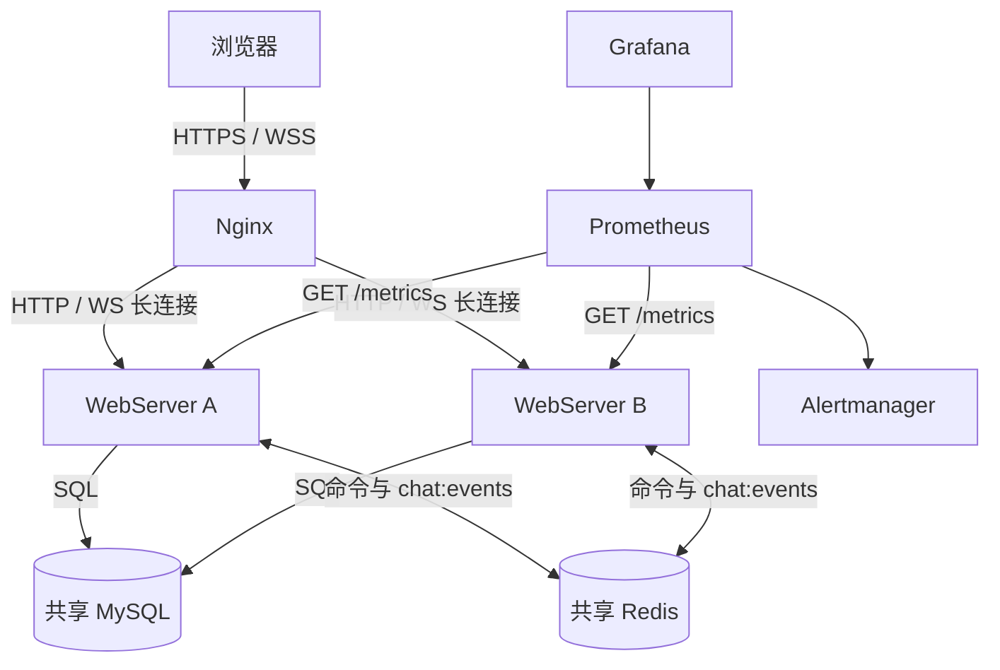
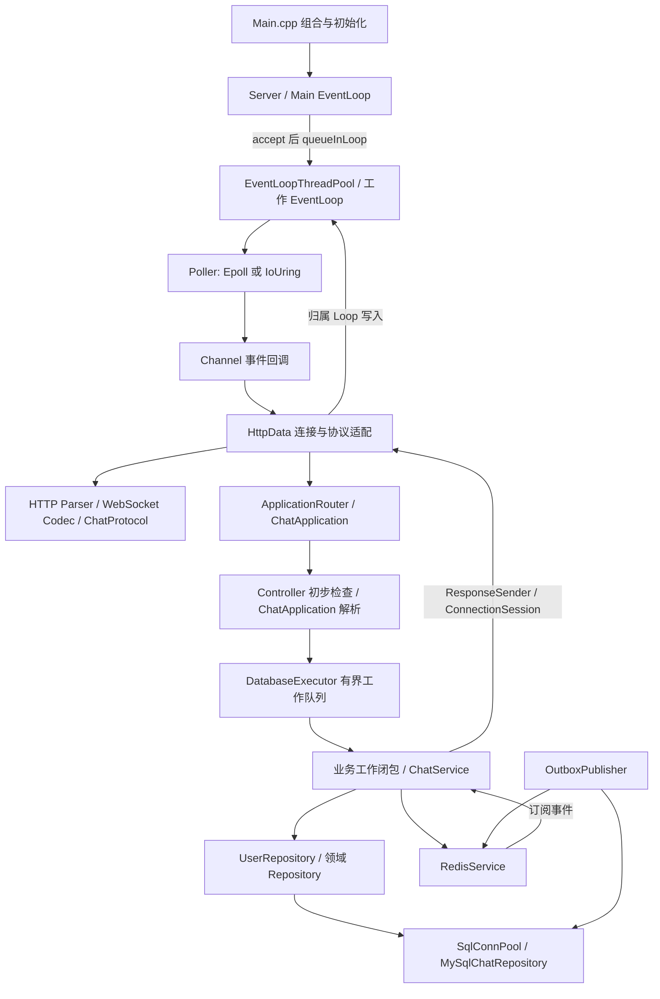
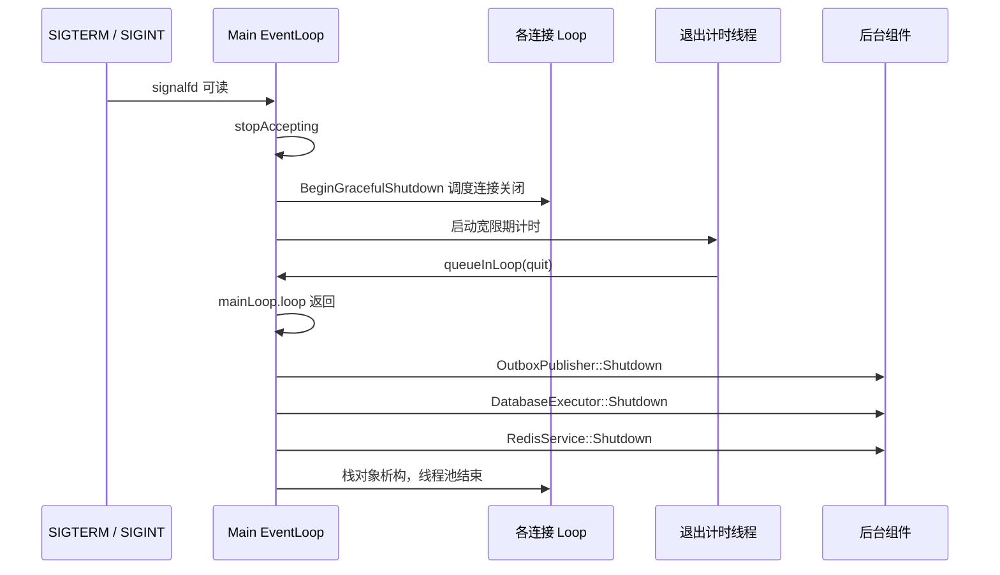

# 01. 整体架构、启动流程与线程模型

本文先给出整个项目的运行地图。协议细节见 [03](03_HTTP_WebSocket_and_Static_Files.md)，业务与存储细节见 [04](04_Application_Auth_and_Domain.md) 至 [06](06_Redis_and_Outbox.md)。

## 1. 项目不是一个线程池包住所有请求

系统同时存在三种不同的并发组织方式：

1. 网络侧：一个 Main EventLoop 接收连接，多个工作 EventLoop 分别持有一组连接。
2. 业务侧：共享 `DatabaseExecutor` 的工作线程从有界队列取任务，执行可能阻塞的业务、SQL 或密码处理。
3. 基础设施侧：Redis 命令线程、Redis 订阅线程、Outbox 发布线程、日志线程承担各自任务。

“One Loop Per Thread”描述的是网络事件循环的归属关系，不表示进程只有 `1 + N` 个线程，也不表示数据库调用本身是异步 API。

## 2. 两张不能混淆的架构图

### 2.1 进程外部署关系

MySQL 是持久化业务事实的来源。Redis 提供实时通知、可重建缓存、presence，以及不能随意丢弃的 JWT 撤销状态；丢失 denylist 可能使尚未到期的已撤销令牌重新有效。各实例的 C++ 对象、socket、连接会话表、输出缓冲区都不共享。

同一条 WebSocket 建立后固定落在一个实例，Redis 事件使其他实例上的会话收到广播。不能理解为 Nginx 对一条 WebSocket 的每一帧重新负载均衡，也不是 Redis 在实例之间搬运 TCP 连接。

这一拓扑由 [Compose](../../docker-compose.yml)、[扩容配置](../../docker-compose.scale.yml)、[Nginx 模板](../../deploy/nginx/httpserver.conf.template)表达。实际是否启用数据库、Redis、TLS 和监控取决于启动配置。

### 2.2 单个 WebServer 进程内部

这不是简单的线性调用栈。例如 `/ping` 有专用快速路径，静态文件不进入业务执行器，Redis 订阅从另一个线程主动进入 `ChatService`。图表达主要职责，具体线程边界见下文。

## 3. 分层、接口和依赖方向

| 层 | 主要对象 | 输入 | 输出 | 不应该负责的事情 |
| --- | --- | --- | --- | --- |
| 组合层 | `main`、`ServerConfig`、`Server` | 参数、环境、配置文件 | 服务对象、线程、监听 socket | 在启动函数实现聊天事务 |
| 传输层 | `EventLoop`、`Poller`、`Channel` | fd 与事件兴趣、跨线程任务 | 事件回调、任务执行 | URI、JWT、SQL、房间规则 |
| 连接与协议适配 | `HttpData`、HTTP/WS codec | 网络字节 | 请求、帧、业务回调；响应字节 | 直接组织跨实例业务事务 |
| 应用层 | Router、Controller、`ChatApplication`、`ChatService` | 请求对象、已认证身份、协议命令、会话 | 用例编排、成员判定、业务结果、接收者集合 | 操作 socket 的发送位置与偏移 |
| 领域层 | Room、Membership、Message、错误结果类型、Repository 接口 | 业务标识与内容 | 领域数据和存储契约 | 依赖 epoll 事件位、Redis 客户端或 MySQL C API |
| 基础设施适配 | MySQL、Redis、Outbox、日志 | 仓储调用、任务、事件 | 持久化记录、发布结果、观测数据 | 替代业务授权判断 |
| 浏览器 | `chat.js` 的 state 与事件处理 | HTTP 响应、WS 事件、用户操作 | 页面状态和业务命令 | 信任本地状态代替服务端权限 |

公开边界在 [include/httpserver](../../include/httpserver/)。实现细节在 `src/`，其中 `src/chat/` 中的 Controller 属于应用实现，不能仅根据目录名字判断层级。

三个最重要的解耦边界在 [ApplicationContext.h](../../include/httpserver/application/ApplicationContext.h)：

- `ApplicationRequest`：拥有 method、path、query、headers、body、remoteAddress、requestId 的值对象。业务请求离开 I/O 回调之后仍有自己的字符串数据。
- `ResponseSender`：`function<void(int, string_view, string_view)>`，表示回复状态码、类型、内容，不暴露 socket。
- `ConnectionSession`：提供 `sessionId()`、`userId()`、`sendMessage()`，让聊天服务只面对会话接口。

`HttpData` 同时实现连接协议状态和 `ConnectionSession`，因此是传输与业务的适配点。不要把它说成“完全纯粹的 HTTP 解析器”，也不要声称所有层已经彻底物理隔离。仓库有架构依赖测试约束主要方向，但仍存在适配层和历史实现头文件。

## 4. 构建和运行依赖

依据 [CMakeLists.txt](../../CMakeLists.txt)：

| 项目 | 当前实现 |
| --- | --- |
| 语言 | C++17 |
| 核心目标 | `httpserver_core` 静态库，别名 `httpserver::core` |
| 可执行程序 | `WebServer`，入口 `src/Main.cpp` |
| 系统能力 | Linux socket、epoll、eventfd、signalfd、pthread、io_uring |
| 必需链接依赖 | Threads、OpenSSL、MySQL 或 MariaDB 客户端库、liburing |
| 可选依赖 | hiredis，决定 `HTTPSERVER_HAS_HIREDIS` 分支 |
| 前端运行 | 浏览器直接加载 HTML/CSS/JS，不需要 Node 服务或前端打包运行时 |
| 质量入口 | CTest、警告选项、可配置 ASan/UBSan 或 TSan 构建 |

选择 epoll 运行不代表当前构建可以完全不装 liburing，因为构建仍包含两个后端。WSL 下能跑的原因是运行在 Linux 发行版里，不是底层 syscall 已抽象成跨操作系统实现。

旧的 `src/thread/ThreadPool.cpp` 没有加入当前核心目标，不能用它解释当前执行器线程模型。

## 5. 启动时到底发生什么

入口源码：[Main.cpp](../../src/Main.cpp)。以下顺序会影响信号、配置失败和依赖初始化行为。

### 5.1 在创建后台线程前屏蔽退出信号

`main` 将 `SIGINT`、`SIGTERM` 加入集合，用 `pthread_sigmask(SIG_BLOCK, ...)` 屏蔽。后续创建的线程继承信号屏蔽状态，再由主 EventLoop 监听 `signalfd` 统一消费退出信号。

好处是退出过程通过普通 fd 事件进入状态机，不需要在异步信号处理函数里调用复杂业务或持锁。

### 5.2 解析网络启动参数

| 参数 | 默认值 | 含义 |
| --- | --- | --- |
| `-t` | 6 | 工作 EventLoop 数量，不是数据库线程数，也不是进程总线程数 |
| `-p` | 8088 | 监听端口 |
| `-b` | `io_uring` | 接受 `epoll`、`uring`、`io_uring`，创建选定 Poller |
| `-l` | `./WebServer.log` | 日志路径；显式指定 `-l` 时检查绝对路径 |

这里的默认值来自 `Main.cpp`，Compose、测试和本地预览可能传入不同参数。`io_uring` 初始化失败不会自动转 epoll；环境不支持时需要显式选择 epoll。

### 5.3 读取并校验业务配置

`ServerConfig::LoadFromEnvironment()` 先读 `HTTPSERVER_CONFIG_FILE`，再用非空环境变量覆盖对应项，否则使用结构体默认值。配置文件是代码实现的简单 section/key=value 子集，并非接入完整 TOML 标准解析器；不要依赖复杂转义、多行或完整 TOML 语法。

当前 CLI 主要控制线程、端口、后端与日志；数据库等项走配置对象。不是“所有 CLI 自动覆盖同名环境变量”的统一配置系统。

配置验证失败打印具体错误并退出。数据库凭证部分填写、JWT 密钥长度不足、生产安全配置不完整等不能被当成可用生产模式。

### 5.4 将配置注入各个全局服务

依次配置 JWT、认证限流、消息限流、数据库执行器、Redis、Outbox、Poller 参数、输出缓冲区限制和 WebSocket Origin 规则。

关键装配语句是 `RedisService::SetEventHandler(...)`：收到 Redis 消息后调用 `ChatService::Instance().DeliverOutboxEvent(event)`。这就是跨进程消息进入本地会话的入口，不是 Redis 自己知道哪些 socket 应接收。

`DatabaseExecutor::Configure` 此时主要保存配置，工作线程在首次提交任务时懒初始化。Redis 是否创建真实客户端与线程取决于启用配置和编译分支。

### 5.5 初始化 MySQL 并选择仓储

如果数据库启用：

1. `SqlConnPool::Init` 建立池内数据库连接。
2. `MySqlChatSchemaCurrent()` 检查数据库迁移是否到 `002_outbox_leases`。
3. `CreateMySqlChatRepository()` 创建实际持久化仓储并注入 `ChatService`。
4. 设置数据库 readiness 要求。
5. 启动 `OutboxPublisher` 后台线程。

初始化失败或 schema 不匹配时启动失败。服务不会在后台悄悄自动执行迁移，也不会在数据库错误时自动把生产写入切到内存仓储。

未启用数据库时，聊天领域可使用内存仓储，默认的 MySQL 认证不可用；另可显式设置 `HTTPSERVER_AUTH_STORE=memory`，配合 JWT 密钥使用 `InMemoryUserRepository` 完成真实注册登录。内存账号随进程重启丢失，也不跨节点共享，因此这是开发预览模式，不是生产持久化认证。测试还可通过专用夹具构造令牌与数据，应区分这些路径。该认证开关在 `GetUserRepository()` 读取，并不由聊天仓储选择自动推导。

### 5.6 建立 Reactor 和监听事件

构造 Main EventLoop，再构造 `Server`。`Server::start()` 启动 `EventLoopThreadPool`，把监听 Channel 加到主 Poller。随后注册 signal Channel，并进入 `mainLoop.loop()`。

监听和连接的实际事件注册含 `EPOLLET`。初次连接注册还带 `EPOLLONESHOT`，但后续重注册不能一概称为全程 ONESHOT，细节见 02。

## 6. 默认资源预算

来源：[ServerConfig.h](../../include/httpserver/config/ServerConfig.h)、[ServerConfig.cpp](../../src/config/ServerConfig.cpp)。这些是代码默认值，不是部署容量结论。

| 资源 | 默认值 | 解释 |
| --- | --- | --- |
| DB 连接池 | 4 | 最多复用的池内数据库连接数量 |
| DB 执行器 | 2 个 worker、256 个排队任务 | 队列等待和实际执行是不同阶段 |
| DB operation timeout | 3 秒 | 传给数据库客户端的超时设置，不等于任意 SQL 总时长强制中断 |
| Redis 命令队列 | 256 | 排队有界，不能保证调用者不等待 |
| Redis 连接 / 命令超时 | 各 500 毫秒 | 仍需结合实现中的排队等待和重连流程理解 |
| `maxFds` | 100000 | Server 接入时检查的数值 fd 上界；不是 Poller 容器容量或“已经验证十万连接” |
| io_uring 队列 | 4096 | ring 配置大小，不是在线连接数 |
| 输出高水位 / 硬限 | 256 KiB / 1 MiB | 高水位限制非关键广播，硬限可关闭连接 |
| 退出宽限期 | 5 秒 | 定时停止主循环，不是所有在途业务成功交付的证明 |
| Outbox | batch 32、poll 200 ms、lease 15 s | 批量、轮询、租约是不同控制项 |
| Outbox 最大退避 | 60 秒 | 重试调度上界，不是消息交付 SLA |
| JWT | TTL 3600 秒 | WebSocket 建立后并无逐帧重新校验到期 |

## 7. 线程、共享数据与通信机制

| 执行位置 | 工作 | 跨线程通信 | 不能作出的推断 |
| --- | --- | --- | --- |
| 主线程 / Main EventLoop | accept、监听器管理、signalfd、退出调度 | 目标 Loop 的 `queueInLoop` | 不是处理所有客户端消息的单线程 |
| N 个工作 EventLoop | socket 读写、协议状态机、连接定时器、轻量路由 | pending functor 队列 + eventfd | 不代表任何路径都绝不阻塞 |
| M 个 DB executor worker | 注册登录、房间请求、聊天业务和同步 SQL 等任务 | mutex + condition_variable + Task 队列 | 不执行客户端 socket 的直接并发写 |
| Redis command worker | 独占命令连接、串行执行命令、部分续租 | 有界任务队列和等待通知 | 独立 worker 不代表公开 API 是非阻塞的 |
| Redis subscriber | 独占订阅连接、解析事件、调用事件 handler | 进入 ChatService，再投递各会话 Loop | 不共享远端实例 Session 对象 |
| Outbox publisher | 扫描和认领 Outbox、发布、回写结果 | MySQL 连接池、RedisService | 不是与消息插入同步完成的分布式事务 |
| 日志后台线程 | 缓冲批量落盘 | 日志缓冲互斥和唤醒 | 不代表没有磁盘或内存压力 |
| 退出计时线程 | 宽限期结束后让主循环退出 | `mainLoop.queueInLoop` | 不是常驻业务 worker |

默认配置大致有主线程、6 个 I/O 线程、按需创建的 2 个业务线程，加上启用的基础设施线程。不要在简历写死一个进程的总线程数。

### 7.1 `queueInLoop` 与 `runInLoop`

`queueInLoop` 把函数放入目标 EventLoop 的 pending 队列，必要时写 eventfd 唤醒阻塞在 Poller 的线程。EventLoop 取走一批任务后执行。

`runInLoop` 在已经属于该 Loop 线程时直接执行，否则走排队。这里传输的是 C++ 闭包和捕获的数据，不是通过 eventfd 传完整业务消息；eventfd 只承担通知。

### 7.2 HTTP 业务响应如何回到正确线程

`HttpData::analysisRequest` 构造 `ApplicationRequest` 和 `ResponseSender`，然后交给 Router。回复回调捕获 `weak_ptr<HttpData>` 和原始 Loop 指针：

1. 业务线程调用回调，传入响应状态、类型、内容。
2. 回调立刻把两个 `string_view` 复制为 `std::string`，避免排队后引用临时内存。
3. `loop->queueInLoop` 回到该连接所属线程。
4. `weakSelf.lock()` 成功才调用 `completeApplicationResponse`。
5. 完成响应后清理 `requestInFlight_`、重置 HTTP 请求状态，尝试继续处理已缓冲的下一请求；读取推进边界见 02、03。

关闭连接后业务结果可以被丢弃，不能因为业务工作结束就断言浏览器必定收到响应。`weak_ptr` 保护连接对象，但不应被扩大解释成整个退出流程中的所有裸指针与资源生命周期都已形式化证明安全。

### 7.3 WebSocket ACK 和广播为何走不同入口

`ChatApplication::HandleMessage` 收到的回复回调捕获当前连接 `shared_ptr`，再调用 `HttpData::sendMsg`。ACK 和错误是直接请求响应，按关键输出处理。

房间接收者通过 `ConnectionSession::sendMessage` 接收事件，在 `HttpData` 中转为 `sendNonCriticalMessage`。该路径也回到所属 Loop，但高水位时可丢弃广播。这是关键响应与实时通知的不同背压策略，不是所有帧使用同样的缓冲政策。

### 7.4 线程隔离还有什么不完整

- `ApplicationRouter` 的受保护路由与 WS 握手会进行认证，Redis denylist 查询可能同步等待，仍有占用 I/O Loop 的窗口。
- `ChatService` 使用共享 mutex，部分仓储访问位于锁内。多个执行器 worker 或多个 I/O Loop 不意味着同一进程的全部聊天业务都完全并行。
- 静态资源按当前实现同步读取，不能以业务执行器的存在推断文件 I/O 已异步化。
- 有界 DB 队列只限制执行器排队；并不是所有 EventLoop pending functor、浏览器 pending 或内部容器都有统一全局容量上限。

## 8. 一条连接的所有权地图

`Server` accept 成功后，用轮询方式选择工作 Loop，经 `ObjectPool<HttpData>::acquire` 构造连接对象、初始化回调，把 owner 关联到 Channel，再通过目标 Loop 队列注册。

| 对象 | 主要生命周期关系 |
| --- | --- |
| `Server` | 主函数栈上的服务对象，拥有监听 Channel 与 Loop 线程池 |
| 工作 `EventLoop` | 在各工作线程中建立并运行；由线程池协调启动退出 |
| `Channel` | 描述 fd、关注事件及回调，不等同于业务连接 |
| `HttpData` | 连接级对象，持有 fd、协议状态、输入输出缓冲、身份与会话标识 |
| Poller owner / operation | 维持被注册连接或操作关联对象的生存期，避免仅凭复用 fd 定位旧操作 |
| `ConnectionSession` 引用 | ChatService 按本地会话维护关系；广播时取得可用接收者，不构造跨节点指针 |
| SQL RAII guard | 单次仓储调用借还池内连接，不把连接永久绑定到某个客户端 |

连接关闭需要解绑业务会话、定时器和 Poller，防止继续接收事件；正常 `handleClose()` 末尾立即关闭 fd 并置为 -1，析构仅兜底关闭仍有效的 fd。具体避免重复关闭、迟到 CQE 和引用环的逻辑见 02。

## 9. 正常退出的实际顺序

退出信号通过 `shuttingDown` 防止重复触发。WebSocket 尽力发送 1001 关闭帧；连接状态决定是否还能写出。当前 DB executor 实例停止接受新任务，排队任务继续执行或触发过期回调，但 socket 交付与数据库执行完成不是一个原子动作。执行器全局状态在 Shutdown 后清空，迟到 Submit 仍可能懒创建新实例，因此还不能把该流程称为全局不可逆的任务停收屏障。

因此这里能讲“具备信号驱动的停止接入、连接退出和组件 join 流程”，不能讲“任何发布时的请求都保证无损”。详细故障边界见 07。

## 10. 如何验证自己理解了架构

先不用背代码，回答以下问题，再用链接定位实现：

1. 为什么 `-t 6` 既不是每个连接分配线程，也不意味着进程总共 7 个线程？
2. Main EventLoop 把连接分给某个工作 Loop 后，DB worker 回复时怎么找到原 Loop？
3. 为什么 eventfd 中无需塞完整 HTTP 响应？
4. 为什么 ConnectionSession 可以让 ChatService 不包含 `HttpData.h`？
5. 为什么有 Redis worker，JWT 检查仍可能拖慢 I/O Loop？
6. 为什么 DB 连接池大小、业务 worker 数量、I/O Loop 数量应该分开设置？
7. 为什么一个实例重启后能查到历史，但它原有的 socket 和 Session 不能恢复原对象？
8. 为什么“支持 io_uring”不能直接推出“所有 I/O 零拷贝且比 epoll 更快”？

建议源码阅读顺序：`Main.cpp` → `Server::start/handNewConn` → `EventLoop::loop/queueInLoop` → `HttpData::analysisRequest` → `ApplicationRouter::Dispatch` → `DatabaseExecutor::Submit` → Controller/ChatService → 响应回调。对照 [10 的完整时序](10_End_to_End_and_Interview_Guide.md)，能在源码中闭合这条链再进入面试陈述。
