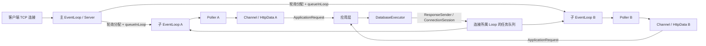
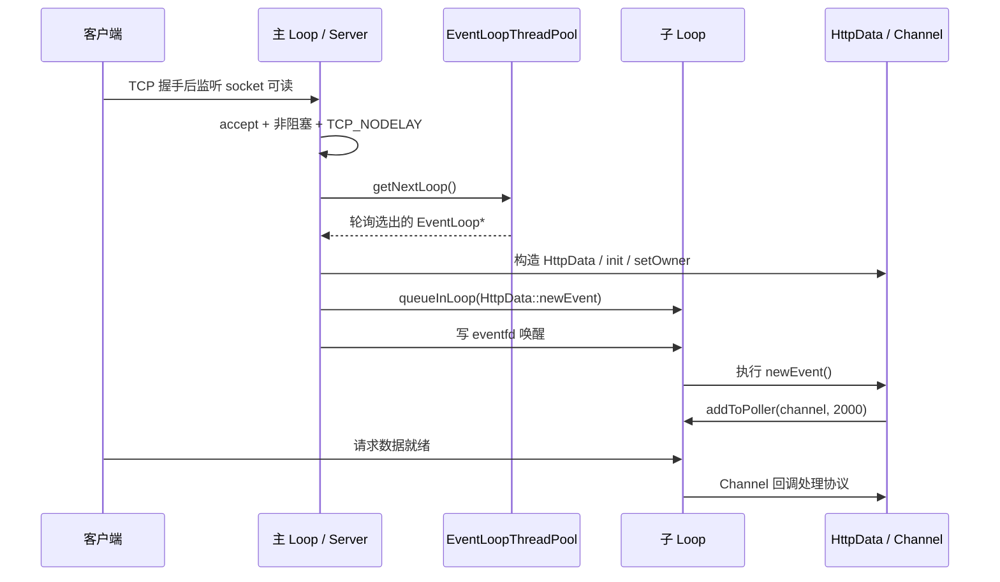
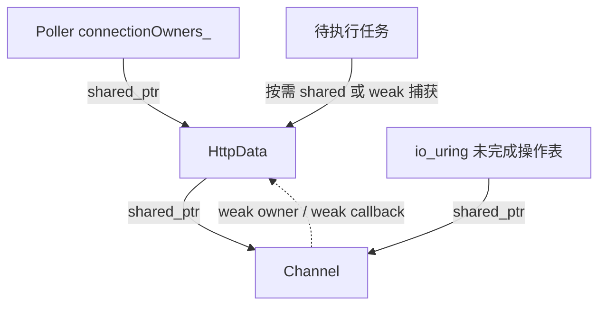

# 02 网络层、线程模型与连接生命周期

本文依据当前工作区源码编写，而不是沿用早期简历描述。这里的“已实现”表示能够在指定源码中找到对应逻辑，不表示所有内核版本、并发规模和故障组合都已经通过验证。

## 1. 先建立正确的心智模型

服务器的基本组织方式是主从 Reactor 与 One Loop Per Thread：主线程持有监听 socket，接入连接后轮询分配给子 EventLoop；每条连接的协议状态、输入输出缓冲区和事件兴趣由该连接所属的 EventLoop 驱动。

业务执行器是另一组线程，不是子 Reactor 线程池。数据库任务通过 `DatabaseExecutor` 执行，结果再通过 `ResponseSender` 或 `ConnectionSession` 回到网络层。不要把这两类线程池合并讲成“线程池里随便挑线程处理一次请求”。

网络层最重要的边界是：

| 对象 | 职责 | 通常运行在哪个线程 |
| --- | --- | --- |
| `Server` | 监听、accept、连接分配、停止接入 | 主 EventLoop |
| `EventLoopThreadPool` | 创建子循环，轮询挑选连接所属循环 | 初始化和分配在主线程 |
| `EventLoop` | 调用 Poller、执行排队任务、检查定时器 | 创建它的线程 |
| `Poller` | 统一事件注册和 I/O 提交接口 | 所属 EventLoop |
| `Channel` | 将事件映射成连接回调 | 所属 EventLoop |
| `HttpData` | 一条 TCP 连接的协议、缓冲和关闭状态 | 所属子 EventLoop |
| `DatabaseExecutor` | 执行可能等待数据库的业务任务 | 独立工作线程 |

源码入口：[Main.cpp](../../src/Main.cpp)、[Server.cpp](../../src/server/Server.cpp)、[EventLoop.h](../../include/httpserver/transport/EventLoop.h)、[ApplicationContext.h](../../include/httpserver/application/ApplicationContext.h)。

这里不是 Windows 原生网络服务器：核心直接使用 Linux 的 `epoll`、`eventfd`、`signalfd`、`liburing` 和 pthread。Windows 上通过 WSL/Docker 使用，不等于实现了 IOCP 或 Windows socket 后端。

## 2. 启动时如何把网络层装配起来

入口是 `main()`，读取 `-t`、`-p`、`-l`、`-b` 参数，再读取服务配置、初始化认证/Redis/数据库执行器/仓储/Outbox，随后创建网络层。

与本章直接相关的顺序如下：

1. 主线程先屏蔽 `SIGINT`、`SIGTERM`，使后续线程继承该信号掩码。
2. `PollerConfig` 接收 `maxFds` 和 `ioUringQueueSize`。
3. 配置 `HttpData` 输出缓冲区高水位、硬限制和 WebSocket Origin 白名单。
4. 构造 `EventLoop mainLoop(backend, pollerConfig)`。
5. 构造 `Server`，创建监听 socket 和监听 Channel。
6. 创建 `signalfd`，把关闭信号也接入主循环。
7. `Server::start()` 先启动子循环，再注册监听事件。
8. 调用 `mainLoop.loop()` 进入事件处理。

`main()` 默认后端是 `kIoUring`；显式 `-b epoll` 使用 epoll。`ParsePollerBackend()` 接受 `epoll`、`uring`、`io_uring`，不是任意大小写输入。

后端是启动时构造选择，不是运行中的热切换。`IoUring` 初始化失败会记录日志并 `abort()`，源码没有自动改用 epoll 的分支。

来源：[Main.cpp](../../src/Main.cpp)、[Poller.cpp](../../src/Poller.cpp)、[Poller.h](../../include/httpserver/transport/Poller.h)。

## 3. 接入与连接分发

### 3.1 监听 socket

`socket_bind_listen()` 创建 IPv4 TCP socket，设置 `SO_REUSEADDR`，绑定 `INADDR_ANY` 和指定端口，使用 `listen(fd, 2048)`。

`Server` 构造时把监听 socket 设成 `O_NONBLOCK`，忽略 `SIGPIPE`，防止向已经关闭的连接写数据时整个进程被默认信号动作终止。

当前没有 `SO_REUSEPORT` 的多监听器设计。所有新连接先进入同一个主 Reactor 的 `accept()` 路径。

来源：[Util.cpp](../../src/util/Util.cpp)、[Server.cpp](../../src/server/Server.cpp)。

### 3.2 接入回调

监听 Channel 的读回调是 `Server::handNewConn()`，连接回调是 `handThisConn()`。

`handNewConn()` 在一个循环中接受连接，针对每个成功返回的 fd 做以下事情：

1. `getNextLoop()` 选择子循环。
2. 如果 `accept_fd >= maxFds_`，立即关闭该 socket。
3. 设置非阻塞，失败则关闭并跳过。
4. 设置 `TCP_NODELAY`，减少小消息受 Nagle 算法影响的等待。
5. 从 `ObjectPool<HttpData>` 取得对象存储，构造新的 `HttpData(loop, fd)`。
6. 调用 `init()`，安装弱引用回调。
7. 记录连接指标，把 Channel 的 owner 设置为这条连接。
8. `loop->queueInLoop(bind(&HttpData::newEvent, req_info))`，由子循环完成注册。

这里的 `maxFds_` 比较的是 fd 数值上限，不是通过一个严格的活动连接计数器实现“最大连接数”。其他文件、日志和 socket 也会消耗 fd，因此不要把它解释为精确的并发配额。

接入循环条件是 `accept(...) > 0`。源码没有为 `EMFILE` 配置备用 fd，也没有单独区分 accept 的 `EINTR`、`EAGAIN` 和资源耗尽错误。这些是继续加固接入层的方向。

### 3.3 轮询而非实时负载调度

`EventLoopThreadPool::getNextLoop()` 返回 `loops_[next_]`，再执行 `(next_ + 1) % numThreads_`。

因此，一条连接只被分配一次，后续读写仍回到同一个循环；新连接在循环之间按数量轮询，但并不依据队列长度、CPU 占用或活跃消息数动态迁移。

源码：[EventLoopThreadPool.cpp](../../src/eventloop/EventLoopThreadPool.cpp)。

## 4. EventLoop 如何跨线程通信

### 4.1 每个循环包含什么

`EventLoop` 保存 `poller_`、`wakeupFd_`、`pendingFunctors_`、互斥锁、创建线程的 `threadId_` 和原子变量 `quit_`。

`loop()` 每一轮的固定顺序是：

1. `poller_->processEvents()` 等待并分发就绪事件或完成事件。
2. `doPendingFunctors()` 执行其他线程提交的任务。
3. `poller_->handleExpired()` 清理到期定时器。

这里没有额外的全局“回调线程”。读写回调和本轮排队任务都在同一个 Loop 线程里串行执行，因此通常不需要为单连接的 `state_`、输入输出缓冲区各自加锁。

`isInLoopThread()` 比较当前线程 ID。`assertInLoopThread()` 用于检测使用位置，但不是所有公开方法内部都强制调用该断言。线程归属也是调用方需要遵守的约束。

来源：[EventLoop.cpp](../../src/eventloop/EventLoop.cpp)。

### 4.2 runInLoop 与 queueInLoop

`runInLoop(cb)` 在本线程直接调用 `cb()`，跨线程则转交 `queueInLoop()`。

`queueInLoop(cb)` 总是先持锁把任务放入 `pendingFunctors_`；跨线程提交，或者正在执行上一批 pending functors 时继续提交任务，会调用 `wakeup()`。

`doPendingFunctors()` 在锁内把共享 vector 和局部 vector 交换，然后释放锁再调用业务函数。这避免了业务函数执行期间长期占用队列锁，也允许回调继续提交任务。

队列存放的是函数对象和其捕获的数据，不是 TCP 数据报，也不是 Redis 消息。`eventfd` 只负责通知循环“有事可做”，真正的任务仍在用户态 vector 中。

### 4.3 eventfd 为什么有用

每个循环创建 `eventfd(0, EFD_NONBLOCK | EFD_CLOEXEC)`，并把它作为普通 Channel 加入 Poller。

其他线程在 `wakeup()` 中写入一个 64 位整数 1；事件循环收到可读事件后，`handleRead()` 读出计数。多次唤醒可以由 eventfd 计数聚合，不需要为每个任务单独创建 fd。

如果循环正阻塞在 epoll 或 io_uring 等待中，eventfd 的可读状态让它返回，随后便会处理任务队列。

这也是数据库线程把 HTTP 响应送回连接线程、跨线程广播写入输出缓冲区的基础。

## 5. 线程启动与退出

`EventLoopThread::threadFunc()` 在新线程栈上创建 `EventLoop loop`，通过互斥锁和条件变量把 `loop_ = &loop` 发布给启动线程，再调用 `loop.loop()`。

`startLoop()` 等待 `loop_` 非空以后才返回，因此 Server 不会把连接分配给尚未构造的循环。

底层 [Thread.cpp](../../src/base/Thread.cpp) 使用 pthread 创建线程，`CountDownLatch` 保证 `start()` 返回前能够得到真实线程 ID；`CurrentThread` 用线程局部变量缓存 ID 和线程名称。

`Thread` 析构时对尚未 join 的线程执行 detach；`EventLoopThread` 的常规析构路径主动对 Loop 调用 `quit()` 并 join。不能因此说所有项目线程都靠自动 detach 安全退出。

`quit()` 将原子状态设为 true，跨线程调用时唤醒 Loop；循环在下一轮条件判断退出。

来源：[EventLoopThread.cpp](../../src/eventloop/EventLoopThread.cpp)、[Thread.h](../../src/base/Thread.h)、[CountDownLatch.cpp](../../src/base/CountDownLatch.cpp)。

## 6. Channel 是事件分发器，不是连接本身

`Channel` 保存 fd、关注的 `events_`、内核返回的 `revents_`、上次注册的 `lastEvents_`、活动状态以及各类回调。

`handleEvents()` 先清空本轮关注事件，再按 HUP/ERR、读、写、连接回调的顺序处理。协议层在回调中重新设定下一轮需要关注的事件，`handleConn()` 负责同步给 Poller。

`active_` 是关闭后的第一道保护：`handleRead()`、`handleWrite()`、完成回调和 `handleConn()` 都检查活动状态，避免已经移除的连接继续被旧事件驱动。

Channel 自身不关闭 fd。关闭属于 `HttpData` 的生命周期；如果 Channel 析构也关闭 fd，容易在 fd 被操作系统复用后误关新连接。

`owner_` 是 `weak_ptr<void>`，能够绑定连接，但不会构成 `HttpData -> Channel -> HttpData` 的强引用环。

来源：[Channel.h](../../include/httpserver/transport/Channel.h)、[Channel.cpp](../../src/channel/Channel.cpp)。

## 7. epoll 后端的实际行为

### 7.1 注册表与事件身份

`Epoll` 创建 `epoll_create1(EPOLL_CLOEXEC)`，内部保存最多一次收取 4096 个事件的 vector。

它不是简单地使用 `fd -> HttpData` 数组：`event.data.ptr` 保存 Channel 指针，`channels_` 用指针查找仍然注册的 `shared_ptr<Channel>`，`connectionOwners_` 在注册期间持有连接的强引用。

`add()` 激活 Channel，记录持有者，按需加定时器，再执行 `EPOLL_CTL_ADD`；失败时移除注册表记录并失活 Channel。

`modify()` 刷新定时器后比较事件兴趣；没有变化时跳过 `epoll_ctl`，有变化才执行 `EPOLL_CTL_MOD`。

`remove()` 先失活、取消计时器、移除连接强引用与 Channel 记录，再执行 `EPOLL_CTL_DEL`。

`processEvents()` 对 `epoll_wait()` 的 `EINTR` 重试，对其他错误记录日志；拿到事件后先查注册表，不在表内的旧指针不会被解引用。

这种身份设计解决了“直接按数字 fd 找到复用后的新连接”的误派问题，但不要把用户态地址注册表说成包含任意 ABA 场景的数学证明。

来源：[Epoll.cpp](../../src/epoll/Epoll.cpp)、[Epoll.h](../../src/epoll/Epoll.h)。

### 7.2 当前不是 LT 模式

实际注册值需要分开讲：

| Channel 类型 | 源码中的注册兴趣 |
| --- | --- |
| 监听 Channel | `EPOLLIN | EPOLLET` |
| eventfd Channel | `EPOLLIN | EPOLLET` |
| 新 HttpData Channel | `EPOLLIN | EPOLLET | EPOLLONESHOT` |
| HttpData 后续 handleConn | 通常重加 `EPOLLET`，不持续附加 `EPOLLONESHOT` |
| signalfd Channel | `EPOLLIN` |

因此，旧描述“基于 Epoll 水平触发模式构建事件循环”不能准确概括当前实现；“所有客户端事件始终 ONESHOT”也不准确。

当前 `HttpData::handleRead()` 的主路径只执行一次 `ChainBuffer::readFd()`，外层是 `do ... while(false)`，不是严格的“循环读到 EAGAIN”。其大报文、边沿重注册和缓冲区残留行为需要专项回归，不能在面试中把理想 ET 模式直接当成这里已完整实现的代码。

### 7.3 epoll 的统一提交接口并非内核异步 I/O

`Epoll::submitRead()` 实际调用一次 `read()`，再立即调用 `handleReadComplete()`；`submitWrite()` 使用 `write()` 和同样的完成回调形式。

这提供了与 io_uring 一致的 C++ 接口，但调用返回前系统调用已发生。它是非阻塞 socket 上的同步系统调用，不是把 epoll 变成了完成式 I/O。

`-EAGAIN` 由 HttpData 转成等待可读/可写事件；`-EINTR` 在完成处理路径重试；其他错误进入错误响应或关闭。

## 8. io_uring 后端：就绪通知与真实异步操作并存

### 8.1 三种操作

`IoUring` 使用 `liburing`，维护 SQ/CQ、复用的 CQE 指针数组和 `UringOperationRegistry`。

注册表的 `UringOp` 分为：

| 操作 | 提交函数 | 语义 |
| --- | --- | --- |
| `kPoll` | `io_uring_prep_poll_add` | 通知 fd 就绪，不传输业务字节 |
| `kRead` | `io_uring_prep_read` | 内核读入指定用户缓冲区，CQE 返回结果 |
| `kWrite` | `io_uring_prep_write` | 内核从指定用户缓冲区发送，CQE 返回结果 |

它不是调用 `poll(2)` 模拟 io_uring，而是使用 io_uring 的 `POLL_ADD` 操作复用 Reactor 回调模型；但 `POLL_ADD` 本身也不是直接完成数据读取。

主常规读路径依然可由 poll 完成后进入 `HttpData::handleRead()`，使用 `readv()`。只有走到 `submitAsyncRead()` 的路径才提交 `IORING_OP_READ`。输出通常由 `submitAsyncWrite()` 提交，遇到就绪回调时也存在 `handleWrite()` 的 write/writev 路径。

准确措辞是“可选择的 io_uring 后端，同时具备就绪通知和读写提交能力”，不是“所有收发全都原生异步”或“全链路零系统调用”。

### 8.2 单次 poll 与兴趣重建

`Channel` 暂时仍采用 epoll 风格事件位。提交前将 `EPOLLIN/OUT/ERR/HUP/PRI/RDHUP` 转换成 poll 位；`EPOLLET`、`EPOLLONESHOT` 没有对应 poll 位，不能原样继承语义。

`POLL_ADD` 是一次性操作，收到 CQE 后需要重新提交下一次兴趣。

`markPollConsumed()` 把 `lastEvents_` 清零，使相同兴趣也能够重新注册。`modify()` 则取消旧 poll 并登记新 poll，因为该实现不做原地更新。

### 8.3 为什么使用 token 而不是 fd

`track()` 为每次操作生成递增的 64 位 token，跳过 0 和尚在表内的 token。记录内容包括操作类型、当时的 fd 和原 Channel 的 `shared_ptr`。

SQE 的 `user_data` 是 token。CQE 到来时先 `take(token)`，取回并移除原操作记录，而不是按当前 fd 找一个新连接。

`pollTokens_` 另外记录 `fd -> 最新 poll token`。消费旧 poll 的 CQE 时，只有该 fd 当前仍指向同一 token 才删除映射，所以迟到的旧完成不会抹掉新 poll 的登记。

源码没有独立的 `connectionGeneration` 字段。`sessionId_` 是业务会话身份，不能把它讲成内核操作代际校验；这里承担操作身份作用的是 token 和原 Channel。

来源：[IoUringOperation.h](../../src/IoUringOperation.h)。

### 8.4 取消不等于立刻销毁

`remove()` 先失活 Channel，再请求取消 poll/read/write，删除活跃连接持有者和 fd 注册。

poll 取消用 `io_uring_prep_poll_remove`，read/write 取消用 `io_uring_prep_cancel64`；取消操作自己的 `user_data` 为 0，不进入用户回调。

原操作仍可能返回一个 CQE。处理代码取出原记录后，检查 Channel 是否仍活动、fd 是否一致；不满足条件就只消费旧完成，不调用连接业务函数。

必须区分“不会误调用已关闭连接”与“缓冲区一定活到所有内核操作结束”：注册表持有的是 Channel，Channel 对 HttpData 是弱引用；取消请求也不是同步屏障。真实 io_uring 关闭时仍需专门验证输入/输出内存存活到 CQE 消费的条件，当前注册表单测不能独自证明这一点。

### 8.5 批处理与队列满

`getSqe()` 先获取本地 SQE；如果满了，先 submit 已准备的 SQE，再尝试获取一次。仍失败会记录日志并返回，不存在无限业务重试队列。

`processEvents()` 调用 `io_uring_submit_and_wait(&ring_, 1)`，把前一轮准备的操作批量提交并等待至少一个完成。

随后 `io_uring_peek_batch_cqe()` 批量查看 CQE，按 token 分发；全部处理完后再 `io_uring_cq_advance()`，防止提前归还导致 CQE 指针失效。

`-ECANCELED` poll 完成不会调用读写回调，负错误结果记录日志。该实现没有运行时自动回退到 epoll，也没有 SQ 满后的完整请求失败回调，不能承诺“任何负载下无丢失提交”。

来源：[IoUring.cpp](../../src/IoUring.cpp)、[IoUring.h](../../src/IoUring.h)。

## 9. 输入输出缓冲区与内存池

`ChainBuffer` 是由 `vector<BufferChunk*>` 组织的分块缓冲区，每块 4096 字节，保存 `readPos`、`writePos`；整个缓冲区保存 `totalBytes_`。

它不是通常意义上每块带 next 指针的链表。多块消费时会删除 vector 首元素，不能把这一操作复杂度说成固定 O(1)。

核心操作及上下游如下：

| 方法 | 用途 | 调用者 |
| --- | --- | --- |
| `append()` | 将 HTTP 响应或 WS 帧复制进尾块 | HttpData 输出路径 |
| `retrieve()` | 前移读指针，释放已消费块 | 协议解析、写完成 |
| `readFd()` | `readv` 读入当前尾块与 64 KiB 栈缓冲区 | readiness 读回调 |
| `writeFd()` | 单块 `write`，多块 `writev`，按实际写入量消费 | readiness 写回调 |
| `getWritableChunkInfo()` | 取连续可写地址 | 异步读提交 |
| `commitWrite()` | 在完成后增加有效字节数 | 异步读完成 |
| `getReadableChunkInfo()` | 取首块连续可读地址 | 异步写提交 |
| `peekContiguous()` | 单块时返回 string_view | HTTP 请求行/头解析 |
| `peekAllAsString()` | 跨块拼接副本 | 通用解析、WS 解码 |

`retrieve()` 消费最后一块后保留一块空缓冲区给 Keep-Alive 重用，减少每次小请求都重新进入全局内存池锁的开销。

`MemoryPool` 在互斥锁下复用 4 KiB 内存块；其空闲块池目前没有配置上限。输出缓冲区有界，不等于进程峰值后所有池化内存会立即归还给操作系统。

`ObjectPool<T>` 则有默认 1024 个缓存对象存储上限。它在归还时先析构对象，再缓存原始存储；下次 acquire 重新构造。这样新连接不会继承旧 fd、Channel、认证身份或解析状态。

来源：[ChainBuffer.h](../../src/base/ChainBuffer.h)、[MemoryPool.h](../../src/base/MemoryPool.h)、[ObjectPool.h](../../src/base/ObjectPool.h)。

## 10. 连接的 ownership 与关闭

### 10.1 活跃阶段谁持有谁

`HttpData::init()` 的读/写/连接/超时回调全部捕获 `weakSelf`，调用前 lock。`HttpData` 因而不会仅仅因为保存自己的回调而永久存活。

Poller 注册期间通过 `connectionOwners_` 持有连接，确保 accept 线程释放局部 `req_info` 后连接不会提前析构。

跨线程发送可能捕获 `shared_ptr<HttpData>`，使任务执行期间对象存活；HTTP 业务响应使用弱引用，客户端提前断开时可以丢弃迟到响应。

### 10.2 handleClose 的执行顺序

`HttpData::handleClose()` 使用 `closed_` 保证幂等：重复调用不重复计数，也不再次关闭被复用的 fd。

其顺序是：

1. 标记已关闭并更新连接/WS 指标，设为 `H_DISCONNECTED`。
2. 创建局部 `shared_from_this()` guard，防止移除 Poller owner 时自身在函数中途析构。
3. 从 Poller 移除 Channel，使其失活并请求取消 I/O。
4. 清空 Channel owner 和定时器。
5. `ChatApplication::Leave(sessionId_)` 移除会话订阅。
6. 如已认证，向执行器提交 Redis presence 撤销任务。
7. 关闭 fd，并把 `fd_` 设为 -1。

析构函数只对仍然非负的 fd 做兜底关闭。会话离开基于 sessionId，而不是只根据用户名移除全部设备。

来源：[HttpData.cpp](../../src/httpdata/HttpData.cpp)、[HttpData.h](../../src/httpdata/HttpData.h)。

### 10.3 输出排空与优雅停机

一般错误响应、WS close 帧都先进入正常输出缓冲区，通过 `closeAfterWrite_` 等待排空；硬限保护是例外，会立即清空并关闭。

收到停机信号后，主 Loop 停止 accept，`BeginGracefulShutdown()` 从弱引用连接表提取活连接，把操作排入各自 Loop。

WS 连接设置 draining 并发送 1001 close；HTTP 连接设置关闭状态，尽量排空已有输出，空输出则关闭。宽限期结束后主循环退出，再顺序停止 Outbox、数据库执行器、Redis 服务。

这不是承诺任何长请求都无损完成：宽限期有限，关闭动作不等待客户端应用层确认，消息恢复仍由业务 ACK、幂等键和历史拉取保证。

## 11. 定时器实际实现与局限

`TimerManager` 用小根堆保存 `shared_ptr<TimerNode>`。刷新超时时取消旧节点并插入新节点，不在堆中随机删除旧项。

`cancel()` 清空回调并标记 deleted。`handleExpiredEvent()` 从堆顶依次弹出已删除或到期节点；当节点最终销毁且回调仍存在时，析构函数执行超时回调。

Channel 保存一个取消函数，确保关闭或重新计时后旧节点不会再次关闭连接。`HttpData::handleConn()` 最多每秒刷新一次计时器，减少 Keep-Alive 高频请求创建堆节点的次数。

当前默认初始超时 2000 ms，Keep-Alive 计时值为 5 分钟，部分非 Keep-Alive 无事件分支使用其一半。响应头声明的 `Keep-Alive: timeout=20` 与这个内部值并不一致。

必须注意三项限制：

1. TimerNode 使用 `gettimeofday()`，并把秒数 `% 10000`；它不是完整的单调时钟期限，跨周期与系统时间调整需要进一步处理。
2. 到期检查发生在事件处理和排队任务之后，不是精确时刻直接触发。
3. epoll 的等待上限为 10 秒，io_uring 当前 `submit_and_wait` 没有按最近到期时间设超时。因此不能声称已经实现精确的毫秒级空闲连接回收。

来源：[Timer.cpp](../../src/timer/Timer.cpp)、[Timer.h](../../src/timer/Timer.h)。

## 12. 验证证据应该怎样引用

以下测试可以定位对应行为，但不能把未运行的测试写成“本次通过”。本次文档整理是静态源码核对，运行状态应查项目验收记录或重新执行测试。

| 测试 | 覆盖的核心事实 | 不能外推的结论 |
| --- | --- | --- |
| [ChannelOwnershipTest](../../tests/base/ChannelOwnershipTest.cpp) | epoll 注册持有 owner，移除释放，取消函数可调用 | 所有 io_uring 关闭竞态已覆盖 |
| [HttpDataLifecycleTest](../../tests/httpdata/HttpDataLifecycleTest.cpp) | 回调不成引用环、close 幂等、fd 释放 | 任意并发关闭和异步缓冲安全 |
| [UringOperationRegistryTest](../../tests/base/UringOperationRegistryTest.cpp) | 旧 token 不删除新 poll 映射、不按复用 fd 误派 | 真实内核 io_uring 读写取消已经验收 |
| [PollerBackendTest](../../tests/base/PollerBackendTest.cpp) | 后端名称解析与枚举转换 | 自动降级、性能比较 |
| [ObjectPoolTest](../../tests/base/ObjectPoolTest.cpp) | 对象重建与缓存上限等对象池行为 | 全局 MemoryPool 也有相同上限 |
| [ConnectionLifecycleStressTest](../../tests/integration/ConnectionLifecycleStressTest.py) | epoll 下中途断开、半请求、不读响应后仍可健康检查 | 两后端完全等价或万级稳定性 |
| [SlowConsumerTest](../../tests/resilience/SlowConsumerTest.py) | 输出硬限触发关闭后服务仍健康 | 长时间真实慢网客户端所有行为 |
| [GracefulDrainTest](../../tests/resilience/GracefulDrainTest.py) | 停机连接排空/关闭行为 | 分布式消息恰好一次交付 |

测试名与标签定义见 [tests/CMakeLists.txt](../../tests/CMakeLists.txt)。多数网络集成脚本显式启动 `-b epoll`；不要把它们的通过结果直接当作 io_uring 通过证据。

## 13. 面试讲解与追问

### 问：为什么一条连接固定在一个 Loop？

答：HTTP 状态机、WS 分片状态、输入输出位置和事件兴趣都属于连接；固定线程归属后这些状态可以串行修改。耗时业务交给执行器，完成后排队回原 Loop，而不是让数据库线程直接改 socket 缓冲区。

### 问：eventfd 传了什么？

答：传的是唤醒计数，不是业务消息。任务数据在 `pendingFunctors_`；eventfd 只让内核等待返回，随后执行这批函数。

### 问：如何避免 shared_ptr 循环引用？

答：HttpData 强持有 Channel，Channel 的 owner 和回调捕获都使用 weak_ptr；Poller 在注册期显式持有连接，移除时释放。跨线程任务按是否需要保活选择 shared/weak 捕获。

### 问：io_uring 相比 epoll 改了什么？

答：在同一个 Poller 抽象下，把部分操作换成 SQE/CQE 提交完成模型，并用操作 token 处理迟到完成和 fd 复用。当前仍保留就绪通知/readv 混合路径，不把后端选择等同于所有 I/O 路径都完成式化。

### 问：线程安全是否等于业务顺序一致？

答：不是。连接 Loop 保证本连接缓冲区串行访问；跨连接和数据库执行器任务可能并发。当前使用持久化 messageId、历史游标、幂等键、数据库事务和订阅校验组织可靠性，没有独立的房间 seq 字段，也不能只凭数据库自增 ID 宣称全局提交顺序一致。

### 问：下一步最值得补什么？

答：先统一并验证 ET 下读到 EAGAIN 和未消费输入推进，再验证真实 io_uring 取消时缓冲区存活；把 Timer 改成完整单调时钟与最近期限唤醒；补 accept 资源耗尽处理和有界全局块缓存。它们应有故障与压力测试，再进入简历成果描述。

## 14. 可直接使用的准确概括

“网络层采用主从 Reactor 和 One Loop Per Thread，由主循环接入连接、轮询分配到子循环；通过 eventfd 与任务队列完成跨线程投递，连接状态由所属循环串行维护。实现可选择的 epoll/io_uring Poller、基于操作 token 的完成事件关联、弱引用回调与显式连接关闭，并为输出缓冲配置高水位和硬限制。io_uring 当前仍包含 readiness 与异步读写混合路径，平台和性能结论以具体环境及验收结果为准。”
