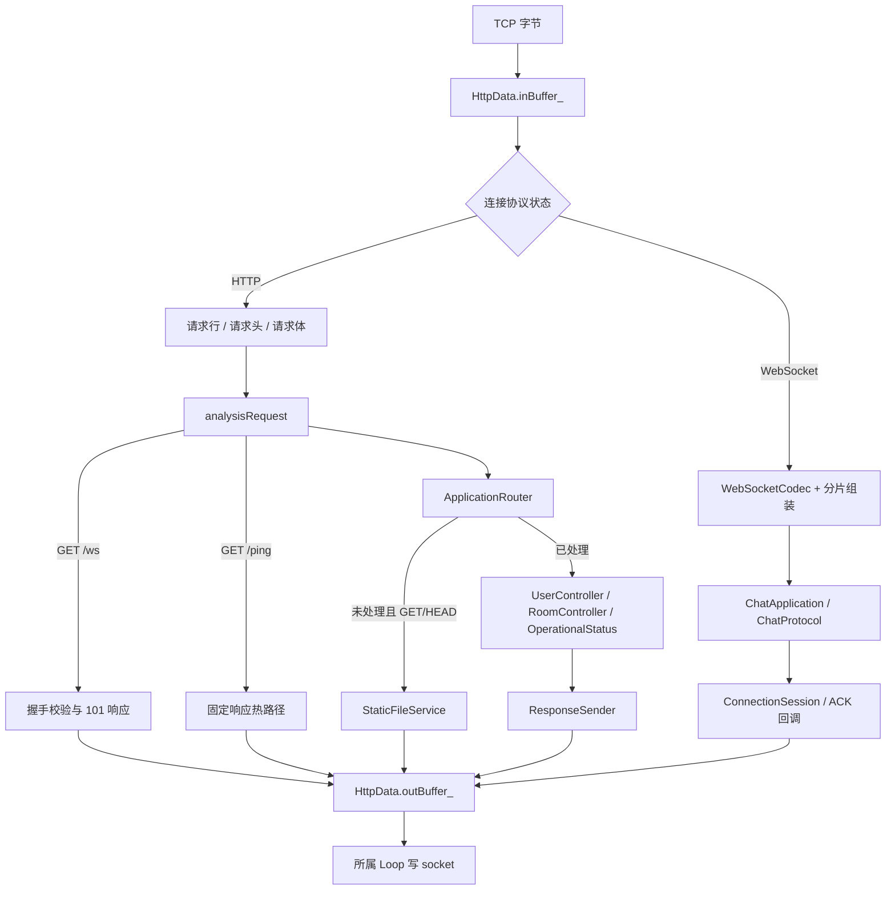
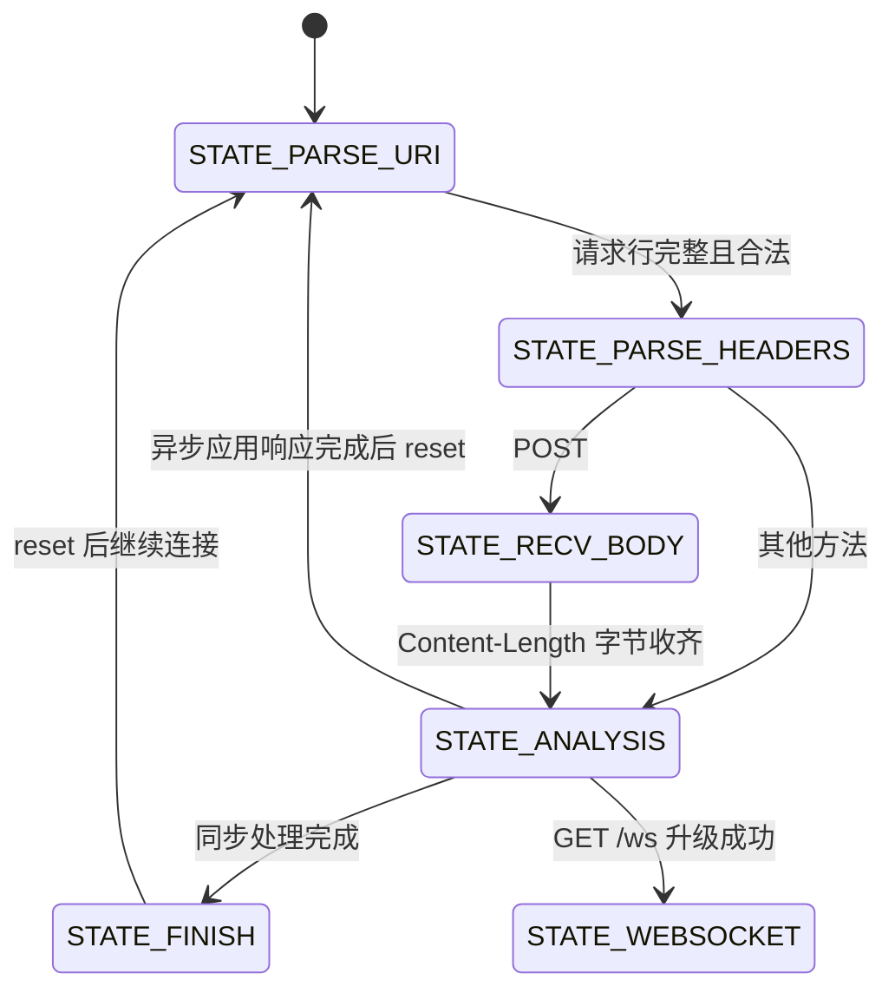
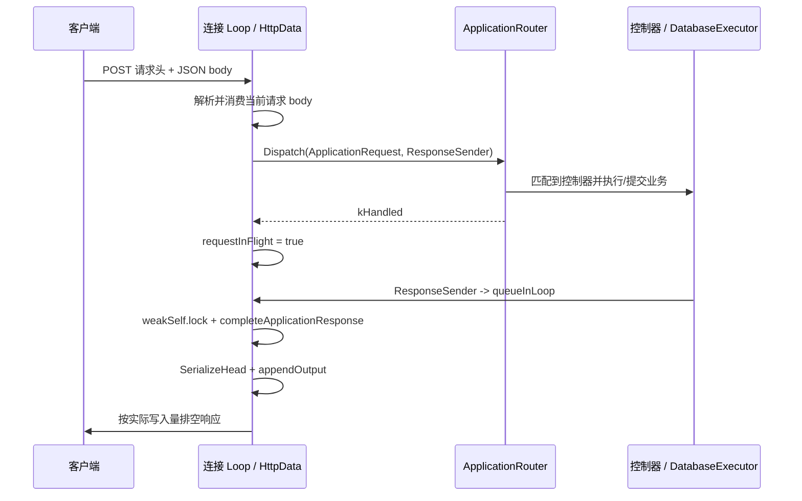
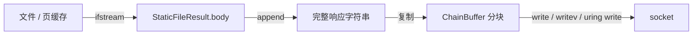
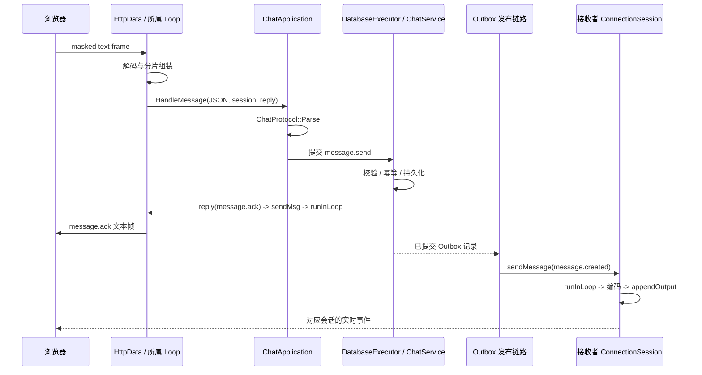

# 03 HTTP、WebSocket 与静态资源处理

本章说明网络字节如何变成应用命令，以及响应如何返回客户端。房间、消息事务和跨实例广播的完整业务实现由其他章节展开；这里着重说明协议层和业务层连接的位置。

源码以当前工作区为准。源码中的旧注释如“OpenCV 在这里”“Authorization is preferred”，不一定准确描述当前实现；下面采用实际分支和函数调用作为依据。

## 1. 协议层如何拆分

协议处理并不是一个完全独立于连接的 HTTP 框架，而是“纯解析工具 + 有状态连接适配器”的组合。

| 模块 | 负责什么 | 不负责什么 |
| --- | --- | --- |
| `HttpData` | TCP 连接状态、HTTP 解析阶段、WS 分片、路由移交、输出排队 | 不直接编写房间 SQL |
| `HttpRequestParser` | 请求行、完整头块、查询参数提取 | 不负责网络读取、异步等待 |
| `HttpResponseWriter` | 按状态码、类型、长度生成响应头 | 不发送 socket，不读取文件 |
| `StaticFileService` | 资源路径校验、类型与长度、可选文件内容 | 不处理登录和房间权限 |
| `WebSocketCodec` | 帧头、掩码、长度、编解码 | 不理解房间与幂等消息 |
| `ApplicationRouter` | 将结构化 HTTP 请求送到应用控制器 | 不持有 Channel 或输入输出缓冲区 |
| `ChatApplication` | 把 WS 文本交给业务协议与执行器 | 不直接操作 fd |

来源：[HttpData.h](../../src/httpdata/HttpData.h)、[HttpRequest.h](../../include/httpserver/protocol/HttpRequest.h)、[HttpResponse.h](../../include/httpserver/protocol/HttpResponse.h)、[StaticFile.h](../../include/httpserver/protocol/StaticFile.h)、[WebSocket.h](../../include/httpserver/protocol/WebSocket.h)。

## 2. HttpData 中有哪些关键状态

### 2.1 HTTP 解析阶段

`ProcessState` 的主流程是：

数据不完整并不立即返回错误，而是保留状态和未消费输入，等待下一次读事件或完成事件。

`requestInFlight_` 用来阻止前一个应用请求尚未完成时又处理下一请求；应用响应回到 Loop 后清零。这是单连接应用响应的串行化机制，不是完整的多请求并行 HTTP pipeline 调度器。

### 2.2 与解析阶段不同的连接状态

`ConnectionState` 分为 `H_CONNECTED`、`H_DISCONNECTING`、`H_DISCONNECTED`。

`closed_` 保证关闭幂等；`error_` 控制错误后的事件处理；`closeAfterWrite_` 表示输出排空后再关闭；`draining_` 表示服务进入停机排空状态。

不要把 `STATE_FINISH` 解释成 TCP 已断开。它只是一次 HTTP 请求分析完成；后续可能复用连接，也可能继续发送未排空的数据。

### 2.3 输入输出数据属于连接

`inBuffer_` 保存还未被协议层消费的字节；`outBuffer_` 保存还未成功写给 socket 的字节。

`headers_` 是小写键的 `unordered_map`；`contentLength_` 和 `hasContentLength_` 描述当前请求体；`uri_` 与 `query_` 分开存储。

WebSocket 使用 `webSocketFragment_`、`webSocketFragmented_` 维护跨帧文本消息。HTTP 和 WebSocket 共享同一条连接的输入输出缓冲区，但使用不同的解析规则。

来源：[HttpData.h](../../src/httpdata/HttpData.h)、[HttpData.cpp](../../src/httpdata/HttpData.cpp)。

## 3. 从 socket 到请求行

### 3.1 两种读入口

常规 readiness 回调是 `handleRead()`，通过 `ChainBuffer::readFd()` 执行 `readv()`；完成式读入口是 `handleReadComplete()`，对成功读取的字节调用 `commitWrite()` 后推进状态机。

两条入口目前保留各自的状态推进代码，并没有抽成完全共用的一份解析循环。因此理解项目时应分别查看它们，不能只读函数名就断言两后端每条路径完全等价。

`EAGAIN` 表示目前没有更多可读数据，重新等待；读取为 0 表示对端关闭读方向，进入断开状态；其他错误生成错误响应或关闭。

输入缓冲区的全局限制是 `16 KiB + 1 MiB`。即使请求头尚未解析出来，也不会无限积累任意长度输入。

### 3.2 parseURI 的步骤

`parseURI()` 优先通过 `peekContiguous()` 查看单块输入，避免小请求复制；多块时回退到 `peekAllAsString()`。

普通请求的处理顺序是：

1. 查找第一处 `\r\n`。
2. 未找到且长度未超过 8192 字节，返回 `PARSE_URI_AGAIN`。
3. 请求行为空或过长，返回 `PARSE_URI_ERROR`。
4. 调用 `HttpRequestParser::ParseRequestLine()`。
5. 将方法映射到 GET、POST、HEAD、DELETE 或 unsupported。
6. 只接受 HTTP/1.0 和 HTTP/1.1。
7. 以 `?` 分离 `uri_` 和 `query_`。
8. 检查路径是否包含非法形式或 `..` 路径段。
9. 消费请求行与其 CRLF，进入头部解析。

`GET /ping HTTP/1.1` 和 `GET /ping HTTP/1.0` 有固定字符串快速识别路径，跳过通用请求行对象构造。

### 3.3 纯请求行解析器检查什么

`HttpRequestParser::ParseRequestLine()` 要求恰好两个空格分隔三段；method 非空且字符为大写字母；target 非空且最长 2048 字节；version 必须是支持的两个值。

纯解析器可以接受语法合法的 `PUT`，但 HttpData 的方法分派仍将其视为 unsupported。这体现“语法能解析”和“应用支持方法”是两层判断。

它不是完整 URL 规范化库；目前没有百分号解码和通用 URI normalization 流程。

来源：[HttpRequest.cpp](../../src/httpdata/HttpRequest.cpp)。

## 4. 请求头、请求体和 Keep-Alive

### 4.1 头部边界

`parseHeaders()` 查找 `\r\n\r\n`，未完整时保留输入，超过 16384 字节则报错。

普通请求调用 `HttpRequestParser::ParseHeaders()`，它按 CRLF 逐行解析 `name: value`，把字段名转小写，修剪值两端空格和制表符。

当前限制为最多 100 个头字段，字段名最长 128 字节，字段值最长 8192 字节。

`Content-Length` 必须为十进制非负数字且不超过 1 MiB。重复且数值相同可以接受；重复且不同、非数字和超限则拒绝。

普通重复头最终存入 map 时覆盖旧值，不是通用的多值头合并器。

### 4.2 /ping 头部快速路径

对于 `GET /ping`，只在当前路径直接解析连接语义，避免建立通用 header map；如果出现 `Content-Length`，会回到通用解析器保留数字与重复值检查。

这是一项针对基准热路径的局部优化，不代表所有业务请求都执行了相同的低分配处理。

### 4.3 请求体的收齐与消费

POST 进入 `STATE_RECV_BODY`，缺少 Content-Length 返回 400；实际缓存不足时继续等待读取，收齐后进入 analysis。

移交应用时只截取当前 `contentLength_` 字节作为 `ApplicationRequest.body`。

路由已处理后立即从输入缓冲区消费这段 POST body，避免 Keep-Alive 下一次请求从旧 JSON 文本开始解析。对应真实回归见 [HttpProtocolTest.py](../../tests/integration/HttpProtocolTest.py) 的 `test_post_body_does_not_pollute_next_request()`。

当前不是通用 HTTP body streaming：没有边到边处理上传，也没有实现 chunked request body 解码。非 POST 请求体没有对应的通用收取流程，不能声称所有方法的 body 都支持。

### 4.4 Keep-Alive 规则

当没有 Connection 头时，HTTP/1.1 默认保持，HTTP/1.0 默认不保持；显式头通过查找小写后的 `keep-alive` 字符串决定。

`reset()` 清除本次请求字段和解析状态，但不清空整个 `inBuffer_`，因此后续已经收到的数据仍在。

响应生成器写出 `Connection: Keep-Alive` 或 `Connection: close`。不过内部 5 分钟计时参数与响应头 `Keep-Alive: timeout=20` 尚不一致，不能把客户端看到的 20 秒当成当前定时器实际精确值。

### 4.5 不能夸大的 HTTP 完整性

当前具备应用所需的请求行/头/固定长度 POST 处理，并非完整 RFC 兼容网关。以下事项没有从当前实现获得充分保证：

1. `Transfer-Encoding` 与 `Content-Length` 冲突的完整拒绝策略。
2. chunked、Expect: 100-continue、Range、条件请求和 HTTP/2。
3. 任意半包、粘包、流水线输入下两条读路径完全等价。
4. 完整 header token 校验、重复 Host 与连接头 token 的严格语法处理。

这些是后续协议加固与测试项，不应在面试中直接用“完整支持 HTTP/1.1”替代具体能力列表。

## 5. analysisRequest 如何移交应用层

### 5.1 统一请求上下文

每次进入分析先初始化 `requestId_` 并记录请求开始时间。

来自 `X-Request-ID` 的值只有非空、长度不超过 64 且仅含字母数字、`-`、`_` 才接受；否则生成 `http-<sessionId>-<sequence>`。

`ApplicationRequest` 是值类型，包含 method、path、query、headers、body、remoteAddress、requestId。`remoteAddress` 来自 `getpeername()`，不是直接信任外部可伪造的 `X-Forwarded-For`。

由于生产前面有 Nginx，后端直接 peer 往往是代理地址；公网按真实 IP 的限制由 Nginx 补充，而不是假定 C++ 自动知道每个访客的真实 IP。

### 5.2 固定分派顺序

`analysisRequest()` 的路径顺序如下：

1. GET `/ws` 先尝试 WebSocket 握手。
2. GET `/ping` 直接追加固定 `200 OK` 响应。
3. 构造结构化 `ApplicationRequest`，调用 `ApplicationRouter::Dispatch()`。
4. 路由返回 `kHandled` 时设置 `requestInFlight_`，等待应用响应回调。
5. 未处理且为 GET/HEAD 时调用静态文件服务。
6. 其他请求返回 405。

`/healthz`、`/readyz`、`/metrics` 在 `ApplicationRouter` 中处理，不需要进入文件服务。GET `/ping` 是特例，HEAD `/ping` 则走 Router。

### 5.3 HTTP 应用响应为什么要回到 Loop

传给应用的 `ResponseSender` 捕获 `weakSelf` 和所属 `loop`。应用调用它时，状态码、类型和 body 被复制进 `loop->queueInLoop()` 的函数。

子 Loop 执行任务时再 lock 连接；如果连接仍在，调用 `completeApplicationResponse()`：清除 `requestInFlight_`，生成响应，reset 请求状态，然后尝试推进剩余输入。

即使控制器同步给出响应，也经过该排队机制，因此不会在 Router 调用栈中直接重入网络响应状态机。

来源：[ApplicationContext.h](../../include/httpserver/application/ApplicationContext.h)、[ApplicationRouter.cpp](../../src/application/ApplicationRouter.cpp)、[HttpData.cpp](../../src/httpdata/HttpData.cpp)。

## 6. 响应序列化与发送

### 6.1 生成什么

`HttpResponseWriter::SerializeHead(status, contentType, contentLength, keepAlive)` 生成状态行、Content-Type、Content-Length、Connection 和可选 Keep-Alive 头。

响应状态行始终为 `HTTP/1.1`，即使输入请求是 HTTP/1.0。支持解析两版本不等于对每个输入版本生成相同版本号的响应。

HEAD 请求仍使用实际 body 长度生成 Content-Length，但不向响应拼接 body。静态 HEAD 还会避免文件内容读取。

`sendResponse()` 记录响应指标与结构化日志，再把头和 body 拼接成字符串，交给 `appendOutput(..., false)`。

`handleError()` 构建简单 HTML 错误页，标记 `closeAfterWrite_`，让错误响应也遵循正常部分写机制，不直接假定一次 write 能发完。

### 6.2 如何处理部分写

`submitAsyncWrite()` 检查连接状态和 `isWriting_`，从输出缓冲区获取首块连续地址，设置正在写标记后调用 Poller 的 `submitWrite()`。

`handleWriteComplete(n)` 只消费实际成功的 n 字节，再继续提交剩余内容。

`-EAGAIN` 加上 EPOLLOUT 兴趣，等待 socket 可写；`-EINTR` 重试；其他错误关闭并记录 I/O 错误。

就绪写回调 `handleWrite()` 使用 ChainBuffer 的 write/writev 路径；没写完则保留写兴趣，排空后移除写兴趣，避免可写事件长期触发空转。

io_uring 的提交/完成与 epoll 的同步非阻塞 syscall 适配差异见 [网络层章节](02_Network_and_Connection.md)。

### 6.3 指标含义

`recordHttpResponse()` 的 HTTP duration 截止于响应准备/记录时，不是客户端完整接收或浏览器渲染完成时间。

TCP 写完成也只表明数据被内核接受或发送推进，不是用户已经看到消息，更不是消息已经被业务接收方 ACK。

来源：[HttpResponse.cpp](../../src/httpdata/HttpResponse.cpp)、[HttpData.cpp](../../src/httpdata/HttpData.cpp)。

## 7. 静态资源：安全校验与真实传输路径

### 7.1 根目录与 URL 映射

`StaticFileService` 默认根目录是进程当前工作目录下的 `./wwwroot`。运行位置错误会导致资源找不到，不能假定它总是相对于二进制位置。

`/` 映射为 `index.html`，其他路径去掉开头斜杠再拼入根目录。查询参数已在 HttpData 中分离，因此不会直接成为文件名的一部分。

目录页面不是列表功能；只允许最终结果为普通文件。

### 7.2 防止越界访问的步骤

`StaticFileService::load()` 做两层校验：

1. 要求以 `/` 开头，拒绝反斜杠、NUL 和精确的 `..` 路径段。
2. 对资源根与候选文件执行 `std::filesystem::canonical()`，解析符号链接。
3. 按路径组件比较 candidate 是否仍处于 root 内，避免只做字符串前缀导致 `/root2` 被误判为 `/root` 子目录。
4. `stat()` 检查目标存在且为普通文件。
5. 超过 8 MiB 返回 `kTooLarge`，非法/不存在/越界返回 `kNotFound`。

因此，稳定文件系统中的符号链接逃逸被目录包含校验拦截。但 canonical/stat 与随后 ifstream 打开不是同一个原子操作，不能宣传成已解决文件被并发替换的 TOCTOU 风险。

路径没有进行百分号解码；不要把“原始路径拒绝 ..”解释成完整浏览器/代理规范化安全模型，生产应配合上游入口校验。

### 7.3 GET 与 HEAD

HEAD 调用 `load(path, false)`，只读取路径/metadata/MIME 信息，不读取文件内容。

GET 使用 `std::ifstream` 与 `istreambuf_iterator` 将整个文件读入 `std::string body`，读取长度与 stat 得到的长度不一致时按失败处理。

HttpData 再将 response head 与 file body 拼成字符串，复制进 ChainBuffer，最后 write/writev 或 io_uring write。

这条路径没有使用 mmap、sendfile 或 splice，不能写成“零拷贝静态文件服务器”。`peekContiguous()` 对请求解析减少一次复制，也不改变静态文件发送路径。

磁盘文件读取在连接 Loop 执行，可能受慢磁盘/缺页影响；非阻塞 socket 不会自动让 ifstream 变成非阻塞文件读取。

### 7.4 两个不同的大小上限

文件服务允许读取不超过 8 MiB 的文件，但默认 `outBuffer_` 硬限制是 1 MiB，且当前一次拼接整个响应后再检查硬限。

因此一个被文件服务判断为 `kOk` 的大文件仍可能在 `appendOutput()` 触发硬限而直接关闭连接，而不是流式发送到完成。

简历可以说“静态资源访问与有界输出”，不能说“已完整解决任意大文件非阻塞传输”。后续改造需要文件分块/发送状态机或 sendfile，并与输出高水位联动。

### 7.5 MIME 与前端资源

`MimeType` 通过 `pthread_once` 初始化映射，当前包含 HTML、CSS、JS、JSON、SVG、WOFF2 等页面依赖类型。

未知扩展的映射默认值是 `text/html`；没有扩展的 StaticFile 路径使用 `application/octet-stream`。这不是一个覆盖全部常见媒体类型的 MIME 数据库，添加资源类型时要补映射和测试。

外部 CSS、JS、图标、字体同样通过本静态路径返回；生产 Nginx 的 `nosniff` 和 CSP 会使错误 MIME 或内联资源问题在浏览器端暴露，不能只在本地直连成功就认定生产资源都正常。

来源：[StaticFile.cpp](../../src/httpdata/StaticFile.cpp)、[MimeType.cpp](../../src/httpdata/MimeType.cpp)、[Nginx 模板](../../deploy/nginx/httpserver.conf.template)。

## 8. WebSocket 握手如何建立身份

### 8.1 升级入口

只有 GET `/ws` 进入 `handleWebSocketHandshake()`。HTTP 已经解析完成，但在输出 101 以前仍可返回普通 400、401、403、429 响应。

检查步骤如下：

1. 存在 Upgrade 与 Sec-WebSocket-Key。
2. Upgrade 小写值等于 websocket，Connection 中含 upgrade。
3. Sec-WebSocket-Version 为 13。
4. 如果开启 Origin 要求，必须精确匹配配置白名单。
5. 提取令牌并通过 `Authenticator::VerifyRequest()`。
6. 按用户与直接 peer 地址执行建连限流。
7. 保存 `authenticatedUser_`，提交 Redis presence 更新。
8. 用客户端 Key 计算 Sec-WebSocket-Accept。
9. 生成 101 响应，转入 `STATE_WEBSOCKET`，设置 keepAlive。

用户名来自已验证 JWT，不采用客户端聊天 JSON 自报的 user 字段。

### 8.2 浏览器怎样传递令牌

浏览器原生 WebSocket API 无法像 fetch 一样自由添加 Authorization 头，当前客户端使用子协议列表：`httpserver.v1` 与 `bearer.<JWT>`。

`parseWebSocketProtocols()` 识别这两类值；bearer token 被放入临时 authorization header，然后交给统一鉴权入口。

响应只回显 `Sec-WebSocket-Protocol: httpserver.v1`，不会将 bearer token 作为选中的子协议返回。

需要纠正旧注释：`Authenticator::ExtractToken()` 实际先读取查询参数 token，查询参数不存在时才读取 Bearer header；它不是 Authorization 优先。

生产 Nginx `/ws` 已拒绝非空 `$arg_token`，避免 URL 查询参数中的令牌进入日志、历史或代理记录。因此公网浏览器按子协议传令牌，查询参数只是后端保留的旧客户端兼容行为。

### 8.3 Origin、TLS 与限流的边界

Origin 白名单是浏览器来源约束，不替代 JWT。后端 Origin 配置未要求检查时会直接允许；生产模板同时在 Nginx 和应用配置层面约束它。

后端代码没有 TLS 握手；WSS 由 Nginx 终止 TLS 后，通过 HTTP/1.1 Upgrade 转发到 C++ 服务。

当前 WS 建连阈值是每用户每分钟 120、每直接 peer IP 每分钟 2000。代理后的后端 peer IP 通常相同，所以 Nginx 的公网限流与后端限流各有不同作用。

此外，统一鉴权和部分限流检查是在握手所在 Loop 中同步调用的；异步数据库执行器并不意味着所有 Redis/认证操作都完全离开 I/O 线程。

### 8.4 握手尚未覆盖的全部规范

当前检查 Key 是否存在并计算 Accept，没有在该握手函数中严格验证 Key 是否为解码后恰好 16 字节的合法 Base64。

Connection 头采用子串判断，不是严格 token 集合解析；没有实现扩展协商和 permessage-deflate。

来源：[HttpData.cpp](../../src/httpdata/HttpData.cpp)、[Authentication.cpp](../../src/application/Authentication.cpp)、[CryptoUtil.cpp](../../src/util/CryptoUtil.cpp)。

## 9. WebSocket 帧是怎样解码的

### 9.1 WebSocketCodec 只解释帧

`DecodeFrame()` 接收 `string_view`，返回 `kNeedMoreData`、`kOk` 或 `kProtocolError`。

处理顺序为：

1. 至少需要两个字节基本头。
2. 提取 FIN、opcode、MASK 与初始 7 位长度。
3. 拒绝 RSV 非零或客户端未 mask 的帧。
4. 126 表示随后两字节长度，127 表示随后八字节长度。
5. 64 位长度最高位不能为 1。
6. 控制帧必须 FIN 且不超过 125 字节；数据帧最大 1 MiB。
7. 数据未收齐则返回 need more，且不消费输入。
8. 按 `payload[i] ^ mask[i % 4]` 解掩码，返回 payload 与 bytesConsumed。

`bytesConsumed` 使 HttpData 能准确消费一帧而保留后面的粘连帧。

### 9.2 连接层如何循环取帧

`handleWebSocketFrame()` 每轮从输入缓冲区取字符串视图副本，调用 Codec；完整帧消费相应字节，然后继续处理下一帧。

数据不足立即返回，协议错误则发 close。当前每轮 `peekAllAsString()` 会复制剩余输入，不能说该帧解析是完全零拷贝。

### 9.3 控制帧处理

Close opcode 0x8：单字节 payload 非法并使用 1002；其他长度回显 close payload，设置排空后关闭。

Ping opcode 0x9：立即编码 Pong 0xA，携带原 payload；Pong 0xA：忽略其应用内容。

Binary opcode 0x2：以 1003 关闭，当前聊天只支持文本消息，不是任意二进制 WebSocket 服务。

### 9.4 文本分片

非 FIN text 开始分片，清空旧 fragment 并设置 fragmented；continuation 只有在已开始分片时才合法。

每个片段追加后检查整条消息不超过 1 MiB。收到最终 continuation 后，把累计文本交给业务层。

未开始就 continuation、分片中又出现新 text、未知 opcode 以 1002 关闭；累计消息超过上限用 1009。

Codec 单帧大小错误默认 closeCode 仍为 1002，因此不能概括为“所有超大数据情况都返回 1009”。

### 9.5 编码能力边界

`EncodeFrame()` 输出未 mask 的服务端帧，FIN 固定为 1，支持 125 字节以内和 16 位扩展长度；超过 65535 字节直接返回空字符串。

业务消息正文当前限制为 4096 字节，因此普通聊天输出在此范围内，但不能把 Codec 描述成已经支持任意 64 位长度服务器帧。

当前没有显式的完整 UTF-8 文本校验、close code 合法值表校验、所有长度编码规范检查与扩展协议支持。JSON 库解析文本并不能替代 WebSocket 层对所有控制/文本帧的完整规范校验。

来源：[WebSocket.cpp](../../src/httpdata/WebSocket.cpp)、[WebSocket.h](../../include/httpserver/protocol/WebSocket.h)、[HttpData.cpp](../../src/httpdata/HttpData.cpp)。

## 10. WS 文本到业务命令的边界

完整文本交给 `ChatApplication::HandleMessage(payload, self, reply)`。`self` 对外呈现 `ConnectionSession` 接口，只暴露 sessionId、userId 与 sendMessage。

业务 JSON 解析由 `ChatProtocol` 使用 nlohmann JSON 完成，不在 WebSocketCodec 中用字符串搜索房间 ID。

V1 协议要求 version=1、requestId、type、payload；roomId、requestId、clientMessageId 均为 1 至 128 字节字符串，message.send 的 content 为 1 至 4096 字节。

主要命令是 `room.subscribe` 和 `message.send`；响应/推送是 `room.subscribed`、`message.ack`、`message.created` 和 `error`。

没有 version 的旧 JSON 走 legacy 兼容路径，支持 join/chat；这条旧路径会自行生成 legacy clientMessageId，不具备新版客户端稳定幂等键的同等重试语义。

`ChatApplication` 把有效业务任务提交 `DatabaseExecutor`，由业务服务校验成员关系、订阅关系、限流并持久化；队列拒绝与期限到期通过协议错误回调给客户端。

这里应区分三种完成：

| 完成事件 | 能说明什么 | 不能说明什么 |
| --- | --- | --- |
| TCP/WS 帧成功写入 | 网络发送状态推进 | 数据库已提交 |
| `message.ack` | 业务持久化/幂等结果已取得 | 所有接收者已看到 |
| `message.created` | 某实例发出了实时推送 | 浏览器一定在线且永不丢失 |

启用 Outbox 时，新消息广播由持久化事件发布后驱动；未启用 Outbox 的内存模式可以直接向 recipients 推送。具体事务、Redis 与重放逻辑应结合持久化章节讲解。

来源：[ChatApplication.cpp](../../src/application/ChatApplication.cpp)、[ChatProtocol.cpp](../../src/protocol/ChatProtocol.cpp)、[ApplicationContext.h](../../include/httpserver/application/ApplicationContext.h)。

## 11. 背压如何影响 HTTP 与 WebSocket

### 11.1 两类输出

`HttpData::sendMsg()` 用于命令回复等重要消息，最终 `appendOutput(frame, false)`。

`ConnectionSession::sendMessage()` 调用 `sendNonCriticalMessage()`，主要承接实时广播，最终 `appendOutput(frame, true)`。

两条路径都通过 `loop_->runInLoop()` 在连接所属线程编码和修改输出缓冲区。来自 Redis 回调或数据库执行器的线程不会直接并发写同一个 ChainBuffer。

### 11.2 高水位和硬限制

默认高水位 256 KiB，硬限制 1 MiB；配置由 main 注入。

追加后将超过硬限制时，先记录 slow consumer 指标，清空输出并立即关闭，不区分是否重要消息。

达到高水位时记录指标；非重要广播被丢弃，重要回复仍可以继续进入缓冲，直到硬限制。

这不是暂停 Redis 或阻塞所有发送者的全局流控，而是以单连接为单位保护进程。高水位丢弃的实时广播必须依靠持久化历史与客户端补拉恢复。

### 11.3 不能遗漏的限制

关闭慢连接时没有保证最后一帧 close 一定能送达；硬限分支直接关闭。

一次性 HTTP 大响应也走同样硬限制，不是只有“恶意慢客户端”才会触发。

当前保护重点是输出有界，不等于每一条业务消息队列、全局内存池和所有输入路径都已统一做了端到端流量控制。

来源：[HttpData.cpp](../../src/httpdata/HttpData.cpp)、[SlowConsumerTest.py](../../tests/resilience/SlowConsumerTest.py)。

## 12. 失败如何回传到用户

| 失败发生处 | 协议动作 | 连接影响 |
| --- | --- | --- |
| HTTP 请求行/头非法 | 400 错误响应 | 输出排空后关闭 |
| 未支持方法 | 405 | 走错误响应关闭流程 |
| 静态文件不存在/越界 | 404 | 走错误响应流程 |
| 静态文件超过服务上限 | 413 | 走错误响应流程 |
| WS Origin 不合法 | 握手 403 | 不升级 |
| WS JWT 不合法或撤销状态不可用 | 握手 401 | 不升级 |
| WS 建连限流 | 握手 429 | 不升级 |
| WS 帧或分片非法 | close 帧，通常 1002 | 尽量排空后关闭 |
| WS binary 消息 | close 1003 | 不进入聊天业务 |
| 业务参数、房间权限、依赖错误 | V1 error 或旧版 error JSON | 一般保留 WS 连接 |
| 输出超过硬限制 | 不再追加，记录指标 | 立即关闭 |
| 服务优雅停机 | WS close 1001 | 停止业务并尝试排空 |

错误协议不全是同一种 envelope。HTTP 的普通解析错误是 HTML，业务 API 是 JSON，WS V1 与 legacy 的错误结构也不同。客户端应按其实际入口处理，而不是假定所有失败都含同一字段。

## 13. 测试与源码阅读顺序

先读纯模块测试，再看真实进程交互，最后看端到端消息恢复；不要把“函数能返回一个结果”当作整条链路已验证。

| 测试 | 现有覆盖重点 |
| --- | --- |
| [HttpRequestParserTest](../../tests/httpdata/HttpRequestParserTest.cpp) | 请求行、头部、查询参数与基础非法格式 |
| [HttpResponseWriterTest](../../tests/httpdata/HttpResponseWriterTest.cpp) | 状态行、Content-Length、Keep-Alive 与 413/429 |
| [StaticFileServiceTest](../../tests/httpdata/StaticFileServiceTest.cpp) | 根页面、长度类型、路径穿越与不存在文件 |
| [MimeTypeTest](../../tests/httpdata/MimeTypeTest.cpp) | 项目资源扩展的 MIME 映射 |
| [WebSocketCodecTest](../../tests/httpdata/WebSocketCodecTest.cpp) | masked 文本、编码、数据不足、未 mask 拒绝 |
| [HttpProtocolTest](../../tests/integration/HttpProtocolTest.py) | Keep-Alive、HEAD、POST 后续请求、非法头、运维接口 |
| [WebSocketSmokeTest](../../tests/integration/WebSocketSmokeTest.py) | 真实握手、Accept、ping/pong、旧版聊天与基本权限 |
| [WebSocketOriginTest](../../tests/security/WebSocketOriginTest.py) | 缺失/不可信 Origin 拒绝，可信 Origin 与浏览器子协议通过 |
| [ChatBusinessFlowTest](../../tests/e2e/ChatBusinessFlowTest.py) | V1 房间及聊天业务链路 |
| [MessageIdempotencyTest](../../tests/e2e/MessageIdempotencyTest.py) | 应用 ACK 与稳定幂等消息行为 |
| [ReconnectRecoveryTest](../../tests/e2e/ReconnectRecoveryTest.py) | 断线恢复与历史补拉 |
| [ChatInteractionTest](../../tests/ui/ChatInteractionTest.cjs) | 真实浏览器布局与客户端交互/恢复行为 |

上述小规模纯测试并未覆盖完整 HTTP/WebSocket RFC，也没有对所有大小边界、全部 frame 分片序列、真实 io_uring 半包/关闭竞态做穷举。

本文没有为了写文档修改协议行为或重新宣称整套验收通过。后续定位问题时应从测试明确覆盖的分支出发，再增加对应场景。

## 14. 面试追问与回答逻辑

### 问：为什么要使用状态机？

答：TCP 没有请求边界，单次读取可能只是半个请求行，也可能包含后续数据。HttpData 保留当前阶段和未消费字节，数据不足时等待；纯解析器只负责验证当前完整片段，连接层负责何时继续。

### 问：解析器和路由器如何解耦？

答：协议层把 method/path/query/header/body 与请求元数据封装成 ApplicationRequest；路由器只依赖这些值和 ResponseSender，不接触 Channel。结果再由 ResponseSender 排回原 Loop。

### 问：WebSocket 升级后为什么不新建连接？

答：101 响应后仍是同一条 TCP 连接，只是 HttpData 的状态切为 STATE_WEBSOCKET，后续输入改按 WS 帧解码，不再按 HTTP 请求行解析。

### 问：你如何处理消息半包和粘包？

答：Codec 在完整 header、mask、payload 收齐前返回 need more；完整帧返回精确 bytesConsumed，连接层循环处理余下帧。文本分片在 HttpData 累积到 FIN 后才提交业务。实际 ET 读取和异步读路径仍有需要专项增强的覆盖，不能把帧解析能力等同于所有传输竞态已验收。

### 问：为什么实时广播允许丢？

答：实时通道服务的是在线体验，不能让一个慢消费者无限积压拖累进程。重要 ACK 尽量保留，广播在高水位丢弃；正确性依赖先持久化、稳定幂等键和按历史游标补拉，不依赖 Pub/Sub 或 TCP 永不丢线。

### 问：静态文件是不是零拷贝？

答：当前不是。使用 ifstream 整文件读取、响应字符串拼接和 ChainBuffer，再进行非阻塞 socket 写。可以准确说实现静态资源路径约束和输出保护；真正大文件流式/零拷贝需要独立发送状态机与测试后再声明。

### 问：TLS 与业务认证有什么区别？

答：TLS/WSS 在 Nginx 终止，保护传输；JWT 确认登录身份；Origin 限制浏览器来源；房间成员与订阅规则授权业务操作。四者不能互相代替。

## 15. 本章可用于口述的总结

“连接层以有状态 HTTP/WS 适配器衔接纯解析组件与应用层。HTTP 按请求行、头部和固定长度 body 推进，将结构化请求交给 Router，并通过回调返回所属 EventLoop；WebSocket 完成 JWT、Origin 校验后复用 TCP 连接，解码 masked 帧并组装文本，再交给版本化聊天协议。输出统一处理部分写、高水位与硬限，持久化 ACK 与可恢复实时广播分开。当前静态资源采用受限整文件读取，不把它包装成零拷贝或完整大文件流式服务。”
