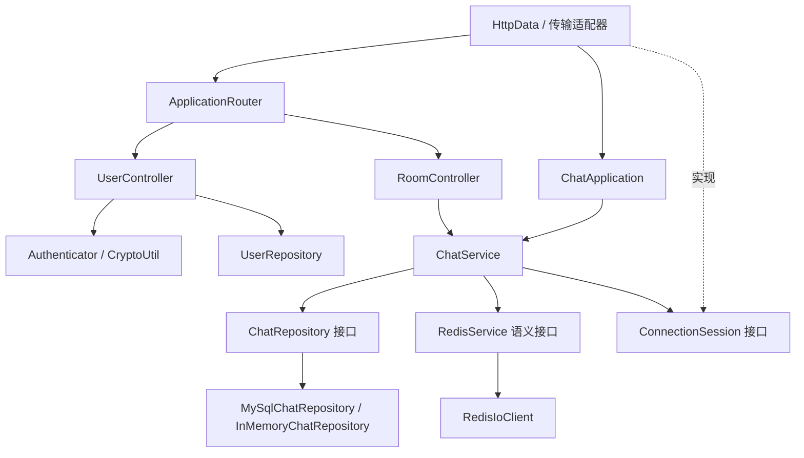
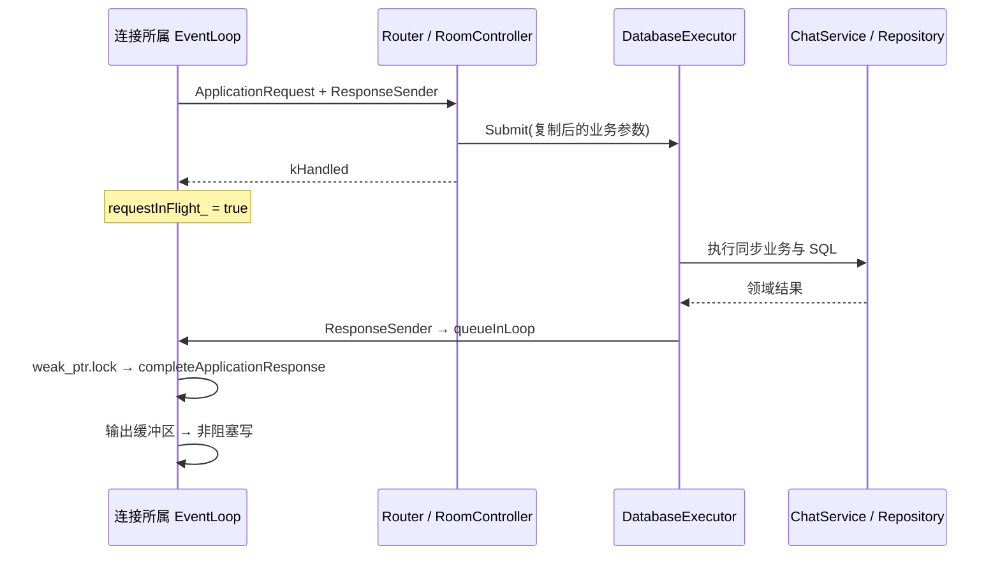

# 04. 应用层、身份认证与聊天领域

> 本文按当前工作区源码解释已经存在的实现，不把路线图目标当作已实现能力。阅读对象是需要在秋招面试中讲清调用链、设计原因和能力边界的项目作者。
>
> 本章中的“测试证据”表示仓库已有对应测试及其断言范围，不表示本次编写文档重新执行了全部测试。

## 1. 先用一句话理解应用层

应用层将 HTTP 请求或 WebSocket 命令翻译为业务操作，通过领域仓储访问用户、房间、成员和消息；完成后调用传输层提供的回调，将结果送回连接所属的 EventLoop。

它不负责 `epoll_wait`、WebSocket 帧拆包或 socket 写入，也不是完全无状态的纯函数层：`ChatService` 还管理本进程在线会话、限流配置和事件去重状态。

整体应称为“模块化单体服务，支持多实例部署”。一个进程内包含网络、应用、数据库任务执行、Redis 和 Outbox；不是将这些模块分别部署为微服务。

## 2. 实际模块划分

| 模块 | 输入 | 输出 | 实际职责 |
| --- | --- | --- | --- |
| `ApplicationRequest` | 传输层已解析请求 | 值类型请求对象 | 隔离 `HttpData` 的网络状态 |
| `ApplicationRouter` | 请求、响应回调 | `kHandled` / `kNotHandled` | 路径匹配、HTTP 入口认证、分发 |
| `UserController` | 注册、登录、退出请求 | HTTP 状态及 JSON | 参数校验、限流、密码处理、JWT 签发或撤销 |
| `RoomController` | 用户身份、房间参数 | HTTP 状态及 JSON | JSON 转换、任务提交、业务错误映射 |
| `ChatApplication` | WebSocket 文本、会话、回复回调 | 协议回复或业务推送 | 命令解析、异步提交、ACK 生成 |
| `ChatService` | 业务命令 | 领域结果 | 成员权限、订阅检查、消息写入、历史查询、本地会话登记 |
| `ChatRepository` | 领域字段 | 领域对象 | 房间、成员、消息存储契约 |
| `UserRepository` | 用户名、密码哈希 | 创建结果、哈希查询结果 | 独立的认证用户存储契约 |
| `ConnectionSession` | 文本消息 | 无同步返回结果 | 应用侧的在线连接抽象 |

源码入口：

- [ApplicationContext.h](../../include/httpserver/application/ApplicationContext.h)
- [ApplicationRouter.cpp](../../src/application/ApplicationRouter.cpp)
- [UserController.cpp](../../src/chat/UserController.cpp)
- [RoomController.cpp](../../src/chat/RoomController.cpp)
- [ChatApplication.cpp](../../src/application/ChatApplication.cpp)
- [ChatService.cpp](../../src/application/ChatService.cpp)

注意物理目录和逻辑模块不完全同名：两个控制器的实现仍在 `src/chat/`，公共接口位于 `include/httpserver/application/`。不要仅按目录名推断职责。

## 3. 依赖方向与真实边界

`ChatDomain.h` 只定义数据结构、业务错误和结果类型，不包含应用、网络、MySQL 或 OpenSSL 头文件。

`ChatService` 使用仓储接口和 `ConnectionSession`，不直接包含 `HttpData.h`、`SqlConnPool.h` 或 `Poller`。因此单元测试能注入内存仓储和假会话，而不启动真实服务器。

这不是完全严格的整洁架构：`UserController` 直接使用 `CryptoUtil`；`ChatService` 通过静态 `RedisService` 访问缓存和限流能力；多个模块采用进程级单例。面试时应说明实际抽象程度，不能说“所有基础设施都通过构造函数依赖注入”。

[ApplicationDependencyTest.sh](../../tests/architecture/ApplicationDependencyTest.sh) 检查的是特定禁止依赖，不是完整的架构形式化证明。

## 4. HTTP 请求如何穿过模块

### 4.1 进入应用层之前

`HttpData::analysisRequest()` 已经获得请求方法、URI、查询串、头部、正文以及直连对端地址。

它构造 `ApplicationRequest`，包含：

- `method`、`path`、`query`：路由及参数。
- `headers`：已规范化的头部映射。
- `body`：当前 POST 的正文副本。
- `remoteAddress`：传输层捕获的真实直连地址，不从不可信转发头直接提取。
- `requestId`：用于请求关联与日志。

所有字段是拥有内存的 `std::string` 或容器，控制器再复制异步任务需要的字段，避免把请求缓冲区的 `string_view` 悬挂到后台任务中。

### 4.2 路由表

| 路径和方法 | 路由目标 | 权限要求 |
| --- | --- | --- |
| `POST /register` | `handleRegister` | 无 JWT，应用限流 |
| `POST /login` | `handleLogin` | 无 JWT，应用限流 |
| `POST /logout` | `VerifyClaims` → `handleLogout` | 有效 JWT，Redis 撤销服务可用 |
| `GET /ping` | 传输层快速路径；Router 亦有兼容路径 | 无 |
| `GET/HEAD /healthz` | 固定存活响应 | 无 |
| `GET/HEAD /readyz` | `OperationalStatus::ready` | 无 |
| `GET/HEAD /metrics` | Prometheus 文本 | 应由部署入口限制外部访问 |
| `GET/POST /api/v1/rooms` | 房间列表或创建 | JWT |
| `GET/POST /api/v1/rooms/{id}/members` | 查看成员或加入房间 | JWT；查看成员还需成员资格 |
| `DELETE /api/v1/rooms/{id}/members/me` | 退出房间 | JWT；房主不可退出 |
| `GET /api/v1/rooms/{id}/messages` | 历史或增量消息 | JWT 和成员资格 |
| `POST /room/create`、`GET /room/list` | 旧版兼容入口 | JWT |

`GET /ws` 在 `HttpData` 内走握手，不由 `ApplicationRouter` 执行普通 HTTP 控制器逻辑。未匹配到应用路由返回 `kNotHandled`，由传输层决定静态文件或方法错误。

### 4.3 为什么响应回调不直接写 socket

`ResponseSender` 的类型为接收状态码、Content-Type 和正文的 `std::function`。

`HttpData` 创建回调时捕获 `weak_ptr<HttpData>` 与所属 EventLoop。控制器执行 `sendResponse` 时，回调先复制 `type` 和 `body`，再调用 `loop->queueInLoop()`。

真正的 `completeApplicationResponse()` 在所属 Loop 中运行：检查连接是否已关闭，清除 `requestInFlight_`，组装响应，重置 HTTP 状态，并继续处理已经到达的后续请求。

`weak_ptr` 的作用是连接断开后不为了一个延迟 HTTP 响应强行保活对象。它不能替代 EventLoop 生命周期管理，Loop 在任务完成前退出的问题依赖服务停机顺序处理。

## 5. 数据库任务执行器不是网络线程池

网络工作线程各自运行一个 EventLoop；`DatabaseExecutor` 运行另一组线程，处理同步 MySQL、scrypt 和部分 Redis 等待。

默认配置是 2 个执行线程、256 个排队任务；可在首次提交前配置。任务队列用互斥锁和条件变量保护，首次 `Submit` 时延迟创建线程。

控制器通常传入 3 秒“排队截止时间”。任务取出时若已过期，则不执行正文，而执行 `onExpired`，通常返回 503。队列满时立即拒绝，控制器同样转换为稳定错误。

这里的 3 秒不是从入队到全部 SQL 完成的统一硬超时，也不会中止已经运行的 scrypt 或数据库事务。运行阶段的 SQL 等待由连接池获取期限和 MySQL I/O 超时分别约束。

当前仍有两个重要阻塞边界：

1. Router 的 `Authenticator::VerifyRequest()` 在提交业务任务前运行，启用 Redis 时会同步等待 denylist 查询。
2. WebSocket 握手也同步执行同样的认证检查。

因此可以说“把主要同步业务和 SQL 移出 EventLoop”，不能说“EventLoop 绝不等待任何中间件”。

源码：[DatabaseExecutor.cpp](../../src/application/DatabaseExecutor.cpp)、[HttpData.cpp](../../src/httpdata/HttpData.cpp)。

## 6. 注册、登录和密码存储

### 6.1 注册

`handleRegister` 先检查用户仓储是否可用，再用 nlohmann/json 解析对象，要求用户名和密码都是字符串。

用户名按字节限制 3～64，字符通过 `isalnum` 或 `_`、`-` 校验；密码按字节限制 8～128。这里不是按 Unicode 字符数量计数。

后台任务依次检查用户名维度和对端 IP 维度限流，然后调用 `registerUser()`：

1. 用 OpenSSL `RAND_bytes` 生成 16 字节独立随机盐。
2. 用 `EVP_PBE_scrypt` 派生 32 字节结果。
3. 参数固定为 `N=32768, r=8, p=1`，内存上限 64 MiB。
4. 保存 `scrypt$v1$32768$8$1$<salt>$<hash>`，两个二进制字段用 Base64URL 编码。
5. `UserRepository::create()` 将用户名和编码后的密码哈希写入仓储。

随机盐让相同密码的存储结果不同；scrypt 的成本让离线猜测比直接 SHA256 昂贵。密码不能用可逆加密或简单 SHA256 替代。

MySQL 实现使用预处理语句，重复用户名由唯一索引和错误码 1062 识别。HTTP 层返回 201 成功、400 参数或注册失败、429 限流、503 依赖不可用。

### 6.2 登录

`handleLogin` 检查仓储和 JWT 配置，解析凭据，后台执行用户/IP 限流，读取该用户名的密码哈希，并重新派生 scrypt 结果。

哈希比较使用 `CRYPTO_memcmp`，避免普通字符串比较的逐字节提前退出。用户名不存在和密码错误对外都返回 `Invalid username or password`。

但当前不存在用户时不会执行一遍等成本的假哈希，因此不能声称“完整消除了账号存在性时序差异”。仓储读取异常与不存在也都可能折叠为 `nullopt`，表现为 401，而不总是 503。

验证成功后生成 JWT，HTTP JSON 返回 `ok=true` 和 `token` 字段；真实 token 不应写入日志或文档。

源码：[CryptoUtil.cpp](../../src/util/CryptoUtil.cpp)、[UserRepository.cpp](../../src/sql/UserRepository.cpp)。

## 7. JWT、会话身份与退出

### 7.1 JWT 内容

JWT 使用 HS256。Header 要求 `alg=HS256`、`typ=JWT`；Payload 包含 `sub` 用户名、`iss` 签发者、随机 `jti`、`iat`、`exp`。

`jti` 来自 16 字节密码学随机数，表示一张凭证，不是用户名或连接 ID。每次登录可以产生不同 JWT。

验证流程包括：长度最多 8192、三段结构、签名恒定时间比较、Base64URL 和 JSON 校验、算法/类型/issuer 校验、字段类型检查、过期时间与签发时间检查。允许 `iat` 最多比当前时间超前 60 秒。

JWT 默认 TTL 为 3600 秒；配置校验要求非空 secret 至少 32 字节。HS256 是共享密钥签名，不是非对称公私钥认证，也没有在当前实现中自动轮换密钥。

### 7.2 token 如何传入

普通 HTTP 可以使用 `Authorization: Bearer <token>`。浏览器 WebSocket 通过握手子协议携带凭证，`HttpData` 将解析出的凭证转为认证头交给 `Authenticator`。

当前 `Authenticator::ExtractToken()` 还保留查询串 `token` 兼容，而且查询串优先于 Authorization。注释中的“prefer Authorization”不能代替实际实现；公网入口应阻止 URL token，避免进入访问日志、浏览器历史或 Referer。

### 7.3 Redis denylist

通过签名和时间校验之后，`VerifyClaims()` 查询 `chat:jwt:denylist:{jti}`。

| Redis 状态 | 当前认证决定 |
| --- | --- |
| 未启用 Redis | 只依赖 JWT 自身验证 |
| 已启用且 key 不存在 | 放行 |
| key 存在 | 拒绝 |
| 已启用但查询不可用 | 拒绝，fail-closed |

退出登录不是删除 JWT 的签名，而是将当前 `jti` 写入 denylist，TTL 为该 token 剩余寿命，最多 86400 秒。写入成功返回 204；Redis 未启用或写入失败返回 503，不能谎报服务端凭证已撤销。

### 7.4 当前长期 WebSocket 的边界

WebSocket 只在握手时验证 token，之后 `HttpData` 保留 `authenticatedUser_`，消息处理使用这个服务端身份。

当前没有每条消息重新检查 JWT 到期/denylist，也没有按 `jti` 检索并关闭全部既有连接的分布式会话撤销机制。因此注销会阻止后续认证请求，不等于立即踢掉所有已建立的 WebSocket；token 到期也不自动结束已经认证的长连接。

## 8. memory 模式与 MySQL 模式不是同一种承诺

`GetUserRepository()` 发现 `HTTPSERVER_AUTH_STORE=memory` 时返回进程内用户 map，否则使用 MySQL 用户仓储。内存模式仍保存 scrypt 哈希，但重启会丢失用户。

聊天仓储的切换独立发生在 `Main.cpp`：配置数据库并初始化、验证迁移版本后，调用 `ConfigureRepository(CreateMySqlChatRepository())`；未配置数据库时沿用默认 `InMemoryChatRepository`。

这意味着 `AUTH_STORE=memory` 不是一键替换所有存储，也不保证与启用 MySQL 聊天仓储的组合合理。生产部署应明确使用持久化用户与聊天仓储；内存模式主要服务测试、演示和无依赖开发。

## 9. 领域对象与标识符

| 对象/字段 | 语义 |
| --- | --- |
| `User.id`、应用层 `senderId` | 当前主要使用用户名字符串，不是数据库 `users.id` |
| `Room.id` | 对外字符串；MySQL 内部为 BIGINT 自增 |
| `Room.ownerId` | 房主用户名 |
| `RoomMember` | 持久成员关系，不等于在线连接 |
| `Message.id` | 服务端消息 ID，用于历史游标和客户端去重 |
| `clientMessageId` | 客户端逻辑发送 ID，用于重试幂等 |
| `sessionId` | 进程内连接身份，不作为消息幂等键 |
| `eventId` | Outbox 事件身份，不等于 HTTP/WS 的 requestId |

源码：[ChatDomain.h](../../include/httpserver/domain/ChatDomain.h)、[ChatRepositories.h](../../include/httpserver/domain/ChatRepositories.h)。

## 10. 房间成员资格与在线订阅必须分开

`POST /members` 修改的是持久成员资格；`room.subscribe` 修改的是本节点内存中的订阅关系。一位用户可以是房间成员而不在线，也可以用多个标签页建立多个 session。

`ChatService::Impl::sessions` 的结构是 `roomId → sessionId → weak_ptr<ConnectionSession>`。服务不通过这个表强行持有全部连接，访问时用 `lock()` 取得临时强引用。

`AttachSession()` 检查房间存在及成员资格，再登记 session。V1 订阅不会自动加入房间；旧协议的 join 使用 `enrollIfMissing=true`，保留“加入同时登记成员”的兼容行为。

退出房间时禁止房主退出；普通成员从仓储删除后，同时清理本节点该用户在该房间的 session。连接关闭调用 `DetachSession(sessionId)`，从本地所有房间移除该连接。

跨节点边界：退出成员事件当前没有通过 Outbox 广播。本节点能清理自己的 session，但其他节点已有订阅不会因此立即清理；`DeliverOutboxEvent` 也不逐个查询成员表。其他节点该连接继续主动发送会经过成员校验，但“立刻停止被动接收”不能当作当前保证。

## 11. WebSocket 应用命令如何执行

`ChatApplication::HandleMessage()` 先检查 session、用户身份和回复回调，再调用 `ChatProtocol::Parse()`。

V1 命令包含协议版本、类型、`requestId` 和 payload。结构非法的 V1 输入直接得到稳定错误；非版本化输入才进入 legacy 兼容路径。

V1 `room.subscribe` 的后台任务调用 `AttachSession`，成功回 `room.subscribed`。

V1 `message.send` 的后台任务依次：

1. `AllowMessage(userId)` 执行消息发送限流。
2. `DispatchMessage()` 转为 `SendMessageCommand`。
3. `SendMessage()` 验证 room、sender、clientMessageId、正文和 session。
4. 检查房间存在、持久成员关系、此 session 已订阅、session 对应用户名与 sender 一致。
5. 调用仓储 `AppendOrGet()`，拿到已存在或新写入的消息。
6. 成功后生成 `message.ack`；重复请求 ACK 相同的持久消息，`inserted=false` 不创建新的实时事件。
7. MySQL/Outbox 模式等待后台发布；内存模式直接向当前节点其他接收者推送。

正文限制为 1～4096 字节；clientMessageId 为 1～128 字节。业务身份来源于服务端 session，不相信客户端提交一个用户名即可代替他人发送。

详细事务与 ACK 语义见 [05_MySQL_and_Transactions.md](05_MySQL_and_Transactions.md)，跨实例广播见 [06_Redis_and_Outbox.md](06_Redis_and_Outbox.md)。

## 12. 两种 WebSocket 出站通道

命令回复回调调用 `HttpData::sendMsg()`，抓取 `shared_from_this()` 后 `runInLoop()`，在 Loop 内编码 WebSocket 文本帧并走普通输出路径。

`ConnectionSession::sendMessage()` 则映射到 `sendNonCriticalMessage()`，也通过 `runInLoop()` 回所属 Loop，但将广播帧标记为非关键数据，交给输出缓冲区背压策略处理。

因此 ACK 与普通实时推送的业务优先级不同。跨线程调用 `sendMessage()` 并不意味着订阅线程直接修改输出缓冲区，也不表示调用返回时浏览器已经收到数据。

## 13. 并发与所有权的实际代价

`ChatService::Impl` 的同一把 mutex 保护仓储指针、会话表及大部分业务操作，并且许多方法持锁执行同步 SQL 和 Redis 读取。

优点是状态一致性较容易理解，内存仓储与会话检查能在本进程内串行；代价是不同房间的业务也会相互等待。增加 DatabaseExecutor 线程数并不自动让同一个 `ChatService` 的全部业务并行。

锁不跨进程，不能代替 MySQL 唯一索引、事务或分布式并发控制。可继续优化为短临界区和房间级状态保护，但那属于后续实现，不是本文描述的现状。

## 14. 已有测试与仍需补强的测试

| 测试 | 实际检查范围 |
| --- | --- |
| [ApplicationBoundaryTest.cpp](../../tests/application/ApplicationBoundaryTest.cpp) | 未知路由回退、非法 WS 输入、V1 未认证 401 |
| [ChatServiceTest.cpp](../../tests/application/ChatServiceTest.cpp) | 创建/加入/退出、非成员禁止、session 身份防伪、历史游标、100 次重试、32 个并发入群、事件去重 |
| [DatabaseExecutorTest.cpp](../../tests/application/DatabaseExecutorTest.cpp) | 工作线程执行、队列饱和拒绝、排队过期 |
| [CryptoUtilTest.cpp](../../tests/util/CryptoUtilTest.cpp) | 密码哈希验证、JWT 校验及篡改/过期场景 |
| [DatabaseAuthenticationTest.py](../../tests/integration/DatabaseAuthenticationTest.py) | 真数据库认证流程 |
| [AuthorizationMatrixTest.py](../../tests/security/AuthorizationMatrixTest.py) | owner/member/nonmember、WS 订阅权限、过期 token |
| [AuthenticationAbuseTest.py](../../tests/security/AuthenticationAbuseTest.py) | 登录/注册输入与滥用行为 |

还需要针对“既有 WebSocket token 撤销”“跨节点退群后是否继续接收”“Redis denylist 延迟对 EventLoop 的影响”“持锁 SQL 的跨房间阻塞”补充专项验收。不能将现有的内存单测通过等同于这些分布式性质已被证明。

## 15. 面试时如何讲

**问：为什么要加 Controller 和 Service，直接在 HttpData 里写业务不可以吗？**

答：能实现功能，但网络状态机与 SQL、认证、房间规则混在一起难以测试。我保留 `HttpData` 作为传输适配器，通过拥有内存的请求对象和回调进入应用层；控制器处理协议转换，Service 处理业务规则，仓储处理数据。假 session 和内存仓储可以直接测领域规则。

**问：异步服务器为什么还需要数据库线程池？**

答：socket 非阻塞不等于 MySQL C API 非阻塞，密码 scrypt 也消耗 CPU。我用有界任务队列隔离这些工作，再把回调投回连接所属 Loop。当前 JWT denylist 检查仍有同步等待，是已识别的进一步优化点。

**问：用户在线、加入房间、订阅房间是一个概念吗？**

答：不是。成员关系在 MySQL，在线连接是进程内 session，房间订阅是 room→session 的内存映射。成员可以离线，同一用户可以有多条连接，断线只移除 session，不删除持久成员关系。

**问：服务为什么同时用 weak_ptr 和 shared_ptr？**

答：长期登记表使用弱引用防止连接被业务表永久保活；发送时取得临时强引用或让 Loop 回调持有对象，保证排队期间对象存在。HTTP 响应用弱引用则允许连接已关闭时丢弃无意义回复。

**问：这是完全无状态的服务吗？**

答：持久用户、成员、消息和发布任务可共享，但 WebSocket 连接、订阅表、任务队列和短期去重仍在本进程。实例故障后需要客户端重连、重新订阅和补拉，不能称为没有状态的进程。

**问：这个模块目前最值得继续优化什么？**

答：优先处理真实边界：把握手/HTTP denylist 检查改为完整异步路径，缩短 ChatService 持锁区间，补齐跨节点退群与会话撤销传播，再优化接口错误类型和仓储查询次数。
