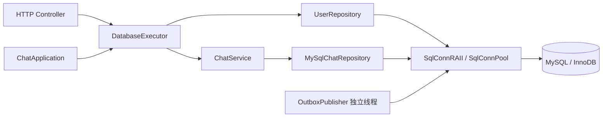
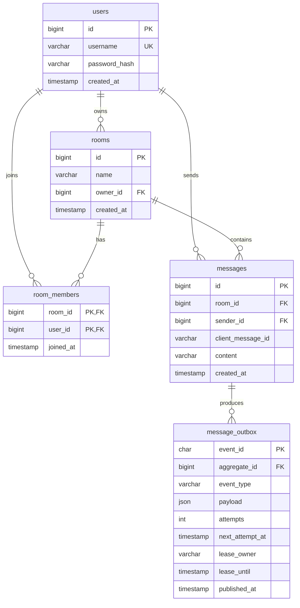
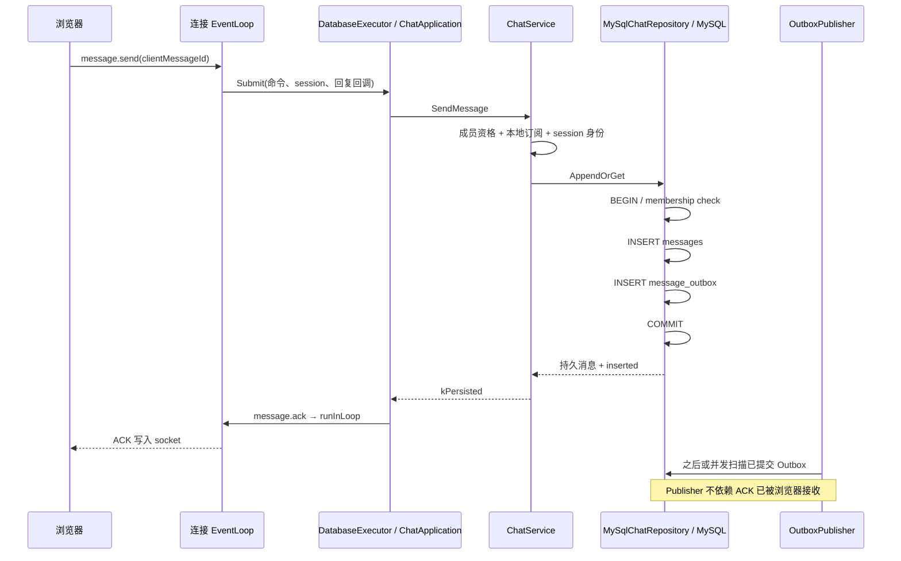

# 05. MySQL 持久化、任务执行与事务边界

> 本章描述当前 `MySqlChatRepository`、用户仓储、连接池、迁移和消息事务的具体实现。重点是能够回答“数据在哪里落盘、什么时候能 ACK、重试为何不重复、现有一致性边界在哪里”。
>
> 代码拥有事务和幂等能力，不等于已经解决所有跨实例并发问题。本文单独标识现有风险，不将待实现方案写成已完成工作。

## 1. MySQL 在系统中的位置

MySQL 是用户、房间、成员关系、消息和 Outbox 发布任务的持久事实来源。Redis 缓存删除、应用进程重启或 WebSocket 断开不应删除这些数据。

数据库模块不持有浏览器连接、不调用 EventLoop、不直接发送 WebSocket 帧。它接收应用层字段并返回领域对象，由调用者决定 HTTP/WS 响应。



源码入口：

- [MySqlChatRepository.cpp](../../src/sql/MySqlChatRepository.cpp)
- [UserRepository.cpp](../../src/sql/UserRepository.cpp)
- [SqlConnPool.h](../../src/sql/SqlConnPool.h)
- [SqlConnPool.cpp](../../src/sql/SqlConnPool.cpp)
- [DatabaseExecutor.cpp](../../src/application/DatabaseExecutor.cpp)
- [001_initial.sql](../../db/migrations/001_initial.sql)
- [002_outbox_leases.sql](../../db/migrations/002_outbox_leases.sql)

## 2. 启动装配与迁移

### 2.1 进程启动做什么

`Main.cpp` 加载配置后初始化连接池；只要任意一个预建连接失败，整批已创建连接释放，初始化失败，服务退出而不是带着半个池开始接流量。

数据库启用时还调用 `MySqlChatSchemaCurrent()`，查询 `schema_migrations` 是否含 `002_outbox_leases`。不满足时退出，避免旧 schema 与新应用不兼容。

检查通过后，`ChatService::ConfigureRepository(CreateMySqlChatRepository())` 安装 MySQL 仓储，设置 Outbox 模式，并在启动阶段读取一次房间数量。

这一步发生在 EventLoop 接收请求之前，启动同步查询不会卡住已有业务请求。它检查的是迁移标记存在，而不是逐表逐列审计或迁移文件校验和验证。

### 2.2 为什么服务启动不自动 ALTER TABLE

[apply_migrations.sh](../../scripts/apply_migrations.sh) 作为独立部署步骤读取数据库环境配置，按迁移文件顺序执行；[migrations.sh](../../scripts/lib/migrations.sh) 查询版本表，跳过已完成版本。

运行中的应用只验证预期版本，不在多个实例启动时竞争修改表结构。这样可以把 DDL 失败与业务启动失败分开处理。

MySQL DDL 可能隐式提交。`002_outbox_leases` 的两个 ADD COLUMN 和一个 ADD INDEX 不是一个可完整回滚的事务；脚本中途失败时应检查已经完成的 DDL 并做前向修复，不能保证直接重跑一定成功。

迁移是有状态管理的部署动作，不应在生产库上随意重复执行。本文展示的是代码路径，不要求为了读文档而操作数据库。

## 3. 表结构与关系



ER 图中的“消息产生事件”是当前代码每次新建消息写一个事件；数据库没有对 `aggregate_id` 施加唯一约束，不能仅靠外键推导一对一关系。

| 表 | 关键约束 | 解决的问题 |
| --- | --- | --- |
| `users` | 自增主键；用户名唯一 | 同名注册竞争最终由数据库裁决 |
| `rooms` | 自增主键；owner 外键 | 房主必须是有效用户 |
| `room_members` | 联合主键 `(room_id,user_id)` | 同一用户不能重复成为同一房间成员 |
| `messages` | 自增主键；唯一键 `(sender_id,client_message_id)` | 多连接、多进程重试的最终去重约束 |
| `messages` | 普通索引 `(room_id,id)` | 按房间和 ID 范围分页 |
| `message_outbox` | UUID 主键；aggregate_id 指向 messages | 发布任务与消息关联 |
| `message_outbox` | pending 和 claim 组合索引 | 待发布任务筛选 |
| `schema_migrations` | version 主键 | 记录完成的迁移版本 |

所有初始表使用 InnoDB、utf8mb4、`utf8mb4_unicode_ci`。应用侧多数长度按 UTF-8 字节校验，数据库 VARCHAR 定义按字符容量，两者不是同一个计数单位。

`utf8mb4_unicode_ci` 是不区分大小写的排序规则，而内存仓储 `std::string` 键是大小写敏感的。用户名和 clientMessageId 的两种后端语义因此并非完全一致；客户端生成 UUID 一类规范 ID 能减少碰撞习惯问题，但不能替代明确的数据库二进制排序规则设计。

## 4. 连接池：复用连接，而不是并发共享一条连接

### 4.1 核心数据结构

`SqlConnPool` 是进程级单例，持有 `queue<MYSQL*>`、互斥锁、POSIX 信号量和使用中/空闲计数。

信号量表示当前可租借的连接数量。每次成功租借一条连接后，该 MYSQL 对象由该业务操作独占，直到 RAII 析构归还。

这不是一条 MySQL 连接被多个执行线程同时调用。MySQL 协议会话状态、结果集和事务都附着在具体连接上，因此连接所有权必须清楚。

### 4.2 初始化

`Init()` 预创建配置数量的连接。每条连接设置：

- 连接建立超时为 3 秒。
- `MYSQL_OPT_READ_TIMEOUT` 为配置的 operation timeout。
- `MYSQL_OPT_WRITE_TIMEOUT` 为相同 operation timeout。

全部创建成功才初始化信号量和标志位。运行过程中 `available()` 主要读取这个初始化标志，不会每次发 SQL ping，所以“available=true”不等于该时刻数据库一定健康。

### 4.3 获取与归还

`GetConn()` 先检查初始化状态，再用 `clock_gettime(CLOCK_REALTIME)` 构造期限，通过 `sem_timedwait` 等待许可；被信号中断则继续等待，超时返回空指针。

拿到许可后持锁从空闲队列弹出连接，调整使用中/空闲计数。`FreeConn()` 把连接放回队列并 `sem_post`。

`SqlConnRAII` 在构造时获取连接，析构时自动归还，因此仓储任意早返回路径不会忘记归还正常取得的连接。

### 4.4 当前池的边界

池不是完整的健康连接管理器：当前没有在借出/归还时自动检测失效连接并重新建立，也没有连接最大寿命、空闲清理或凭证热更新。

MySQL 重启后已有连接可能失效，仅看到池的 `initialized_` 仍为 true 不代表故障已恢复。这是健康探测、错误分类和连接重建要进一步联动的地方。

停机时必须先停止会使用数据库的任务和发布线程，再关闭池。`ClosePool()` 关闭空闲连接；仍在外面的连接稍后归还时看到池未初始化会被关闭，不能把“可归还”误解为支持任意并发销毁信号量。

## 5. DatabaseExecutor 与 SqlConnPool 的区别

| 维度 | DatabaseExecutor | SqlConnPool |
| --- | --- | --- |
| 管理资源 | 后台任务和线程 | MySQL 会话连接 |
| 有界对象 | 排队任务数 | 活跃连接数 |
| 饱和响应 | 入队失败或任务过期 | 获取连接超时 |
| 默认关键配置 | 2 worker、256 queue | 由数据库 pool size 配置决定 |
| 工作粒度 | 一个完整业务 lambda | 一个或多个仓储方法所持有的连接 |

控制器的一个任务可能执行多次仓储调用，每次重新租借连接；只有显式事务范围内的操作共享同一条连接。Outbox 的独立线程也租用同一个连接池，需要预留容量。

此外 `ChatService` 经常持有全局 mutex 执行仓储操作，因此执行器线程数、SQL 池大小和聊天吞吐并不是简单线性关系。

## 6. 预处理与结果集绑定

MySQL 仓储用 `Statement` 或 `MysqlStatement` RAII 管理 `MYSQL_STMT*`，在析构时调用 `mysql_stmt_close()`。

`StringBind` 保存 string_view、长度和 MYSQL_BIND；`UIntBind` 绑定无符号 64 位整数。参数按值通过 MySQL 绑定接口传入，不拼接用户的房间名、消息正文或用户名到 SQL 字符串。

返回字段用定长缓冲区加 MySQL 写回长度读取。例如消息正文缓冲区 4097 字节，对应应用层 4096 字节限制；不能只用 C 字符串结束符来读取 SQL 返回值。

`FetchMessage()` 通过 messages 与 users JOIN，将数据库 sender_id 转回用户名，返回应用层的 `Message`。这解释了为什么 API 的 senderId 看起来是用户名，而表里却是 BIGINT 外键。

时间格式也由 SQL 生成：FetchMessage 将 TIMESTAMP 格式化到毫秒并追加 `Z`，Outbox INSERT 则用 NOW(3) 生成时间。当前连接初始化没有显式设置 session time_zone，因此应在部署中验证数据库时区；字符串带 `Z` 本身不证明源时间一定已经转换为 UTC。

Outbox 发布器部分 SQL 使用转义后拼接，这是另一个实现路径；不能宣称整个项目每一条 SQL 都采用 prepared statement。

## 7. 创建房间的事务

`MySqlChatRepository::Create(ownerId,name)` 的实际顺序是：

1. 租借连接，关闭 autocommit，创建 `Transaction`。
2. 根据用户名查找 owner 的数据库 ID。
3. `INSERT INTO rooms(name,owner_id)`。
4. 用 `mysql_stmt_insert_id()` 得到数据库生成的 roomId。
5. 向 `room_members` 插入房主成员记录。
6. `Commit()` 成功后返回 Room。

所以房间创建与房主加入处在同一个 MySQL 事务，避免出现房间存在但房主不在成员表的部分结果。

`ChatService::CreateRoom()` 随后还会调用仓储 `Add(roomId,ownerId)`。对 MySQL 实现来说，这是重复的 `INSERT IGNORE`，因为 Create 已添加房主；对默认内存实现则承担真正添加成员的责任。这是当前复合仓储契约不够统一的细节，不应误述为两次创建不同成员。

roomId 是数据库全局自增整数转字符串，不是 Redis INCR、Snowflake、随机 8 位邀请码，也不是每个节点自行分配的全局 ID。

## 8. 加入、退出和成员校验

`Add` 使用 `INSERT IGNORE INTO room_members`，受联合主键约束；affected rows 为 1 才认为新增成功。Service 区分已是成员，Controller 把重复加入作为成功且 `joined=false` 返回。

`Remove` 删除指定 room/user，affected rows 为 1 才认为真正退出。房主不能退出的规则在 Service，而不在 DELETE SQL 中。

`Contains` 根据用户名查 users.id，再查 room_members。`List` JOIN users 返回成员用户名；`Count` 做房间内 COUNT。

这些接口使用 bool、optional、vector 返回，某些 SQL 错误会和“没有记录”合并。比如连接不可用导致 Find 返回空时，Service 可能返回 room_not_found。这是现有错误模型的限制，不是完整的可重试错误分类。

## 9. 消息幂等键究竟是什么

业务定义是 `(senderId, clientMessageId)`。数据库里 senderId 对应用户数字主键；客户端 clientMessageId 必须在同一发送用户下唯一。

它不是 `(sessionId, requestId)`：WebSocket 重连会改变 sessionId，重试也可能使用新的 requestId，但同一逻辑发送应保持 clientMessageId 不变。

数据库唯一键是最后一道跨进程约束。内存 map 或本节点 mutex 无法阻止两个实例同时插入同一个逻辑消息。

当前同一幂等键携带不同 room/content 时，重复路径会返回旧消息，不会比较载荷并返回冲突。调用方不能复用一个 clientMessageId 发送不同逻辑消息；后续可增加请求指纹或显式字段一致性检查。

## 10. AppendOrGet 的逐步事务

`MySqlChatRepository::AppendOrGet(roomId,sender,clientMessageId,content)` 运行在后台任务线程中。

### 10.1 前置读取

解析 roomId 为非零 uint64，租借连接，根据用户名查数据库 senderId。任何必要条件缺失先返回 dependency_unavailable。

随后创建 `Transaction`，在这个事务内再次执行 `MembershipExists`。这是仓储自己的权限检查，不能仅依赖上层 Service 在事务外做过检查。

### 10.2 新消息路径

执行 messages INSERT，取得新 messageId；生成 UUID 的 eventId，向 message_outbox INSERT 对应 `message.created`，payload 含消息 ID、房间 ID、发送人、clientMessageId、内容、时间字段。

然后读取完整消息记录。只有读取成功且事务 `Commit()` 成功，才返回 `error=kNone, inserted=true`。

### 10.3 重复消息路径

messages INSERT 返回 MySQL 1062 时，通过 `(sender_id,client_message_id)` 查询已存在消息；取得旧记录并 Commit 成功后返回 `inserted=false`。

这一分支不插入新的 Outbox，也不生成新的服务端消息 ID。ACK 使用旧持久记录，而不是重新接受一条消息。

### 10.4 失败路径

插入失败、Outbox 插入失败、读取失败、提交失败都会返回错误。`Transaction` 仍为 active 时析构执行 rollback 并恢复 autocommit。

`HTTPSERVER_TEST_FAIL_OUTBOX_INSERT=1` 是 Debug 编译下的故障注入点，位于消息插入后、Outbox 插入前；Release 的 NDEBUG 路径不会启用它。

## 11. 从发送到 ACK 的完整时序



事务提交是 ACK 生成的前提，但 ACK 到客户端与 Outbox 发布哪个先被客户端观察到，没有全局顺序保证。发布线程可以在消息提交后立即看到记录，发送者自己的推送可能先于 ACK 到达。

ACK 的准确说法是“服务端接受并完成持久消息事务”，不是“对方已收到”或“对方已读”。`MessageDeliveryStage` 有 received/persisted/published/delivered 枚举，但当前不是一张逐用户送达状态表，也没有已读回执事务。

内存模式虽复用 `kPersisted`/ACK 结构，实际只写入进程内 map，不能借相同的字段宣称重启后可恢复。

## 12. 三个最需要讲清的故障窗口

| 故障时间 | 数据库可能状态 | 客户端正确动作 |
| --- | --- | --- |
| 事务提交前进程退出 | 未提交变更回滚 | 用原 clientMessageId 重试 |
| COMMIT 成功、ACK 丢失 | 消息和 Outbox 已存在 | 用原键重试，取回同一条记录 |
| Redis 不可用但事务成功 | 消息已持久，Outbox 待发布 | ACK 仍可成功；实时性受损，恢复后发布或历史补拉 |

数据库 COMMIT 的网络响应丢失会造成“调用方不知道是否提交”的不确定结果。即使此时返回错误，也不能推导数据库一定没有写入；客户端稳定幂等键才是消除重试副作用的机制。

事务只覆盖同一 MySQL 连接中的消息和 Outbox，不覆盖 Redis、浏览器输出缓冲区或客户端 IndexedDB/localStorage。这不是分布式两阶段提交。

## 13. 不能将自增 ID 等同于提交顺序

当前 AppendOrGet 不对房间行执行 `SELECT ... FOR UPDATE`，也没有房间级序列提交屏障。全局 ChatService mutex 只在同一实例内串行，不会约束另一个实例。

例如实例 A 插入得到 ID=101 后事务延迟，实例 B 插入得到 ID=102 并先提交；客户端先看到 102，将增量游标推进到 102，随后 101 才提交。只查询 `id > 102` 会漏掉晚提交的 101。

因此当前 ID 能表示分配顺序、去重键和查询排序，却不能证明跨实例严格提交顺序。要保证持续增量无遗漏，应增加明确的房间序列与提交顺序方案，或设计有界回扫与去重窗口并验证故障模型。

“数据库自增，所以天然保证多节点聊天严格有序”是错误的面试表述。

## 14. 当前事务锁顺序与权限竞争

创建房间的写入顺序是 rooms → room_members；消息的写入顺序是 messages → message_outbox；Outbox claim 单独锁待领取的 message_outbox 行。

消息事务内的 MembershipExists 是普通 SELECT，而不是锁定读。当前没有通过成员行锁、房间锁或外键到 room_members 保证“检查成员资格”和“退出成员”之间的强串行关系。

在跨实例退群与发送并发时，发送可能在成员检查通过后再遇到另一实例删除成员，但仍完成消息写入。数据库外键验证的是 user 和 room 存在，不是“此人此刻仍为成员”。

事务隔离级别没有在代码中显式设置，取决于数据库配置。不要把某个开发 MySQL 的默认隔离级别当作所有部署环境保证；1062 后读取旧消息的可见性、并发退出和死锁重试都需要真实多实例测试。

## 15. 历史分页的 SQL 与结果方向

`ListBefore(room,before,limit)` 使用 `room_id=? AND id<? ORDER BY id DESC LIMIT ?`，取出后反转，最终仍按时间方向由旧到新返回。

Service 默认空 before 为 uint64 最大值，先取 limit+1；有多的一条时去掉最旧的额外项，将返回页第一条 ID 作为 `nextBefore`，用于继续向前翻页。

`ListAfter(room,after,limit)` 使用 `room_id=? AND id>? ORDER BY id ASC LIMIT ?`；通常 Service 同样取 limit+1，移除末尾额外项，以最后一条已返回 ID 作为 nextAfter。

接口默认 limit=50，允许 1～100；before 和 after 不能同时提供。before 要求正整数，after 允许 0。IDs 对外为字符串以避免 JavaScript Number 丢失 BIGINT 精度。

按 `(room_id,id)` 范围读取属于 keyset pagination，不依赖大 OFFSET 扫描。但当前实现先查一页 ID，再对每个 ID 调 `FetchMessage()`，形成一页 N+1 查询；房间列表也通过每个 room 的 Count/Contains 形成多次查询。这是可优化的真实成本。

## 16. 历史首屏缓存的具体边界

`ChatService::ListMessagesAfter` 对 `after=0 && limit<=50` 有特殊 Redis 路径：读取 `chat:room:{id}:recent`，未命中时调用仓储 `ListAfter(room,0,50)` 并缓存。

名字叫 recent，但 SQL 实际是从最早消息开始的前 50 条，而不是最近 50 条。

还有一个明确分页边界：当请求 limit=50、房间消息多于 50 条时，此路径只取 50 条，没有第 51 条作为 has-more 探针；`nextAfter` 仅在结果 size>limit 时设置，所以可能错误返回 null。当前不能用该首屏路径证明大历史房间能完整拉完。

此问题与第 13 节的并发提交顺序是两类问题：一个是分页探针逻辑，一个是游标水位的跨事务语义。都应通过专项回归修复后再宣称完整断线恢复保证。

## 17. 验证数据库事实时可用的只读查询

以下查询只读，不展示密码、不删除数据。需要在目标测试库连接中运行，不能把示例统计当作当前环境实测结果。

```sql
SELECT version, applied_at
FROM schema_migrations
ORDER BY version;

SELECT sender_id, client_message_id, COUNT(*) AS copies
FROM messages
GROUP BY sender_id, client_message_id
HAVING COUNT(*) > 1;

SELECT COUNT(*) AS unpublished
FROM message_outbox
WHERE published_at IS NULL;

SELECT COUNT(*) AS messages_without_outbox
FROM messages AS m
LEFT JOIN message_outbox AS o ON o.aggregate_id = m.id
WHERE o.event_id IS NULL;

SELECT @@transaction_isolation, @@innodb_flush_log_at_trx_commit;
```

第二个查询为空应由唯一索引保证；第四个用于检查写入链完整性，历史导入或手工数据也可能影响结果。数据库持久化强度还取决于部署的 flush 策略、磁盘与备份，不能仅凭 C++ 调用 mysql_commit 就声称物理机断电零丢失。

## 18. 已有测试证据

| 测试 | 源码中可确认的断言 |
| --- | --- |
| [DatabaseMessageIdempotencyTest.py](../../tests/integration/DatabaseMessageIdempotencyTest.py) | 同一服务两条 WS 发同一键，ACK payload 相同，历史只有一条 |
| [PersistenceRestartTest.py](../../tests/integration/PersistenceRestartTest.py) | 建房、入群、发消息后重启应用进程，另一个成员能读同一 messageId |
| [TransactionRollbackTest.py](../../tests/integration/TransactionRollbackTest.py) | Debug 注入 Outbox 插入前失败，WS 返回依赖错误，历史无该消息 |
| [ChatServiceTest.cpp](../../tests/application/ChatServiceTest.cpp) | 内存模式 100 次重复调用仅一次 inserted、游标行为、身份检查 |
| [DatabaseExecutorTest.cpp](../../tests/application/DatabaseExecutorTest.cpp) | 饱和拒绝、过期回调、后台执行 |
| [OutboxRecoveryTest.py](../../tests/integration/OutboxRecoveryTest.py) | Redis 故障时 Outbox 未发布，恢复后发布标记出现 |

“同一服务两条 WS”的幂等测试不能替代“两个实例同时写同一键”的测试；“重启应用进程”不能替代“MySQL 断电或磁盘故障”的测试；事务测试打印 outbox=0 也不能当作其直接查询过 Outbox 行数，应阅读实际断言。

建议补强的验收包括：跨实例并发重试、幂等键不同载荷冲突、两事务反序提交、51/100/1000 条历史连续分页、退群与发送竞争、MySQL 运行中重启恢复、不同排序规则下的用户及 ID 行为。

## 19. 面试追问与准确回答

**问：先写 MySQL 再发 Redis，为什么要额外一张 Outbox 表？**

答：进程可能在写 MySQL 后、发 Redis 前退出。将消息和待发布事件放进同一个本地事务，可以让后台线程恢复未完成发布。它解决的是“数据库事实与发布意图一致”，不是让浏览器收消息也进入事务。

**问：为什么不能只靠 clientMessageId 的内存 set 去重？**

答：进程重启 set 会丢，不同实例也不共享内存。数据库唯一键保证并发写入只能建立一条逻辑记录，重试从原记录返回相同 ACK。

**问：ACK 丢了客户端怎么办？**

答：保留原 clientMessageId 重试，requestId 可以变化。后端若已提交就读取旧消息，否则重新写入。不能每次网络重试生成新的 clientMessageId。

**问：事务提交失败一定没有消息吗？**

答：不一定。提交响应丢失会产生不确定结果，所以必须使用幂等重试查询最终数据库事实，而不是让客户端推断一次网络错误等于没有执行。

**问：为何使用 RAII 连接池？**

答：连接建立昂贵，业务很多早返回路径。池限制并发数据库会话，RAII 确保离开作用域归还连接；事务 RAII 负责未提交时回滚。这两个生命周期不能混为一谈。

**问：目前数据库层最重要的技术债是什么？**

答：优先完善跨实例提交游标语义、幂等冲突检测、明确成员变更竞争规则与失效连接重建；再合并 N+1 查询并缩短 Service 持锁时间。性能和正确性需要分别测量，不能只看一个静态 /ping QPS。
