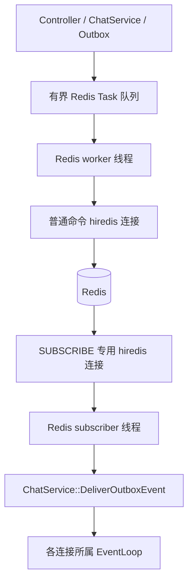
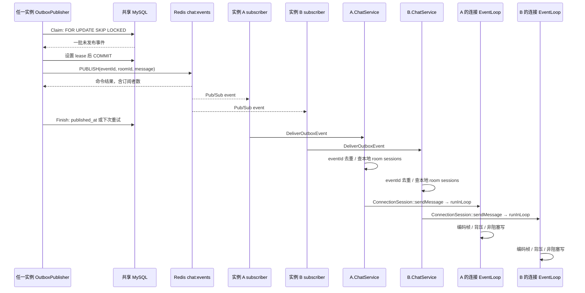

# 06. Redis、中间件通信与 Transactional Outbox

> 本章按当前 Redis 和 Outbox 源码展开，区分“持久数据”“发布尝试”“在线推送”“客户端恢复”。这是面试中最容易说得过满的一部分，应先掌握承诺边界再谈架构价值。
>
> 当前具备双实例实时广播、事务内发布意图、失败后重试及短期去重，但不保证端到端 exactly-once，也尚未具备完整的发布租约 fencing。

## 1. Redis 在本项目承担五类职责

| 职责 | 主要调用者 | Redis 数据 | Redis 失效后的策略 |
| --- | --- | --- | --- |
| 分布式限流 | UserController、ChatService | 窗口计数 key | 回退本地限流 |
| JWT 撤销 | Authenticator、UserController | jti denylist key | 已配置时认证 fail-closed |
| 房间/消息缓存 | ChatService | JSON + TTL | 未命中或读取失败后读仓储 |
| 在线状态 | HttpData 生命周期任务 | user+instance TTL key | 最佳努力，不作为成员权限依据 |
| 跨实例广播 | OutboxPublisher、订阅线程 | Pub/Sub channel | 未发布事件重试；已错过的 Pub/Sub 依靠持久历史恢复 |

Redis 不是消息最终存储，也不是当前系统的唯一认证事实来源。密码哈希在用户仓储，房间成员在 MySQL；缓存内容不应替代成员权限校验。

## 2. 源码与初始化入口

- [RedisClient.h](../../include/httpserver/application/RedisClient.h)：业务语义接口和静态服务入口。
- [RedisClient.cpp](../../src/redis/RedisClient.cpp)：hiredis 实现、任务队列、普通命令连接、订阅连接、presence。
- [AuthenticationRateLimiter.cpp](../../src/application/AuthenticationRateLimiter.cpp)：Redis 结果与本地回退。
- [OutboxPublisher.cpp](../../src/application/OutboxPublisher.cpp)：领取、发布、回写与重试。
- [ChatService.cpp](../../src/application/ChatService.cpp)：缓存接入、会话路由、事件去重与本地 fan-out。
- [Main.cpp](../../src/Main.cpp)：中间件启动顺序和事件回调装配。

`Main.cpp` 先 `RedisService::Configure(config.redis)`，再注册 event handler，将收到的事件交给 `ChatService::DeliverOutboxEvent`；数据库初始化与 schema 检查完成后再启动 OutboxPublisher。

Redis host 为空表示未启用；编译未包含 hiredis 时走返回 unavailable 的 stub。启用配置不等于已连接成功，因为后台线程负责连接与重连。

## 3. 语义接口而不是业务代码写 Redis 命令

`RedisClient` 对外暴露 `AllowRateLimit`、`RevokeToken`、`GetRoom`、`PutRoom`、`Publish`、`TrackPresence` 等含义明确的方法。ChatService 不需要处理 `redisReply*` 或 `freeReplyObject()`。

`RedisService` 持有 `shared_ptr<RedisClient>`。调用时先在 service mutex 下复制指针，然后在解锁后调用接口，避免全局服务锁覆盖网络等待。

测试可通过 `SetClientForTesting` 安装 FakeRedisClient，验证语义接口与业务接线；生产配置安装 hiredis 实现。假客户端的同步回调行为不能当作真实 Redis 的线程模型。

## 4. 双连接、双线程的真实模型

一个 RedisIoClient 创建两个 std::thread，各自独占一个 redisContext：

1. worker 串行执行普通 GET/SET/DEL/EVAL/PUBLISH。
2. subscriber 独立执行 `SUBSCRIBE chat:events` 和 `redisGetReply`。

订阅连接不能与普通请求混用，否则连接的响应模型会冲突；独立线程也避免等待 Pub/Sub 时完全阻塞普通限流和缓存命令。

这里用的是同步 hiredis API 加专用线程，不是直接把 hiredis socket 注册到项目 EventLoop 的异步客户端。

默认配置：connect timeout 500ms、command timeout 500ms、队列容量 256、最多一轮连接尝试 5 次。实际部署可以覆盖这些值。

## 5. Execute 与 Submit 不能混为一谈

每个 Task 包含参数字符串 vector、自己的 mutex/condition_variable、completed/cancelled 标志和 CommandResult。

### 5.1 Execute：排队后同步等待结果

`Execute()` 将 Task 入队，然后调用线程等待 commandTimeout。GET、EVAL、PUBLISH、token revoke 都用这个路径，因为调用方要知道结果。

超时则标记 cancelled，返回 unavailable。worker 尚未取到的 cancelled Task 会被跳过；如果命令已经发往 Redis，取消等待无法撤销 Redis 端已经发生的副作用。

因此 caller 返回超时不等于命令一定未执行。对 SET/DEL 类操作通常可设计幂等；对 PUBLISH 和限流计数则要识别结果不确定性。

主要业务 Execute 在 DatabaseExecutor 或 Outbox 线程中等待，但当前 HTTP/WS 的 Authenticator denylist 查询发生在 EventLoop，仍有同步等待边界。

### 5.2 Submit：只确认入队

缓存 SET/DEL、presence SET/DEL 使用 `Submit()`，调用立即返回队列是否接收，不等待 Redis 成功。

所以 `PutRoom()==true` 或 `InvalidateRoom()==true` 只意味着任务已入队，不能证明 Redis 已写入或已删除。后台故障可导致这些最佳努力操作未生效，TTL 是后续淘汰的辅助机制。

### 5.3 有界排队

停机或 tasks.size 达容量时 Enqueue 立即拒绝并增加 rejected 计数，避免 Redis 变慢时请求无限堆积内存。

一个 worker 串行处理所有普通命令，缓存、限流、denylist、Pub/Sub 发布会共享队列；大规模 presence 刷新也会占据该连接。这是容量设计和优先级隔离的后续优化方向。

## 6. 重连为何只发生在发送前

`Connect()` 使用连接超时，设置命令读写超时，需要密码时先 AUTH。

`ConnectBefore()` 只在还没有可用连接时执行有限尝试，退避基数从 50ms 按指数增长并加入最多约四分之一的随机抖动，受本轮 deadline 限制。

`ExecuteOnConnection()` 将参数交给 `redisCommandArgv`。遇到 I/O 或 Redis 错误时释放连接并返回失败，不在原地重放同一条命令，因为 Redis 可能已经执行却没能返回响应。

下一条任务可以重新连接。这种“发送前重连、不盲目重放已发送命令”的原则降低重复副作用，但 Outbox 作为上层可靠发布机制仍会根据未完成记录发起新的发布尝试，因此事件仍可能重复。

订阅线程有自己的连接、重订阅和退避循环。当前它也使用命令读超时，空闲等待遇到 `redisGetReply` 错误会重连；该路径没有持久订阅游标，重连期间错过的 Pub/Sub 不会自动重放。

## 7. Redis key 与消息通道

| key/channel | 内容 | 生命周期 |
| --- | --- | --- |
| `chat:ratelimit:{scope}:{identity}:{bucket}` | 窗口请求计数 | PEXPIRE 为窗口长度 |
| `chat:jwt:denylist:{jti}` | 字符串 1 | 当前 token 剩余有效期 |
| `chat:room:{roomId}` | 房间 id/name/ownerId JSON | 300 秒 |
| `chat:room:{roomId}:recent` | 消息 JSON 数组 | 600 秒 |
| `chat:presence:{userId}:{instanceId}` | 字符串 1 | 30 秒 |
| `chat:instance:{instanceId}` | 字符串 1 | 30 秒 |
| `chat:events` | Pub/Sub 消息事件 | 不保存历史 |

Redis key 不包含 TCP fd，避免连接重建改变幂等或认证语义。缓存和 presence 的 key 也不承担 room_members 的权威职责。

## 8. 限流算法与降级

### 8.1 Redis 路径

代码根据 scope、identity、当前窗口拼 key，Lua 脚本在一次 EVAL 中执行 INCR，并只在计数第一次变为 1 时 PEXPIRE，然后返回计数。

原子 Lua 避免进程在 INCR 后、EXPIRE 前崩溃留下永不过期计数，也避免多个实例并发创建窗口时产生应用侧的读改写竞争。

计数不超过配置阈值则 allowed，超过则 limited。用户/IP、注册/登录/建房/发消息使用不同 scope，使一个动作的计数不直接覆盖另一个动作。

默认认证阈值 10 次/60 秒；登录和注册 IP 路径额外使用 1000 次/60 秒；消息发送默认 1000 次/60 秒。WebSocket 握手连接频率则使用本地 `Allow()`，不是这里的 Redis 分布式函数。

### 8.2 本地回退

`AuthenticationRateLimiter::AllowDistributed()` 看到 Redis unavailable 时，使用 `unordered_map<string, deque<steady_clock::time_point>>` 保存本节点尝试记录，先删除窗口外记录，再检查数量。

这实际是本地滑动时间窗口；Redis 路径是固定窗口计数，两者边界突发行为并不完全相同。

回退保证故障时仍有基本滥用约束，不保证多实例总额度继续精确一致。N 个节点各自回退时，总允许量可随节点数扩大。

### 8.3 当前跨主机窗口问题

Redis key 的 bucket 来源于 C++ steady_clock 的 time_since_epoch 除以窗口秒数。steady_clock 不保证不同主机共享同一时间原点，因此同机双进程共享窗口的测试不能证明跨主机窗口一定相同。

要宣称多主机严格共享固定窗口，应使用明确的全局时间方案，例如在 Redis 脚本内取 TIME，或使用经过定义的系统时间窗口。当前代码没有这样做。

## 9. JWT denylist 与不同故障策略

`RevokeToken()` 用 `SET key 1 EX ttl` 并等待结果，只有确认成功才返回 204。`TokenState()` 用 GET 区分 revoked、not-revoked、unavailable。

限流允许降级，token 撤销检查却不能随意放行：如果用户刚撤销凭证，Redis 故障时跳过检查会让它重新有效。因此启用 Redis 后认证检查采用 fail-closed。

“Redis 故障系统还能发消息”需要附带条件：已经建立并通过认证的 WS 在发送路径不重查 denylist，可以走本地限流回退并写 MySQL；新的受保护 HTTP 请求或 WS 握手可能因 denylist 不可用被拒绝。

这不是对所有业务一刀切的 fail-open。持久化可用性、认证安全性和实时性是分别设计的。

## 10. Cache Aside 的实际执行逻辑

### 10.1 房间信息

`ChatService::Impl::FindRoom()` 先 GET 房间缓存；成功解析就记录 hit 并返回。缓存缺失、JSON 无效或 Redis 不可用都视为 miss，调用仓储 Find，取得房间后异步 PutRoom。

缓存只包含 room id/name/owner，成员资格每次仍问仓储。ListRooms 本身也不是整页 Redis 缓存。

### 10.2 消息数组

`ListMessagesAfter` 的 `after=0 && limit<=50` 路径读取 recent key；未命中时读取 `ListAfter(room,0,50)` 后缓存。

这其实缓存最早前 50 条，不是最新 50 条；limit=50 时缺少第 51 条探针的分页问题见 [05_MySQL_and_Transactions.md](05_MySQL_and_Transactions.md)。不要仅根据 recent 名字推导行为。

### 10.3 写后失效与一致性

新消息成功写入后调用 `InvalidateRoom()`，异步 DEL 房间 key 和 recent key。幂等重复不会再次失效缓存。

这是最终一致缓存：写后的 DEL 可能延迟、队列满或失败；并发 reader 也可能在 writer 删除后回填旧数据。当前没有缓存版本号、比较写入、双删或事务消息驱动的失效确认。

TTL 能限制部分陈旧时间，不能证明“所有写后读立即看到最新消息”。历史持久事实仍应从 MySQL 解释。

## 11. Presence 不是可靠在线成员表

`TrackPresence(userId)` 在本进程增加该用户名的连接引用计数，再写 user+instance key，TTL=30 秒。

`UntrackPresence` 减少计数，只有计数降到 0 才删 key，避免同一用户两个浏览器标签页关闭其中一个就被错误标成离线。

实例 ID 优先取配置，否则使用 hostname+pid。这样同一用户同时连到多个实例可以拥有多个 presence key，不会互相覆盖。

worker 在队列空闲等待 10 秒超时后调用 `RefreshPresence()`，刷新 instance key 和所有本地在线用户 key。

重要边界：当前刷新不是独立的每 10 秒定时器。如果命令队列持续非空，wait_for 谓词一直立即满足，刷新分支可能长期不执行，30 秒 TTL 会让活跃连接的 presence 过期。不能据此实现严格在线人数计费或权限判定。

连接关闭的 presence 任务也会受执行器/Redis 队列影响；正常情况下显式删除，异常退出依靠 TTL 清理。它是短期状态提示，不是连接真实存在的强一致证明。

## 12. 为什么需要 Transactional Outbox

没有 Outbox 时，业务通常会“写 messages → PUBLISH”。进程若恰好在两步中间退出，数据库已有消息但其他在线节点不知道；反过来先发布再写库，则可能展示最终没有持久化的消息。

当前方案在同一个 MySQL 事务中同时写 messages 与 message_outbox，把“发出通知的意图”也持久化。后台发布器不依赖原请求或原进程仍存活，可以继续处理未完成记录。

它避免数据库与 Redis 的直接双写原子性要求，但不是让两套系统参加同一个事务。发布成功、发布结果未知、回写失败仍需靠重试和去重处理。

## 13. Outbox 行的状态字段

| 字段 | 当前含义 |
| --- | --- |
| `event_id` | 事件 UUID，进程内去重使用它 |
| `aggregate_id` | 当前对应 messages.id，而不是 roomId |
| `event_type` | 当前为 message.created |
| `payload` | 发布前所需的消息数据 |
| `attempts` | Finish(false) 增加的失败尝试计数 |
| `next_attempt_at` | 下一次可领取时间 |
| `lease_owner` | 领取发布者的标识 |
| `lease_until` | 领取租约期限 |
| `published_at` | 当前实现已完成 PUBLISH 命令后的回写标记 |

默认 batchSize=32、pollInterval=200ms、leaseSeconds=15、maxBackoff=60 秒。未配置 publisherId 时仅使用 `outbox-<pid>`，多主机/容器中 pid 可以相同，部署应显式提供唯一实例标识。

## 14. Claim：短事务抢占待发布任务

`Publisher::Claim()` 租借数据库连接并关闭 autocommit，先统计 pending 数和最老未发布事件年龄，然后执行领取查询。

筛选条件是 published_at 为空、next_attempt_at 已到、lease 为空或已经过期；按 created_at 排序、批量 LIMIT，并加 `FOR UPDATE SKIP LOCKED`。

`FOR UPDATE` 锁住本批候选行；`SKIP LOCKED` 让另一个 Publisher 跳过已锁行，不必等待整个批次完成。它依赖支持该语法的数据库版本，部署不能随意换成不支持的旧 MySQL。

领取后逐行设置 lease_owner 和 lease_until，然后提交并归还连接。只在成功提交后，Claim 才把事件数组交给后续发布循环。

这个事务只负责领取，不在事务中访问 Redis。否则 Redis 延迟会把数据库行锁持有时间扩大，拖住其他发布器和相关数据库工作。

## 15. Publish：事件封装和跨实例传输

Run 循环解析 payload，将 MySQL JSON 中 unsigned number 形式的 messageId/roomId 转成字符串，以匹配 WebSocket 协议的 ID 表示。

随后补充 eventId、eventType 和 originInstanceId，调用 `RedisService::Publish("chat:events", envelope.dump())`。

当前使用一个全局 channel，所有节点订阅后各自按 roomId 路由本地 session。不是为每个房间建立一个 Redis 订阅连接，也没有按房间做 Redis Cluster 分片路由。

originInstanceId 作为事件来源字段存在，接收端不靠它跳过本节点。因此发送者所在节点也通过 Redis 接收事件，保证 MySQL 模式所有节点走同一广播入口。

PUBLISH 的成功含义仅是 Redis 返回了非错误响应。当前 `Publish()` 不检查返回的订阅者数量，返回 0 也被当作成功；它绝不表示所有实例或所有浏览器已收到。

## 16. Finish：发布标记和重试

Publish 成功后，Finish 更新 published_at，并清空 lease_owner/lease_until。失败时 attempts+1、清空租约，并把 next_attempt_at 延后。

退避 SQL 使用受上限约束的指数项和 0～1 秒随机抖动；默认上限 60 秒，代码还将配置上限限制到 3600 秒。失败任务没有固定最大次数，也没有 dead-letter 表或自动人工接管状态。

发布线程处理完一批后通过 condition_variable 等待 pollInterval，收到停止通知可提前结束等待。

当前 Finish 没有检查 mysql_query 返回值或 affected rows 就增加 published/failed 计数，所以这些计数是进程观察到的发布尝试结果，不是数据库状态已成功落地的强证明。pending 查询也只是采样值。

## 17. 已有 lease，但尚无 owner fencing

这是当前实现必须明确指出的缺口：Finish 的 UPDATE 条件只有 `WHERE event_id=...`，没有 `lease_owner=当前领取者`，也没有 lease generation 或 fencing token。

考虑 Publisher A 领取后暂停超过 15 秒，B 重新领取同一事件；A 恢复后依然可以清空或更新 B 的租约。A 的旧结果不应该有权覆盖 B 的新所有权，但当前 SQL 未阻止它。

Claim 的行锁只能保护领取事务执行期间；事务提交之后的 lease 只是字段协议，必须由后续更新条件继续执行这个协议。

因此可以说“实现了租约领取和超时重领”，不能说“已经实现了完整租约 fencing 或严格避免陈旧 owner 回写”。应补充带 owner/generation 条件的完成更新、受影响行校验、批次租约续期或可控时限，再用暂停旧 owner 的故障注入验证。

## 18. 从 Outbox 到本地 WebSocket 的完整时序

发布器不必是原消息接入的实例。只要多个实例共享同一个 MySQL 与 Redis，就能由任一 Publisher 领取未发布任务，由每个节点的订阅者路由自己的连接。

## 19. DeliverOutboxEvent 的本地处理逻辑

先解析 JSON，要求 eventType 为 message.created、eventId 为字符串，并取出各消息字段。

持有 ChatService mutex 时清理超过 10 分钟的 deliveredEvents，已存在 eventId 则忽略；新 eventId 记录当前 steady_clock 时间，超过 10000 条时按 unordered_map.begin 删除条目。

因此这是有限容量、有限时间的进程内去重，不是持久去重，也不是严格 LRU。进程重启、超过容量或超过时间窗口后，同一 eventId 仍可能再次推送。

然后按 roomId 找到本节点的弱 session，临时 lock 成强引用，释放 Service mutex，再调用各 session 的 sendMessage。Redis subscriber 不直接写 socket。

此路径会包括发送者自己的 session；memory 直接广播路径则排除本次发送 session。客户端需要能合并 ACK 和广播，不把它们展示成两条逻辑消息。

当前接收端不重新查询每位接收者的 MySQL 成员资格，也不验证 originInstanceId 是否可信。Redis 是服务内部可信通道，应通过网络隔离和凭证限制谁能发布，不能把 channel 当公网输入接口。

## 20. 哪些重复可以被吸收

| 位置 | 去重标识 | 当前能力 |
| --- | --- | --- |
| 客户端重复提交 | sender + clientMessageId | MySQL 唯一键，返回旧消息 |
| Publisher 重复发布 | eventId | 节点 10 分钟/10000 条内存去重 |
| ACK 与广播重叠 | messageId / clientMessageId | 前端消息合并，详见前端章节 |
| 浏览器断线后补拉与已显示消息重叠 | messageId | 前端按持久消息身份合并 |

去重不是消灭重试，而是允许不确定结果被重试，同时让业务状态尽量只产生一次副作用。持久幂等、节点临时去重和 UI 去重各自负责不同层次。

## 21. Outbox 的故障窗口逐个拆开

| 故障窗口 | 当前可观察状态 | 恢复机制及限制 |
| --- | --- | --- |
| messages 插入后、事务提交前退出 | 消息/Outbox 不可见 | InnoDB 回滚未提交事务 |
| 提交后、Publisher 领取前退出 | Outbox pending | 其他实例或重启后领取 |
| 领取后、发布前退出 | 未发布但带 lease | 租约到期后重领 |
| PUBLISH 已执行但响应丢失 | 可能已推送，Finish 可能走失败 | 后续重复发布，靠去重吸收 |
| PUBLISH 成功、Finish 前退出 | 事件已推送但数据库仍 pending | 租约到期重复发布 |
| Redis 返回成功但订阅者为 0 | published_at 可被置位 | 不会自动重新发布，需客户端历史恢复 |
| 某节点订阅断开 | 其他节点仍可收到 | Pub/Sub 不补发，断开节点需要恢复策略 |
| 浏览器太慢导致广播被丢 | MySQL 中仍有消息 | 不能把 published 当 delivered；依赖历史同步 |
| 陈旧 Publisher 在新 lease 后回写 | 新 owner 状态可能被覆盖 | 当前缺 fencing，需修复后再严格承诺 |

Pub/Sub 本身没有消息持久化、consumer group、每个订阅者 ACK 或 offset。Outbox 提高发布尝试的可恢复性，却不会让普通 Redis Pub/Sub 自动变成可靠消费队列。

## 22. 断线恢复与实时广播的分工

实时链路负责低延迟把新消息推给在线连接；历史接口负责读取已经提交的事实。连接重建后应重新加入订阅，并通过 HTTP 游标拉取未见消息，最后按 messageId 去重。

但恢复保证还依赖历史分页与游标正确性。当前 first-50 缓存分页和跨实例 ID/提交顺序存在已识别边界，因此不能笼统宣称“任何故障下绝不漏消息”。

一个更准确的项目表述是：实现持久消息、客户端幂等重试、可恢复发布任务和跨实例实时推送，使用故障测试验证典型中断场景，并持续补强分页、租约 fencing 和跨实例顺序边界。

## 23. 监控、日志与关闭顺序

RedisStats 暴露 queued、rejected、errors、cacheHits、cacheMisses、connected；connected 当前描述普通命令 context，并非 subscriber 的独立健康状态，不能用它完全代表跨实例广播已就绪。

OutboxStats 暴露 claimed、published、failed、pending、oldestAgeSeconds。排障时比起单看成功率，更应观察 pending 和最老事件年龄是否持续上升。

Outbox publish 日志带 eventId 和 messageId；本地广播日志也带这两个字段，能将事务消息与发布/推送阶段关联。requestId、clientMessageId、eventId、messageId 的含义不同，不应混成一个 trace ID。

Outbox shutdown 设置 stopping 并唤醒线程后 join；Redis shutdown 停止接收新任务、唤醒 worker、等待普通队列处理结束和 subscriber 退出。数据库任务、发布线程、Redis client 与网络 Loop 的停机顺序必须与应用整体 drain 配合，详见运维章节。

## 24. 仓库已有测试与证明范围

| 测试 | 真实断言 |
| --- | --- |
| [RedisClientTest.cpp](../../tests/application/RedisClientTest.cpp) | fake 客户端注入、缓存语义、统计、handler 接线 |
| [RedisRateLimitTest.py](../../tests/integration/RedisRateLimitTest.py) | 两端口共享阈值；100 并发中 10 允许、90 限制 |
| [RedisFailureRecoveryTest.py](../../tests/integration/RedisFailureRecoveryTest.py) | 正常连接/关闭 presence；Redis 停止后本地限流回退；恢复后重新限流 |
| [RedisAuthenticationFailureTest.py](../../tests/integration/RedisAuthenticationFailureTest.py) | Redis 密码错误时登录失败路径及时回退 |
| [RedisCacheTest.py](../../tests/integration/RedisCacheTest.py) | hit/miss 计数、手动 DEL 后回填 |
| [TokenRevocationTest.py](../../tests/security/TokenRevocationTest.py) | HTTP 认证前 200，logout 204，旧 token 后续 HTTP 401 |
| [CrossInstanceChatTest.py](../../tests/e2e/CrossInstanceChatTest.py) | A/B 各一个 WS，同一消息在两节点接收，Outbox 标记已发布 |
| [OutboxRecoveryTest.py](../../tests/integration/OutboxRecoveryTest.py) | 已建立 WS 在 Redis 停止时仍取得持久 ACK，Outbox 暂未发布；恢复后标记发布 |

OutboxRecoveryTest 没有直接验证 Redis 恢复后的每个浏览器都收到推送；CrossInstanceChatTest 假设 Alice 先收到 ACK 再收到广播，实际并行发布可能不同，应强化测试对消息类型的匹配而不固化时序。

目前还需要补充：发布成功后杀进程、旧 owner 暂停后恢复、零订阅者、subscriber 单独断线、持续 Redis 负载下 presence、跨主机时钟原点、退群跨节点传播和 10 分钟后重复事件等验收。

## 25. 面试问答

**问：已经有 MySQL 为什么还用 Redis？**

答：MySQL 保存事实；Redis 处理低延迟共享计数、token 撤销、可丢弃缓存和在线广播。这些职责不一样。缓存失败可以回源，撤销检查失败则不能随意放行。

**问：为什么 Pub/Sub 不够，还要 Outbox？**

答：Pub/Sub 不能原子地跟随数据库提交，也不会替应用保存尚未发布的意图。Outbox 把意图和消息放进同一事务，后台线程可以从失败位置继续，但订阅者掉线期间的消息仍需历史恢复。

**问：多个 Publisher 怎么不抢到同一任务？**

答：领取时用 FOR UPDATE SKIP LOCKED 和短事务设置 lease，避免同时领取被锁行；崩溃后靠 lease 到期重领。当前 Finish 还缺 owner fencing，所以对租约过期旧 owner 回写不能承诺严格安全，这也是需要补齐的关键点。

**问：你实现了 exactly-once 吗？**

答：没有端到端 exactly-once。消息写入有唯一键幂等；发布允许重复；节点与前端分别去重。ACK 表示持久接受，不代表接收者已经收到或已读。

**问：Redis 挂了为什么不是所有操作统一返回 503？**

答：不同依赖的风险不同。缓存可以回源，限流可退成本地并承认总额度精度下降，撤销检查必须拒绝不可验证凭证，已经认证的 WS 可以继续持久写入，实时广播则暂时受损。

**问：怎么证明这是可恢复设计，而不是只跑通 happy path？**

答：用数据库行数、Outbox pending/published、相同 messageId、重启后的历史来观察真实状态，而不是只看页面出现文字。现有测试覆盖 Redis 停止与恢复、持久 ACK 和双节点广播；租约陈旧回写、分页边界和反序提交必须补充专项故障测试后才能扩展承诺。
