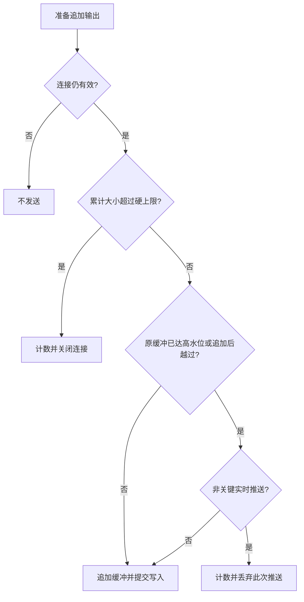
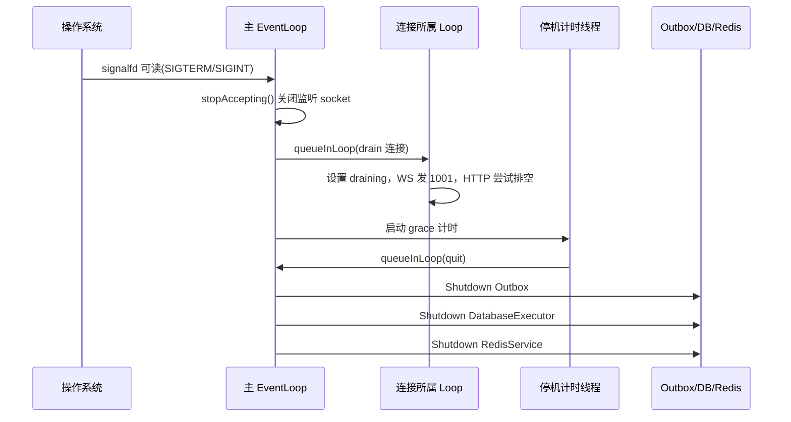

# 07 可靠性、背压与安全边界

> 阅读对象：需要在秋招面试中解释“依赖变慢、用户断线、进程退出、恶意请求到来时，系统如何保持可控”的项目作者。
>
> 依据：2026-09-12 当前工作区源码与现有验收记录。本文解释已经存在的实现，不把待改进项写成已完成功能。

## 1. 这一层解决什么问题

网络层的非阻塞 socket 只解决“内核暂时不能读写时不占住线程”等待的问题。
它本身不能防止数据库调用阻塞、任务积压、慢客户端占满内存，也不能防止一个有效 JWT 越权访问其他房间。
本项目把防线放在入口、协议、业务、依赖和退出过程五个位置。

| 位置 | 组件 | 防护目标 | 失败时的主要行为 |
| --- | --- | --- | --- |
| 公网入口 | Nginx | TLS、Origin、IP 级速率与连接限制 | 拒绝请求或关闭超时连接 |
| 连接与协议 | `HttpData`、解析器、WebSocket codec | 输入大小、输出积压、非法帧、连接生命周期 | HTTP 错误、WebSocket Close、释放连接 |
| 身份与业务 | `Authenticator`、控制器、`ChatService` | 凭证有效性、成员权限、消息频率 | 401、403、429 或协议错误响应 |
| 阻塞依赖 | `DatabaseExecutor`、MySQL 连接池、Redis 工作线程 | 有界排队、连接超时、依赖故障隔离 | 拒绝、超时、降级或 fail-closed |
| 退出过程 | `signalfd`、`BeginGracefulShutdown` | 停止接入、通知长连接、收拢工作线程 | 1001 Close、有期限排空、任务线程 join |

一个正确的概括是：“用分层限额把过载转化为可观测的拒绝和可恢复的断线。”
不应概括成“任意负载下永不丢消息、零阻塞、零停机”。

## 2. 线程归属如何保证背压逻辑成立

### 2.1 连接状态只在所属 EventLoop 中修改

每个 `HttpData` 归属于一个工作 `EventLoop`。
`outBuffer_`、`connectionState_`、`isWriting_`、`requestInFlight_` 等字段不是一个任意线程都可直接修改的共享对象。

跨线程发送有两条明确入口：

1. `sendMsg()` 捕获 `shared_from_this()`，调用所属 Loop 的 `runInLoop()`，再编码 WebSocket 帧并写入输出缓冲。
2. `sendNonCriticalMessage()` 采用相同的 Loop 投递方式，但写缓冲时使用 `nonCritical=true`。

业务线程和 Redis 订阅线程因此只发出“请在连接所属线程执行发送”的任务。
实际追加缓冲、发起写入和关闭连接仍回到连接自己的 Loop。

HTTP 异步响应使用另一种生命周期策略：

1. `HttpData::analysisRequest()` 构造 `ResponseSender`，捕获 `weak_ptr<HttpData>`。
2. 数据库任务调用响应函数时，先把状态码、Content-Type 和正文复制进一个 Loop 任务。
3. Loop 执行时再 `lock()` 弱引用；连接已消失就不再向旧连接写入。
4. 活连接进入 `completeApplicationResponse()`，清除 `requestInFlight_`、发送响应、重置解析状态，继续处理已经收进缓冲的后续请求。

这解释了为什么异步查询完成并不意味着客户端一定收到响应：查询期间客户端可能早已断线。
消息可靠性必须依赖数据库记录、幂等键和恢复协议，不能只依赖一个回调是否被调用。

源码入口：[HttpData.cpp](../../src/httpdata/HttpData.cpp)、[HttpData.h](../../src/httpdata/HttpData.h)。

### 2.2 哪些状态仍然需要锁或原子量

| 状态 | 同步方式 | 原因 |
| --- | --- | --- |
| 输出高水位、硬上限 | `atomic<size_t>` | 启动配置写入，多个连接线程读取 |
| 活连接弱引用登记表 | `mutex` | 工作线程登记与主线程发起全局 drain 交叉 |
| WebSocket Origin 白名单 | `mutex` | 配置与握手检查使用共同容器 |
| 本地限流窗口 | `mutex` | 多个工作线程或数据库任务按相同身份计数 |
| 数据库任务队列 | `mutex + condition_variable` | 多生产者、多个数据库消费者 |
| Redis 命令队列 | `mutex + condition_variable` | 多调用方、独立命令执行线程 |
| 连接/请求计数 | 原子计数器 | 观测数据需要线程安全，但不承担业务事务顺序 |

不要把“一个连接一个线程归属”说成“整个项目无锁”。
项目用线程归属减少连接状态的锁，用互斥锁保护真正跨线程的容器。

## 3. 输入、连接和内存限额

### 3.1 主要默认值

| 项目 | 当前默认值 | 实际含义 |
| --- | ---: | --- |
| `HTTPSERVER_MAX_FDS` | 100000 | 接受连接时要求 fd 数值小于该值，不是精确的活跃连接数配额 |
| 请求行 | 8192 字节 | 阻止无限增长的 URI/请求行 |
| 请求头总量 | 16384 字节 | 限制头部累积内存 |
| 请求头数量 | 100 | 避免大量小 header 的对象开销 |
| HTTP body | 1 MiB | 限制声明体积和实际缓冲输入 |
| WebSocket payload/分片聚合 | 1 MiB | 协议帧层上限，不是业务聊天正文上限 |
| 输出高水位 | 256 KiB | 可以丢弃非关键实时推送的阈值 |
| 输出硬上限 | 1 MiB | 无法容纳新增输出时关闭连接 |
| 静态文件读取上限 | 8 MiB | 静态资源服务的文件大小门槛 |
| io_uring 队列大小 | 4096 | ring 配置，不等同于活跃连接上限 |

聊天正文还有业务层更小的 4096 UTF-8 字节限制，不能把 1 MiB 帧上限宣传成单条聊天消息可以发送 1 MiB。
源码中的字节计数与浏览器字符数也不是同一概念，中文通常占多个 UTF-8 字节。

`Server::handNewConn()` 判断的是 `accept_fd >= maxFds_`。
一个进程还会打开日志、监听 socket、eventfd、数据库和 Redis 连接，因此该配置不等于“支持 10 万用户”，更不是压测结论。
最终还受系统 `RLIMIT_NOFILE`、内存、代理连接额度和业务 CPU 消耗影响。

源码入口：[Server.cpp](../../src/server/Server.cpp)、[ServerConfig.cpp](../../src/config/ServerConfig.cpp)、[StaticFile.cpp](../../src/httpdata/StaticFile.cpp)。

### 3.2 输出背压的精确执行顺序

`appendOutput(output, nonCritical)` 的判断顺序不能讲反：

1. 连接已关闭或断开时，直接返回失败。
2. 检查本次输出本身是否超过硬上限，或现有缓冲加本次输出是否越界。
3. 超过硬上限时，增加 `slow_consumer_closed_total`，清空输出并 `handleClose()`。
4. 未超过硬上限，且 `current >= highWater || current + output.size() > highWater` 时，增加 `output_buffer_high_water_total`。
5. 此时只有 `nonCritical=true` 才增加丢弃计数并拒绝追加；关键输出仍尝试入队。
6. 通过检查后追加到 `ChainBuffer`，由非阻塞写路径逐步排空。



HTTP 响应、握手、直接 ACK/错误响应和控制帧使用关键路径。
`ConnectionSession::sendMessage()` 最终进入非关键路径，用于房间实时投递。
这里的“非关键”指该推送副本可以通过历史恢复补回，不表示消息本身不重要或不需要持久化。

等号边界需要单独记住：原缓冲低于高水位、本次追加后恰好等于高水位时，不进入第 4 步，因此不会仅因这一次恰好相等而丢弃。
下一次追加时，如果原缓冲仍等于高水位，则会触发检查。

### 3.3 丢推送与消息可靠性怎样衔接

数据库是消息事实来源；WebSocket 广播只是更低延迟的分发渠道。
因此接收端缓冲过高时可以放弃某次广播，避免一个慢接收者持续拖累服务内存。
如果硬上限导致连接关闭，客户端重连、重新订阅、按服务端消息 ID 补拉，可以找回数据库中的历史消息。

但要注意一个实际边界：**高水位丢弃本身不会立即强制客户端重连**。
如果连接继续存活，前端没有收到此次广播，也没有立即启动缺口扫描，该消息可能要到后续重连/历史补拉时才出现。
因此当前保证不是“所有在线接收者立即收到每条广播”，而是“持久消息可恢复，实时推送允许降级”。

另外，硬上限检查发生在高水位判断之前。
即使是可丢弃广播，只要追加后的总量超过硬上限，当前实现也是关闭连接，不是仅丢弃。

### 3.4 静态资源与输出限额的交叉限制

静态文件服务允许读取至 8 MiB，但 `HttpData` 默认输出硬上限只有 1 MiB。
当前实现把文件正文读入内存并构造输出，不是 sendfile 或按固定小块持续流送。
因而一个小于 8 MiB、但包含响应头后超过 1 MiB 的 GET 响应，也可能在 `appendOutput()` 被关闭。

这不是“真正测到慢客户端才关闭”：指标名称虽然是慢消费者关闭，但一次性大响应也能触发。
解释性能和故障图时，必须结合请求路径分析。
后续若要支持大文件，应统一静态文件上限与输出策略，并实现分块流送；只放大硬上限会按连接数放大内存风险。

## 4. 数据库与 Redis 的有界排队

### 4.1 数据库任务队列

`DatabaseExecutor` 默认 2 个工作线程、256 个等待任务、默认排队期限 3 秒。
配置必须在首次 `Submit()` 触发线程池延迟创建之前完成。

入队过程：

1. 调用方提供任务与可选 `onExpired`。
2. 获取队列锁；如果正在停机或等待队列已满，立即拒绝，增加 `rejected`。
3. 保存 `steady_clock::now() + queueDeadline`，唤醒一个工作线程。
4. 工作线程取出任务时检查期限；过期则增加 `expired` 并执行过期回调，不再执行正文。
5. 正常任务在锁外执行，执行前后维护 `running`，异常不会杀死工作线程。

排队期限不是 SQL 执行期限，也不是端到端请求总期限。
一个任务等待了 2 秒后开始执行，还可能继续等待 Redis、获取数据库连接和执行多条 SQL。
MySQL 默认操作超时 3 秒是另一层约束，不能直接宣布“所有请求 3 秒内返回”。

用户控制器、房间控制器和聊天应用把队列拒绝/过期转换成 503 或稳定的 WebSocket 业务错误。
异常兜底只负责保住工作线程，不能替代控制器为每条失败路径发送正确响应。

`ExecutorState::shutdown()` 将当前实例的 `stopping_` 置为 true，使该实例拒绝入队，并等待已有任务执行或按排队期限走过期回调。
但全局 `DatabaseExecutor::Shutdown()` 删除实例后会把 `state()` 清空，后续 `Submit()` 仍可能走延迟创建分支，再建一个执行器。
当前没有一个永久关闭、阻止所有迟到提交的全局状态；安全收尾仍要求提交方按顺序停止，不能把当前实例的停收解释成整个进程永久禁止提交。

源码入口：[DatabaseExecutor.cpp](../../src/application/DatabaseExecutor.cpp)、[UserController.cpp](../../src/chat/UserController.cpp)。

### 4.2 Redis 不是“调用后一定立刻返回”

Redis 有独立的命令工作线程和订阅线程；命令等待队列默认 256，连接与命令超时默认各 500 ms。
命令排队和 socket 操作被集中管理，`Submit()` 类型的操作只负责入队。
但 `Execute()` 类型的调用会等待任务条件变量完成，最长等待配置的命令超时。

例如查 denylist、同步限流、PUBLISH 都属于需要结果的路径。
注册/登录限流在数据库工作线程中进行，避免把 scrypt 和这一段依赖访问放在 Loop 中。
然而受保护 HTTP 路由的 `Authenticator::VerifyClaims()` 与 WebSocket 握手直接从 I/O 处理路径调用，denylist 检查仍可能同步等待 Redis。

所以当前正确说法是“主要数据库业务已异步卸载，并为 Redis 访问设置有界等待”，不是“所有 I/O Loop 从不等待外部依赖”。
这个边界也是后续值得优化的方向：鉴权状态机需要异步化，并保持连接弱引用和请求顺序保护。

源码入口：[RedisClient.cpp](../../src/redis/RedisClient.cpp)、[Authentication.cpp](../../src/application/Authentication.cpp)。

### 4.3 故障策略不是一刀切

| 故障点 | 当前处理 | 需要理解的取舍 |
| --- | --- | --- |
| Redis 限流不可用 | 回退本进程限流窗口 | 保留可用性，但失去跨实例共享额度 |
| Redis 缓存不可用 | 使用持久仓库路径 | MySQL 仍是事实来源，缓存失败不能伪造数据 |
| 已配置 Redis 的 denylist 查询失败 | 拒绝认证 | 不能因依赖故障恢复已经撤销的凭证 |
| Redis 发布失败 | Outbox 保留并退避重试 | 数据已持久化不等于实时广播已经成功 |
| 数据库任务排队满/过期 | 明确失败响应 | 不无限积压，不返回伪成功 ACK |
| MySQL 写入失败 | 事务失败，不确认新消息成功 | 客户端通过原幂等键重试 |
| 输出高水位 | 部分实时广播丢弃 | 牺牲即时性保护实例内存 |
| 输出硬上限 | 关闭连接 | 让恢复协议承担重新同步 |

这里的 fail-closed 是特定安全路径选择，不意味着 Redis 一断所有功能立即同一种状态码失败。
认证层当前把依赖不可用与凭证无效统一为无身份结果，路由可能返回 401；不能把所有 Redis 故障都描述成 503。

## 5. 超时、心跳与优雅停机

### 5.1 超时的实际来源

`HttpData` 普通过期时间常量为 2000 ms，Keep-Alive 常量为 5 分钟。
`handleConn()` 根据连接状态和事件集合选择超时，最多每秒刷新一次，避免每个事件都产生新定时器节点。
定时器失效通过回调进入 `handleClose()`，节点使用优先队列管理和惰性删除。

但“过期时间是 2000 ms”不代表连接会在第 2 秒准时关闭。
`EventLoop::loop()` 先处理 Poller 事件，再执行 pending functors，最后才调用 `handleExpired()`。
epoll 的等待超时固定为 10000 ms，没有按定时器堆顶到期时间缩短；空闲状态下可能等到更晚一轮才检查。
io_uring 使用 `io_uring_submit_and_wait(..., 1)`，当前未把最近定时器到期时间接入等待超时；没有 I/O 完成或其他唤醒时，检查也可能延后。
事件处理或回调本身过长还会进一步推迟回收。当前实现提供过期判断，尚不是精确 deadline 调度器。

存在三个不能混淆的事实：

1. `/ping` 的固定响应头写着 `Keep-Alive: timeout=20`，并不等于内部 5 分钟常量；这是当前待统一项。
2. Nginx 还有自己的 HTTP 头/body 10 秒、普通代理读写 15 秒、WSS 读 65 秒等超时。
3. `Timer.cpp` 仍基于 `gettimeofday()` 和 `tv_sec % 10000` 计算到期值，不是稳态时钟；校时和 10000 秒回绕需要专项修正验证。

最后一点尤其说明：短时连接生命周期测试通过，不能代替 24 小时长稳和时钟边界证明。

源码入口：[Timer.cpp](../../src/timer/Timer.cpp)、[EventLoop.cpp](../../src/eventloop/EventLoop.cpp)、[Epoll.cpp](../../src/epoll/Epoll.cpp)、[IoUring.cpp](../../src/IoUring.cpp)、[Nginx 模板](../../deploy/nginx/httpserver.conf.template)。

### 5.2 WebSocket Ping/Pong 与 Redis presence

服务端收到 WebSocket Ping（opcode `0x9`）会回送相同 payload 的 Pong（`0xA`）；收到 Pong 则继续解析。
收到 Close 会回应关闭帧；协议错误、非法分片或过大聚合体产生对应 Close。

但当前浏览器脚本没有周期性业务 heartbeat，服务端也没有主动发送 Ping 并追踪 Pong 截止时间的完整机制。
浏览器 WebSocket API 本身也不能直接发送协议级 Ping 帧。
因此“已验证 ping/pong”不等于“已经实现主动心跳与半开连接检测”。

Redis presence 则是另一条链路：握手后登记用户/实例，Redis 工作线程刷新 30 秒 TTL，断开后尝试取消登记。
它表示进程维护的在线近似状态，不能证明某个浏览器最近 30 秒真实收到了消息。
经 Nginx 的长时间静默连接可能因 65 秒 read timeout 关闭，前端重连与补拉是现有恢复手段。

### 5.3 真实停机时序



启动时先 `pthread_sigmask()` 阻塞 SIGINT/SIGTERM，新线程继承信号屏蔽。
主 Loop 注册非阻塞 `signalfd` 的 Channel，从正常事件回调处理停机，而不是在异步信号处理函数里加锁、分配内存或直接 join。

第一次收到信号后：

1. `Server::stopAccepting()` 从 Poller 移除监听 Channel、停用它并关闭监听 fd。
2. `BeginGracefulShutdown()` 在登记表锁内收集活连接的强引用，同时清理过期弱引用。
3. 释放全局锁后，向每个连接所属 Loop 排队 drain 任务。
4. WebSocket 发送状态码 1001、原因 `server shutdown`；HTTP 设置写完关闭，缓冲为空时直接关闭。
5. 默认等待 5 秒后，通过主 Loop 队列执行 `quit()`。
6. 退出主循环后按 Outbox、数据库任务执行器、Redis 顺序停止后台服务。

重复信号被 `shuttingDown` 忽略，不会反复创建计时线程。
数据库执行器的当前实例进入 shutdown 后不接收新任务，但会取完队列，过期任务走过期回调，正在执行的任务执行完再退出。
全局实例清空后的迟到 `Submit()` 仍可能重建线程池，因此还需要上游停止提交与工作线程生命周期的配合，不能仅凭调用了 `Shutdown()` 就认定所有后台任务入口永久关闭。

### 5.4 停机保证的边界

5 秒是主 Loop 的 grace 窗口，不是进程退出硬上限；后续数据库/Redis 线程 join 可能继续耗时。
HTTP 连接若正在等待应用响应但输出缓冲为空，drain 路径可能提前关闭，所以不能承诺所有在途 HTTP 请求完成。
`OperationalStatus` 当前没有显式 draining 标记；停机的主要入口摘流方式是停止接收连接，不是先把 `/readyz` 固定切成 503 再延迟摘流。

WebSocket 1001 只是通知客户端重新连接，不是把已有 TCP 连接迁移到另一实例。
重连后状态重建仍需要 JWT 验证、重新订阅、历史恢复和幂等重试。

源码入口：[Main.cpp](../../src/Main.cpp)、[GracefulDrainTest.py](../../tests/resilience/GracefulDrainTest.py)。

## 6. 安全链路的实现与调用关系

### 6.1 密码不是普通 hash

注册控制器先校验 JSON 类型、用户名字符与长度、密码长度。
用户名为 3-64 字节的字母数字、下划线或连字符；密码后端按字符串字节长度约束为 8-128。
真正的密码派生在数据库工作线程执行，使用 OpenSSL scrypt：`N=32768, r=8, p=1`、16 字节随机盐、32 字节派生值、最大内存 64 MiB。

数据库只保存编码后的密码派生记录，不保存明文密码。
登录时读取派生参数和盐，重新计算，用 `CRYPTO_memcmp()` 做常量时间比较。
MySQL 用户增查使用 prepared statement 绑定参数；SQL 注入防线不是手工给用户名加引号。

源码入口：[CryptoUtil.cpp](../../src/util/CryptoUtil.cpp)、[UserRepository.cpp](../../src/sql/UserRepository.cpp)。

### 6.2 JWT 身份、房间成员授权和订阅是三件事

JWT 默认 issuer 为 `httpServer`，有效期 3600 秒，secret 至少 32 字节。
校验覆盖签名、声明类型、issuer、时间关系、用户名与 jti 等约束；时间检查允许 iat 最多在未来 60 秒，拒绝过期和 `exp <= iat`。

随后仍须检查当前用户是否可以读取房间历史、读取成员、订阅房间或发送消息。
“握手成功”只建立连接身份，不意味着可以向任意房间发消息。
同理，“已经是数据库成员”不自动等于“该连接已经订阅房间”；持久成员关系与当前进程订阅关系分属不同生命周期。

用户 ID 来自认证结果，不能信任消息 payload 中客户端自称的发送者。
具体领域授权和持久化流程见本目录的聊天业务、MySQL 与 Redis/Outbox 章节。

### 6.3 浏览器凭证怎样进入 WebSocket

浏览器不能为原生 WebSocket 构造器任意设置 Authorization 头。
项目使用 `Sec-WebSocket-Protocol` 携带 `httpserver.v1` 和 `bearer.<JWT>`。
服务端提取 bearer 子协议作为认证输入，但响应只选择 `httpserver.v1`，不回显 token。

Nginx `/ws` 同时检查配置的 HTTPS Origin，并拒绝 query 中的 `token`，避免凭证出现在 URL、历史记录和默认代理访问日志。
服务端也做 Origin 精确匹配：配置非空白名单后，缺失或不匹配的 Origin 返回 403。

需要明确：独立二进制在 Origin 白名单为空时允许开发请求；生产 Compose 通过必填环境变量提供白名单。
不能只脱离生产配置说“程序永远拒绝无 Origin 请求”。

内部兼容路径仍保留 query token，且 `Authenticator::ExtractToken()` 实际先取 query，再取 Authorization。
不要依据握手附近“Authorization is preferred”的旧注释讲优先级。
公网代理当前显式屏蔽的是 `/ws` query token；其他认证路径的内部兼容性仍需谨慎管理。

### 6.4 登出和 fail-closed

`POST /logout` 先验证当前 token，然后把 `jti` 写入 Redis denylist，TTL 为剩余 token 有效期，上限 86400 秒。
写入成功返回 204；Redis 未启用、撤销失败或队列失败返回 503，不假装服务端已撤销。

以后鉴权查询 denylist：

1. key 存在：token 已撤销，拒绝。
2. 已配置 Redis 但查询不可用：拒绝，即 fail-closed。
3. 未启用 Redis：仍允许开发模式 JWT 校验，但不能提供分布式登出撤销保证。

前端登出会先关闭自己的 WebSocket，并最终清除本地会话。
当前没有把一个 jti 的撤销广播为所有已建立 WebSocket 的强制踢下线，也没有每帧重新验 JWT；不要将撤销能力说成全设备瞬时强制离线。

### 6.5 三层限流，各有不同语义

| 层 | 当前规则 | 计数范围 |
| --- | --- | --- |
| Nginx 登录/注册 | `10r/m`，burst 10 | 真实入口 IP |
| Nginx 普通请求 | `60r/m`，burst 60 | 真实入口 IP |
| Nginx WS 握手 | `60r/m`，burst 20 | 入口 IP 的握手，不检查连接内每条消息 |
| Nginx 连接 | 每 IP 32 | 代理连接限制，不是注册用户配额 |
| 应用认证 | 默认每用户名 10 次/60 秒；每 IP 1000 次/60 秒 | Redis 共享，失败回退本地 |
| 应用 WS 握手 | 每用户 120 次/分钟，每对端 IP 2000 次/分钟 | 本地滑动窗口 |
| 应用聊天 | 默认 1000 条/60 秒 | 业务层按消息限流配置控制 |

应用的远端地址来自 `getpeername()`，没有无条件信任 `X-Real-IP`。
经过反向代理时它看到的可能是 Nginx 地址，因此公网客户端精细 IP 限流主要靠 Nginx，后端大 IP 额度避免把代理整体过早限死。

Redis 计数通过 Lua 原子执行 `INCR` 与首次 `PEXPIRE`，是固定时间窗口。
本地 fallback 用 `deque<steady_clock::time_point>` 清除过期时间戳，是滑动窗口；两者不是完全相同的算法。
本地状态 map 当前没有全局身份 key 回收，随机身份洪泛仍需依靠入口限制并作为后续内存治理项。
Redis 固定窗口 key 使用本机 `steady_clock` 的时间段，在同机双实例可一致，但跨不同启动时间的主机不能直接假定共享同一个时间窗口，需专项修正后再宣称跨主机严格限流。

## 7. 静态资源与容器边界

静态文件服务先拒绝 `..` 路径段、反斜杠和 NUL，再做 `filesystem::canonical()` 并逐路径段确认结果位于文档根目录内。
这能阻止普通路径穿越和指向根目录外的符号链接。
仍然存在检查路径后再打开文件的时序边界；生产镜像只读根文件系统有助于减少运行时替换资源路径的机会，不能称为 openat 风格的原子路径沙箱。

Nginx 开启 TLS 1.2/1.3、`nosniff`、`X-Frame-Options: DENY`、不发送 Referer 的策略和同源 CSP。
浏览器脚本、样式、SVG、字体均本地分发；将 JS 从 HTML 内联脚本提取出去是为了保持 CSP，而不是加 `unsafe-inline` 放宽保护。

应用镜像使用非 root 用户；生产服务设置只读根、`/tmp` tmpfs、丢弃全部 capability、no-new-privileges、PID/CPU/内存上限。
这些限制主要应用于 WebServer 容器，不意味着 MySQL、Redis、Nginx 每项都完全相同。
MySQL/Redis 不映射公网端口，但共享一台主机和 Docker 网络，不是跨故障域高可用数据库集群。

配置文件是项目实现的有限 TOML 风格读取器，不是完整 TOML 标准解析库；加载文件后由非空环境变量覆盖，错误值阻止启动。
secret、生产 `.env` 与备份不能进入 Git，业务日志也不应记录密码、JWT 或聊天正文。

## 8. 如何用测试证明，而不是口头保证

| 测试入口 | 证明什么 | 不能据此证明什么 |
| --- | --- | --- |
| `application.database_executor` | 队列、并发、拒绝与到期行为 | 任意 SQL 都在 3 秒内结束 |
| `application.authentication_rate_limiter` | 本地窗口与并发计数 | 不同主机固定窗口一致性 |
| `resilience.slow_consumer` | 64 KiB 硬上限下，大响应被关闭且 `/ping` 仍可用 | 完整真实 WS 慢读广播容量 |
| `resilience.graceful_drain` | SIGTERM 后 WS 1001、监听停止、按窗口退出 | 所有在途业务请求都得到响应 |
| `integration.graceful_shutdown` | 正常退出流程 | SIGKILL 下缓冲日志不会丢 |
| `security.websocket_origin` | Origin/浏览器握手边界 | 所有代理配置均无误 |
| `security.authorization_matrix` | HTTP/WS 房间访问矩阵 | 完整第三方安全审计 |
| `security.token_revocation` | Redis denylist 撤销与故障拒绝 | 已连接所有设备立刻被踢下线 |

在已有构建与隔离依赖准备好后，可运行：

```bash
ctest --test-dir build/debug -R 'resilience\.|integration.graceful_shutdown|application.database_executor' --output-on-failure
ctest --test-dir build/debug -L security --output-on-failure -j 1
bash tests/resilience/run_fault_matrix.sh build/debug
```

`run_fault_matrix.sh` 默认只执行生命周期测试；要真的注入 MySQL 延迟，必须启动专用 chaos Compose 并显式配置 `HTTPSERVER_RUN_TOXIPROXY=1`。
当前 `DependencyLatencyTest.py` 注入 MySQL downstream 2000 ms 延迟，要求注册返回 503、4 秒内结束，同时 `/ping` 最大延迟低于 500 ms。
Redis 断开、认证失败和恢复由另外的 integration 测试覆盖，不能只看到脚本名就宣称所有故障矩阵自动执行。

验收证据见 [验收状态](../Productionization_Roadmap/Acceptance_Status.md) 与 [2026-09-12 复验记录](../Productionization_Roadmap/Acceptance_2026-09-12.md)。
本文编写期间只检查源码和既有证据，没有重新执行上述测试。

## 9. 面试追问与回答重点

### 为什么不无限扩大缓冲，保证实时消息不丢？

因为接收速度低于发送速度时，缓冲增长没有终点。用持久化和恢复协议承担完整性，比让一个慢连接耗尽整个实例内存更可控。当前实时推送可丢，持久化记录不可伪成功。

### 有线程池为什么还要超时和队列长度？

线程池只限制同时执行数，不限制等待数。队列长度限制积压内存，排队期限避免执行已失去时效的任务，数据库操作超时限制阻塞依赖，各层解决不同问题。

### 为什么 Redis 有些地方降级，有些地方不降级？

限流和缓存可以牺牲精度或速度换可用性；denylist 不允许因依赖故障重新接纳已撤销凭证，所以失败时拒绝认证。选择依据是该状态是否承担安全承诺。

### 主从 Reactor 的项目是不是就不能阻塞？

应该避免，但需要逐调用链检查。当前多数数据库与密码运算卸载到工作线程；denylist 鉴权仍存在同步等待边界，这是下一阶段需要异步化的具体路径。

### 优雅关闭是否保证零丢失、零停机？

不保证。它停止接入、通知可写 WS 并在 grace 内尝试排空；数据库已提交的数据可依靠恢复协议继续获得，而未收到 ACK 的发送要按原幂等键重试。当前同批双实例部署也不是严格零停机发布。

### 你会先补哪些可靠性问题？

优先把定时器切换为稳态时钟并补长时间边界测试，再处理主动 heartbeat、鉴权异步化和高水位丢弃后的及时缺口恢复。跨主机限流时钟、静态文件流送和限流 key 回收也需要独立测试，而不能只通过改配置宣布解决。
