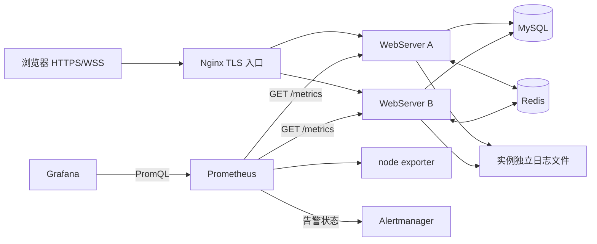
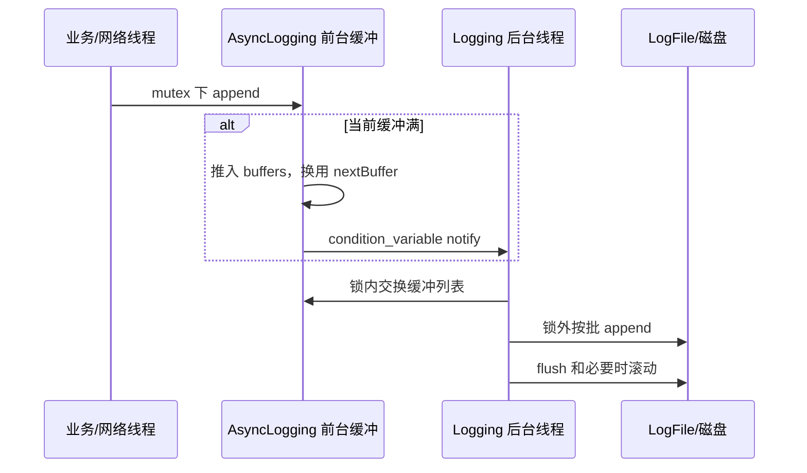

# 08 可观测性、部署交付与测试证据

> 本章回答三个面试问题：系统出问题时怎样看见、怎样定位；版本怎样安全交付；你用什么证据证明功能与性能。
>
> 依据为 2026-09-12 当前工作区源码和既有验收文档。已实现配置、已执行本地验收、尚未完成公网/长稳验收，三者严格区分。

## 1. 运行态的整体通信图

图中监控数据流是 Prometheus 主动拉取，不是每个请求主动向 Prometheus 推送。
Grafana 查询 Prometheus，业务进程不依赖 Grafana 是否在线才能处理消息。
日志目前写到共享日志卷中的实例独立文件，没有默认接入 Loki、Elasticsearch 或分布式追踪平台。

两个应用实例共享 MySQL 和 Redis，可以验证跨实例广播和实例重启恢复。
生产 Compose 仍是单主机拓扑，MySQL/Redis 也是单节点，不能因此声称已经实现跨机房高可用。

主要配置：[生产 Compose](../../docker-compose.production.yml)、[Prometheus](../../deploy/prometheus/prometheus.yml)、[Grafana dashboard](../../deploy/grafana/dashboards/httpserver.json)。

## 2. 健康检查、就绪检查与业务探针

### 2.1 三个端点不能互相替代

| 端点 | 主要实现 | 适合回答的问题 | 不能保证的事情 |
| --- | --- | --- | --- |
| `/ping` | GET 固定响应热路径 | 进程能否接入并处理简单 HTTP | JWT、SQL、Redis、聊天是否可用 |
| `/healthz` | 路由返回 200 和 `ok` | 进程 HTTP 服务是否还活着 | 数据库写入是否成功 |
| `/readyz` | JWT、用户仓库、聊天仓库、DB schema 健康快照 | 应用是否基本具备对外提供服务的条件 | 每条 Redis 命令与每条真实业务都可成功 |
| `/metrics` | 聚合原子计数与各组件统计 | 当前负载/错误/积压的趋势 | 单次业务流程是否成功 |

`/ping` GET 在 `HttpData` 中走固定响应分支，避免一般路由对象和异步回调开销。
它适合网络路径基线，不能用 `/ping` 的 QPS 代替注册、历史查询或持久化聊天吞吐。

[Dockerfile.deploy](../../Dockerfile.deploy) 内默认 HEALTHCHECK 请求 `/healthz`。
生产 Compose 为 A/B 覆盖成 `/readyz`，每 10 秒一次、超时 3 秒、重试 6 次、启动缓冲 10 秒。
这是镜像默认与生产编排覆盖的区别，面试中应说明使用哪份配置。

### 2.2 `/readyz` 的后台探测与健康快照

`OperationalStatus` 保存三个原子状态：是否启用 DB、最近一次 DB 健康结果、当前是否已有探测在途。
首次配置时同步确定 schema 是否已到要求版本。
后续请求 `ready()` 时：

1. CAS 抢占 `probeInFlight`，防止并发 ready 请求提交重复探测。
2. 向 `DatabaseExecutor` 提交 `MySqlChatSchemaCurrent()`，检查数据库可达性和 schema 条件。
3. 返回时不等待这次 SQL；使用最近一次 `databaseHealthy` 值。
4. 探测完成后写回结果并清除 in-flight。
5. 如果队列提交失败，立即将健康值设为 false 并清除 in-flight。

这样健康请求不等待本轮后台探测的 SQL，但代价是状态存在更新滞后。
例如数据库刚断开时，第一次 ready 可能仍返回上一轮健康结果；这不是严格实时的一次完整依赖事务。
当前 ready 也未明确纳入 Redis 存活、Outbox 积压或 draining 状态。

“不等待本轮探测”不等于整个 `/readyz` 不会阻塞。
`ready()` 仍同步调用 `ChatService::persistenceAvailable()` 获取服务粗粒度 mutex；其他线程可能正持有同一把锁执行仓储 SQL，健康请求就会等待该锁释放。
因此当前不能保证 ready 延迟独立于业务数据库耗时，也不能把这条路由描述成完全不等待依赖的轻量热路径。

还有一个当前实现边界：探测使用默认 `Submit()`，没有提供 `onExpired`。
若探测已成功入队却等待超过 3 秒，被执行器作为过期任务丢弃，探测正文不会运行，`probeInFlight` 也不会在该路径清除。
此时可能持续使用旧快照并不再提交新探测；这是排队过载时需要补回归的具体问题，不能写成已完备的健康状态机。

`HttpServerUnavailable` 告警使用 Prometheus `up`，而不是 `/readyz`，所以“抓指标成功”和“业务已经 ready”还要分别观察。
业务级探针应登录、建房、订阅、发送并验证 ACK/广播，不能仅调用 ready。

源码：[OperationalStatus.cpp](../../src/application/OperationalStatus.cpp)、[ApplicationRouter.cpp](../../src/application/ApplicationRouter.cpp)。

## 3. Metrics 模块的内部结构

### 3.1 指标怎样从业务线程进入 `/metrics`

`Metrics.cpp` 用静态原子计数和固定维度数组保存热路径统计。
连接线程、应用工作线程、广播线程更新计数；读取时取快照并序列化为 Prometheus 文本格式。
多数加减使用 `memory_order_relaxed`，因为计数只用于观测，不负责发布业务对象或保证事务一致性。

`OperationalStatus::prometheusMetrics()` 进一步合并：

- `ChatService` 缓存房间数。
- MySQL 连接池空闲数与使用数。
- 数据库执行器排队、运行、拒绝、过期计数。
- Redis 队列、错误、拒绝、缓存命中/未命中。
- Outbox 领取、发布成功、失败、待发布量和最老年龄。

`/metrics` 是多组件的近似同时快照，不是用一个大锁拍下所有线程的严格一致视图。
监控允许短时读数交错，业务唯一性仍必须由数据库事务保证。

不过读取快照也不等于没有等待：`CachedRoomCount()` 仍获取 `ChatService` 的同一把粗锁。
若业务持锁进行仓储 SQL，`/metrics` 在读取房间数时也可能被间接阻塞；执行器与 Redis 的统计函数另有各自的同步开销。
原子计数降低了热路径竞争，但当前监控端点还没有与慢业务彻底隔离。

### 3.2 主要指标与解释

| 指标 | 类型/来源 | 正确解释 |
| --- | --- | --- |
| `httpserver_connections_active` | gauge，连接开关事件 | 当前进程登记的活 TCP 连接 |
| `httpserver_connections_total` | counter | 进程启动以来接受的连接数 |
| `httpserver_http_requests_total` | counter | 按 method/route/status_class 记录的完成响应 |
| `httpserver_http_request_duration_seconds` | histogram | 服务端请求分析到生成响应的耗时 |
| `httpserver_websocket_connections` | gauge | 已升级 WebSocket 的连接数 |
| `httpserver_websocket_messages_total` | counter | 按 subscribe/message/invalid 与 accepted/rejected 分类 |
| `httpserver_websocket_broadcast_duration_seconds` | histogram | 当前进程组织推送并调用发送入口的耗时 |
| `httpserver_output_messages_dropped_total` | counter | 因高水位放弃的非关键实时输出 |
| `httpserver_slow_consumer_closed_total` | counter | 超过输出硬上限导致的关闭，大静态响应也可能触发 |
| `httpserver_database_executor_queue_depth` | gauge | 正等待数据库任务线程的队列长度 |
| `httpserver_database_executor_expired_total` | counter | 取出时已过排队期限的任务 |
| `httpserver_redis_errors_total` | counter | Redis 命令/连接错误趋势 |
| `httpserver_outbox_pending` | gauge | 当前待发布统计快照 |
| `httpserver_outbox_oldest_age_seconds` | gauge | 最老待发布事件年龄，适合发现长期积压 |

`httpserver_rooms_active` 传入的是 `CachedRoomCount()`，不一定是 MySQL 中总房间数，也不是当前有消息流动的房间数量。
将它用作业务总量统计需要更改语义，不能只改 dashboard 标题。

### 3.3 请求耗时从哪里开始，到哪里结束

HTTP 的 `requestStartedAt_` 在 `analysisRequest()` 中设置，不包含连接建立及完整请求到达前的所有等待。
`recordHttpResponse()` 在构造/安排响应时记录，不等待内核把最后一个字节真正发给客户端。
因此它主要反映应用处理路径耗时，而不是浏览器观察到的端到端延迟。

广播 histogram 在遍历目标 `ConnectionSession::sendMessage()` 前后计时。
跨线程时发送只是投递到目标 Loop；它不等待所有客户端读完，更不代表数据库提交到远端浏览器渲染的总时长。
需要用户端延迟时，应看压测器实际收到 ACK/广播的计时，不能把微秒级本地入队耗时作为端到端成绩。

### 3.4 固定标签为什么重要

HTTP method 只有 5 类：`GET`、`POST`、`DELETE`、`HEAD`、`OTHER`。
route 只有 10 类，包括 `/ping`、`/healthz`、`/readyz`、`/metrics`、`/register`、`/login`、`/ws`、房间集合、`/api/v1/rooms/:id` 和 `other`。
status_class 只有 `1xx` 至 `5xx`。

动态房间 ID 不进入 route 标签，用户名、消息 ID、request ID、token 也不作为标签。
HTTP 完成计数的标签组合上界因此是 `5 × 10 × 5 = 250`，而不是随着用户数和消息数无限增大。
同一实例最多 50 组 method/route duration histogram，每组 8 个有限桶、`+Inf`、sum、count。

桶边界为 1、5、10、25、50、100、500、1000 ms。
一个 7 ms 样本会增加所有不小于 10 ms 的累计桶；sum 内部累加微秒，输出时换算秒。
这是 Prometheus 累计 histogram，不是把每条请求耗时存在 vector 里再排序。

实现会省略部分值为零的 HTTP 样本序列，尤其有限桶；查询初期/低流量时需留意缺失序列语义。
WebSocket 广播桶则始终输出。
这是值得进一步与标准 exposition 及低流量 PromQL 行为对齐的细节，不能假设所有标签序列启动后立即齐全。

源码：[Metrics.cpp](../../src/application/Metrics.cpp)、[MetricsTest.cpp](../../tests/application/MetricsTest.cpp)。

## 4. 日志怎样关联一次业务请求

### 4.1 结构化字段

`LogStructuredEvent()` 用 nlohmann JSON 生成以下字段：

| 字段 | 作用 | 边界 |
| --- | --- | --- |
| `timestamp_ms` | Unix 毫秒时间 | 用系统时钟，跨机比较依赖校时 |
| `level` | 当前固定 `info` | 不是完整动态日志等级系统 |
| `instance_id` | 区分 A/B | 来自环境变量，未配时为 `local` |
| `request_id` | 跟踪 HTTP/WS 请求 | 广播阶段当前使用 clientMessageId，语义需结合 operation |
| `connection_id` | 定位进程内连接 | 跨重连会变化 |
| `event_id` | 定位 Outbox 事件 | 连接重启后仍可由持久记录关联 |
| `message_id` | 定位数据库消息 | 历史与 ACK/推送共同使用 |
| `operation` | `http.request`、`websocket.message`、`websocket.broadcast`、`outbox.publish` 等 | 说明事件发生在什么阶段 |
| `duration_ms` | 当前阶段耗时 | 某些事件填 0，并非所有都测量了业务耗时 |
| `error_code` | 稳定失败分类 | 不包含原始请求正文/凭证 |

HTTP 可接受不超过 64 字符、仅字母数字/下划线/连字符的 `X-Request-ID`；不合法则生成 `http-<session>-<sequence>`。
Nginx 设置自己的 `$request_id`，帮助从入口关联应用日志。
这不是完整 W3C traceparent/OpenTelemetry 分布式追踪：没有标准 span 父子关系与自动上下文传播。

### 4.2 一条消息的日志关联步骤

1. 从发送端保存的 clientMessageId 或 ACK 的 messageId 开始搜索。
2. `websocket.message` 表示该发送请求已经得到应用处理，并记录 messageId。
3. 数据库 Outbox 把 messageId 与 eventId 关联。
4. `outbox.publish` 反映该事件发布结果。
5. 在 A/B 日志中找到相同 eventId/messageId 的 `websocket.broadcast`，证明各实例处理了该事件。
6. 客户端没有出现消息时，再看该实例慢消费者关闭/丢推送计数及客户端重连恢复状态。

这里“广播日志存在”仍不等于客户端已读取消息，只表示服务器进入投递步骤。
也不要要求所有阶段的 `request_id` 完全相同：当前广播日志填的是 message.clientMessageId，而 HTTP 与 WS envelope 有自己的 requestId。

源码：[StructuredLog.cpp](../../src/application/StructuredLog.cpp)、[ChatApplication.cpp](../../src/application/ChatApplication.cpp)、[ChatService.cpp](../../src/application/ChatService.cpp)、[OutboxPublisher.cpp](../../src/application/OutboxPublisher.cpp)。

### 4.3 异步日志的真实实现

`Logger` 析构时提交一条日志，首次使用由 `pthread_once()` 启动后台线程。
单条日志使用 `LogStream` 的 4000 字节小缓冲；异步批量缓冲为 `4000 × 1000` 字节，约 4 MB，而不是 4 MiB。
前台默认持有 current/next 两块，后台也准备两块供交换复用。
前台只在短锁内复制和切换，磁盘追加在后台执行。

默认每 2 秒唤醒/flush，缓冲写满也会通知后台。
后台若发现一个批次超过 25 块，会记录丢弃提示并只保留前两块写出，防止磁盘落后时把日志积压无限扩展。
因此异步日志有背压丢弃策略，不具备消息持久化同等级别的可靠性保证。

`LogFile` 默认文件达到 100 MiB 后滚动，保留 7 个归档；重名归档附加序号，每 1024 次 append 也执行 flush。
应用实例分别写 `webserver-a.log`、`webserver-b.log`，避免把两进程输出主动拼到同一活动文件。

### 4.4 当前日志不能直接当 JSONL

`StructuredLog` 最后仍经过传统 `LOG` 宏。
`Logger` 在 JSON 前加入时间字符串，时间格式本身带换行，又在末尾附加源码位置。
因此磁盘上的整个物理行不是纯 JSON 文档，直接逐行 `jq` 会失败；采集器需要提取 JSON 部分，或后续改为单行 JSON sink。

`AsyncLogger_` 为首次使用后分配的全局指针，`Main` 没有明确调用其 stop/flush 并 join。
进程退出、SIGKILL、崩溃、过载批量丢弃都可能丢失最后一段日志；`flush()` 也不等同于对持久介质完成 fsync。
不要在简历中写“日志零丢失”或“严格审计日志”。
日志时间格式当前调用 `localtime()`，并发格式化与退出收尾仍值得专项治理。

源码：[Logging.cpp](../../src/base/Logging.cpp)、[AsyncLogging.cpp](../../src/base/AsyncLogging.cpp)、[LogFile.cpp](../../src/base/LogFile.cpp)。

## 5. Prometheus、Grafana 与告警

### 5.1 抓取和查询路径

生产配置每 15 秒抓取 A/B 的 `/metrics` 和 node-exporter，每 15 秒评估规则。
Prometheus 数据保留 15 天并挂载独立卷；Grafana 预置 Prometheus datasource 和四组概览图。

预置图覆盖 HTTP 请求与 5xx、WebSocket 连接和消息、DB/Redis 队列、Outbox 发布与慢消费者关闭。
node-exporter 采集的是宿主机视角；当前 dashboard 不等于完整应用进程 RSS、fd、线程数看板。
要证明特定 WebServer 24 小时无泄漏，需要补充进程指标采集或压测资源记录。

普通公网 Nginx 对 `/metrics` 返回 404；监控服务不在生产 Compose 中直接暴露公网端口。
这减少监控信息泄露，但管理员仍需通过受控网络/隧道进入 Grafana 与 Prometheus。
`docker-compose.observability.yml` 是不同的开发示例，不能不检查目标名和端口就代替生产拓扑。

### 5.2 六条规则的真实阈值

| 规则 | 条件 | 持续时间 | 主要排查方向 |
| --- | --- | --- | --- |
| `HttpServerUnavailable` | 应用 scrape 的 `up == 0` | 2 分钟 | 进程、端口、网络、容器 |
| `HttpServerHigh5xxRate` | 五分钟 5xx rate / 全请求 rate 大于 5% | 5 分钟 | DB 超时、队列拒绝、业务内部错误 |
| `HttpServerSlowConsumers` | 五分钟硬上限关闭增量大于 20 | 5 分钟 | 慢读用户、异常大响应 |
| `HttpServerDatabaseQueueSaturated` | DB 等待队列超过 200 | 2 分钟 | 2 个工作线程能否消化查询 |
| `HttpServerOutboxBacklog` | 最老未发布事件超过 60 秒 | 3 分钟 | Redis 发布、租约、重试、数据库 |
| `HttpServerRedisErrors` | 五分钟 Redis 错误增量超过 10 | 3 分钟 | 密码、网络、Redis 重启 |

5xx 比例分母用 `clamp_min(..., 1)`，低于 1 请求/秒时并不是严格按极低流量比例放大。
200 的队列告警阈值按默认容量 256 设计；如果改容量，规则也必须重新评估。
告警阈值是运行策略，不是所有机器都适用的客观性能上限。

### 5.3 Alertmanager 接通不等于通知到人

当前 Alertmanager 配置 receiver 为 `discard`，未配置邮件、Webhook 或即时通讯。
因此已经有规则评估与 Alertmanager 管道，但没有外部告警送达保证。
未来上线应接入实际通知渠道并做 firing/resolved 演练，保留接收截图或记录；仅看到 `/ready` 返回 OK 不够。

源码配置：[rules.yml](../../deploy/prometheus/rules.yml)、[alertmanager.yml](../../deploy/alertmanager/alertmanager.yml)、[Runbook](../Runbook.md)。

## 6. 从源码到生产拓扑

### 6.1 镜像构建

`Dockerfile.deploy` 使用 Ubuntu 24.04 多阶段构建：

1. build 阶段安装 C++/CMake/Ninja、liburing、OpenSSL、MySQL、hiredis 开发库。
2. 复制源码，执行 Release preset，关闭镜像内部构建的测试目标。
3. runtime 阶段只安装运行库和健康探针 curl，创建专用 `httpserver` 用户。
4. 复制 `WebServer` 与整个 `wwwroot`，工作目录设为 `/app`，以非 root 运行。

没有前端 Node 构建服务，浏览器资源跟随 C++ 镜像一起交付。
生产默认命令选择 epoll；二进制 Main 默认选择 io_uring，不能混为同一个默认配置。

### 6.2 Compose 限制和状态归属

| 服务 | 主要状态 | 对外暴露与限制 |
| --- | --- | --- |
| A/B | 内存会话、缓冲、缓存、统计 | 8088 仅内网；各 512 MiB/1 CPU/256 PID；只读 root |
| MySQL | 用户、房间、成员、消息、Outbox、迁移 | 数据卷持久化，不映射公网端口 |
| Redis | 限流、缓存、presence、denylist、Pub/Sub | AOF 开启、数据卷持久化，不映射公网端口 |
| Nginx | TLS 入口、upstream 配置 | 只公开 80/443，证书只读挂载 |
| Prometheus | 时序数据 | 独立持久卷、保留 15 天 |
| Grafana | 账户及配置状态 | 禁止开放注册，管理员密码必填 |
| Alertmanager | 告警状态 | 独立持久卷，当前不发外部通知 |

MySQL/Redis 共享一台宿主机，它们的故障仍能影响两个 WebServer。
Redis AOF 不把 Pub/Sub 变成持久消息队列；真正的事件重试依靠 MySQL Outbox。
MySQL 数据卷也不等于备份，误删数据或卷损坏仍需独立恢复方案。

### 6.3 Nginx 的分发方式

upstream 使用 `least_conn`，A/B 各配置 `max_fails=3 fail_timeout=15s`，并启用 32 个 upstream keepalive。
HTTP 请求可以分配到不同实例；WebSocket 一旦升级，整个长连接固定在当次选择的实例。
跨实例通信因此必须经过 Redis/Outbox，而不是期待 Nginx 把一个连接的消息自动分送到所有实例。

停止一个实例后，新连接可由另一实例处理；已在停止实例上的长连接必须断线重连。
Nginx reload 重新解析容器地址，避免仍使用被替换容器的旧 IP。
这属于入口与应用恢复能力，不等于 session 无损热迁移。

## 7. 数据库迁移怎样与版本交付串联

两个入口共享 [scripts/lib/migrations.sh](../../scripts/lib/migrations.sh)：独立 `apply_migrations.sh` 和 `deploy_release.sh`。
它们先确保 `schema_migrations` 表存在，再按文件名顺序遍历 SQL。

每个文件的版本必须符合三位数字与名称格式，例如 `001_initial`、`002_outbox_leases`。
执行前查询版本：已记录则跳过，未记录才执行文件，成功后 `INSERT IGNORE` 记录版本。
这避免重复执行 migration 002 的 ADD COLUMN 再次报错。

`Main` 启动配置数据库后还检查 schema 已包含要求的 migration 002；结构不满足则拒绝启动。
因此镜像更新、迁移和 readiness 是同一条交付链，而不是互不相关的手动步骤。

但迁移文件不能假设能跟应用事务一样回滚。
MySQL DDL 可隐式提交：文件执行一半失败时，前半结构修改可能已永久生效，而版本记录尚未写入。
此时需要检查实际结构并向前修复，盲目重跑文件仍可能碰到已存在的列。

当前版本表没有迁移内容 checksum，也没有数据库级跨主机 migration 锁。
本地发布脚本的 flock 只约束使用同一个锁文件的发布进程；跨主机或独立迁移入口并发仍需运维协调。

源码：[apply_migrations.sh](../../scripts/apply_migrations.sh)、[migrations.sh](../../scripts/lib/migrations.sh)、[db/migrations](../../db/migrations)。

## 8. 发布脚本的实际执行步骤

### 8.1 发布前阶段

`scripts/deploy_release.sh` 使用 `set -Eeuo pipefail` 和 `umask 077`。
它加载服务端 `.env`，要求 `IMAGE_TAG` 是 40 位小写十六进制 commit SHA，并要求镜像仓库和数据库管理密码。

1. 在备份目录打开 `.deployment.lock`，`flock -n` 失败直接退出，防止同机并发发布。
2. 分别保存 A/B 旧容器的实际 `.Image` ID，而非仅保存可变 tag。
3. 拉取候选应用、Nginx 和监控镜像。
4. 启动 MySQL、Redis、监控组件，并等待两个依赖 healthy。
5. 用 `mysqldump --single-transaction --routines --triggers` 导出数据库，通过 gzip 写临时文件。
6. `gzip -t` 检查压缩文件完整性，再把临时文件重命名成最终备份；权限来自 077 umask。
7. 调用共享 migration runner，完成前向迁移。

备份文件只说明已经获得一个可读压缩包，不代表已经在目标机成功完成业务数据恢复。
恢复演练还必须真的导入隔离库并验证数据关系。

### 8.2 激活与验收阶段

1. 设置 `activation_started=1`。
2. 一次 `compose up -d --no-deps --no-build webserver-a webserver-b nginx` 激活候选。
3. 分别在 A/B 容器内部轮询 `/readyz`；每个最多 30 次，失败之间等待 2 秒，每次 curl 有自身连接/总超时。
4. 执行 `nginx -t`，成功后 reload。
5. 如果配置 `HTTPSERVER_SMOKE_URL`，检查该入口 `/readyz`。
6. 如果配置 `HTTPSERVER_PUBLIC_WSS_URL`，执行实际注册/登录/房间/WSS 消息探针，并使用配置的 Origin/CA。
7. 所有步骤成功后清除 trap，输出镜像、备份文件和实例数的验收行。

这里是**双实例同批激活、分别验收**，不是逐个摘流、逐个替换的严格滚动发布。
当前脚本也不是蓝绿两套完整环境；升级时可能存在两实例一起重建的短暂不可用。
公网 probe 为条件执行，未设置 URL 时不会自动证明公网可达。

### 8.3 失败回滚

ERR、SIGINT、SIGTERM 都进入统一回滚路径，并首先删除尚未完成的备份临时文件。
只有已经开始应用激活时才触发旧镜像恢复，避免前置拉取/备份失败时无端重建当前应用。

1. 对 A/B 分别用记录的不可变 image ID 重新启动。
2. 每个恢复后重新等待 ready，不把 `compose up` 退出码当恢复成功。
3. 至少恢复过一个实例时，重新校验/reload Nginx，再执行配置的入口 ready 探针。
4. 两实例都恢复才报告 `rollback_acceptance status=passed instances=2`。
5. 回滚中任一步失败则报告需要人工恢复，不覆盖掉原始发布失败。
6. 首次部署没有旧镜像时，停止新服务并报告回滚不可用，不伪造“已恢复上一版本”。

数据库 schema 不随应用 image 回退，发布前备份也不会自动覆盖回生产数据库。
所以每次结构演进应考虑旧镜像兼容性；有删除字段或不兼容语义时，自动应用回滚也可能失败。
发布是应用层回滚，不是全系统时间倒流。

源码：[deploy_release.sh](../../scripts/deploy_release.sh)、[DeployReleaseTest.py](../../tests/deployment/DeployReleaseTest.py)、[DeployRollbackDockerTest.py](../../tests/deployment/DeployRollbackDockerTest.py)。

## 9. CI、镜像发布与远端部署的关系

### 9.1 CI 里实际配置了什么

| Job | 主要门禁 | 重要边界 |
| --- | --- | --- |
| `quality` | 指定生产化文件 clang-format、warnings-as-errors、指定路径 clang-tidy | 不是全仓库逐文件格式/静态检查 |
| `build-and-test` | Debug、非 Redis/DB CTest、压测器/部署脚本回归、ASan/UBSan | 此 job 排除真实依赖测试 |
| `browser-interactions` | Playwright fixture 下桌面/移动聊天与恢复、截图归档 | 未配置真实服务 URL，不是公网浏览器 E2E |
| `dependency-integration` | MySQL/Redis 容器、真实依赖标签测试 | 需 Docker fixture 启动成功，串行执行避免数据冲突 |
| `compose-e2e` | 双实例聊天与 Outbox 恢复 | 测试 Compose，不是可信公网 TLS |
| `security` | 历史 secret 扫描、候选镜像漏洞扫描 | CI Trivy `ignore-unfixed=true` |
| `compose-config` | 生产 Compose 渲染 | 只能验证配置解析，不能证明服务真的 healthy |

CTest 登记在 [tests/CMakeLists.txt](../../tests/CMakeLists.txt)。
真实数据库测试需要构建选项 `HTTPSERVER_BUILD_DATABASE_INTEGRATION_TESTS=ON`。
Redis 部分还依赖编译时找到 hiredis。
所以“某人运行 ctest 全绿”必须同时报告构建配置、已登记数量和依赖环境，不能只说一个绿色截图。

当前 CI 文件没有把 TSan job、完整 Toxiproxy 矩阵和真实 Docker 回滚演练全部加入每次 push。
这些路径中有本地验收记录，但不能宣称云端每次提交已自动全量执行。

### 9.2 release-image 的独立发布门禁

`release.yml` 在 `v*` tag 或手动触发时运行。
它先以指定 Gitleaks 镜像扫描 commit 历史，构建 SHA tag 镜像，然后 Trivy 扫描候选镜像。
release Trivy 的 `ignore-unfixed=false`，比一般 CI job 的策略更严格。
扫描成功后才登录 GHCR 推送 SHA tag；如果由 tag 触发，还推送版本别名。

这避免“另一个 workflow 还没通过，镜像已经先发布”的安全扫描竞态。
但它没有直接依赖 `ci` 的所有功能测试结论；应结合分支保护、tag 策略或后续工作流依赖来保证发布 commit 的全量质量门禁。
不可变 SHA tag 是命名约束，仓库规则和镜像 digest 才能进一步防止重打相同 tag 带来的混淆。

### 9.3 deploy-production 的远端执行

手动提供 image SHA 后，工作流使用 production environment 和部署串行 group。
通过 SSH 进入 `/opt/httpserver`，先拒绝已有 tracked 修改，再 fetch 该 commit 并 detached checkout。
随后用相同 SHA 调用服务器上的 `deploy_release.sh`。
这样镜像、部署脚本、Compose 与 migration 来源一致，不会拿新镜像配旧脚本。

当前 SSH known_hosts 通过运行时 `ssh-keyscan` 填充，没有预置人工核验 fingerprint 的完整信任流程；正式上线应再加固。
真实远端 secrets、GHCR 权限、域名证书和生产机尚需外部环境验证。
2026-09-12 记录只证明三份 workflow 的本地 YAML 与内嵌 Shell 校验通过，不能写成“已在 GitHub Actions 上自动发布成功”。

配置：[ci.yml](../../.github/workflows/ci.yml)、[release.yml](../../.github/workflows/release.yml)、[deploy.yml](../../.github/workflows/deploy.yml)。

## 10. 测试如何分层串起整条链

### 10.1 由小到大的证据链

| 层级 | 代表入口 | 证明的契约 |
| --- | --- | --- |
| 基础单元 | ObjectPool、ChannelOwnership、UringOperationRegistry | 生命周期、资源所有权、异步完成登记 |
| 协议单元 | HttpRequestParser、HttpResponseWriter、WebSocketCodec、StaticFile | 字节流拆分、边界、错误和路径防护 |
| 应用单元 | ChatService、ChatProtocol、DatabaseExecutor、Metrics | 领域规则、任务隔离、计数与协议结构 |
| 架构约束 | `architecture.application_dependencies` | 应用/领域避免反向依赖传输实现 |
| socket integration | HTTP/WS smoke、protocol、lifecycle | 真实 fd 上的解析、发送和关闭行为 |
| 业务 E2E | ChatBusinessFlow、MessageIdempotency、ReconnectRecovery | 注册至历史恢复的完整路径 |
| 持久化 integration | Restart、Rollback、DatabaseMessageIdempotency | 真 MySQL 事务、重启恢复与唯一约束 |
| 双实例 E2E | CrossInstanceChat、OutboxRecovery | 持久事件经过 Redis 传播并重试 |
| 韧性/安全 | SlowConsumer、GracefulDrain、Origin、Revocation | 故障与恶意输入行为 |
| 浏览器 | ChatInteractionTest | DOM/输入法/草稿/重连/未读/字体和 CSP |
| 交付/工具自测 | DeployRelease、BenchmarkClient | 发布失败能报告并恢复，压测器不能产生伪结果 |

单元测试可以定位失败模块，端到端测试可以验证模块串接没有漏接。
只写 E2E 往往难以定位竞态；只写单元又不能证明线程、SQL、socket 和浏览器真正协同。

### 10.2 当前已保存的执行结果

2026-09-12 复验记录明确写明：

- Debug + 真实 MySQL/Redis：44/44，130.94 秒。
- Release 压测器回归：17/17。
- 部署脚本回归：13/13。
- 真实隔离 Docker 回滚：探测失败发布，恢复两个旧镜像，代理 ready，耗时 153.82 秒。
- 浏览器完整故障 fixture 与真实本机双账号主流程通过，最近第二轮 UI 记录有 32 张最终截图。
- 静态 MIME/文件/HTTP 协议相关 3/3 通过；真实浏览器预览使用内存仓库，持久性另由 DB 测试证明。

此前 ASan/UBSan 44/44、隔离 TSan 三个目标、安全扫描等记录保留原执行日期，不代表 2026-09-12 全部重新执行。
其中 TSan 记录为 chat_service、database_executor、authentication_rate_limiter，不是所有传输/日志线程都已由 TSan 全覆盖。

正文编写期间没有重跑这些测试，结果来自 [验收状态](../Productionization_Roadmap/Acceptance_Status.md) 与 [2026-09-12 复验](../Productionization_Roadmap/Acceptance_2026-09-12.md)。
未来修改相关模块后，应更新结果对应的 commit、构建选项和日期，而不是永久复用旧的“44/44”。

## 11. 压测工具本身也是被测试的软件

### 11.1 HTTP、WS Ping 和业务 fanout 不同

HTTP 脚本优先使用 wrk，没有时使用 Python asyncio fallback；C++ epoll 客户端另用于 `/ping` 高吞吐路径。
WebSocket ping 场景主要验证连接和帧往返。
chat 场景才执行真实注册/登录、建房、加入、订阅、发送、ACK 与多接收者消息校验。

业务 fanout 的当前负载名是 `closed-loop-round-robin-one-message-in-flight`：多房间轮流发送，一次等待当前消息完成后才进入下一次。
这适合正确性和受控 fanout，不等于多个房间各有独立发送者持续并发打满服务器。
报告 `recipients=1000` 不意味着 1000 人同时发言，更多是在说明一条发送需要扇出多少份投递。

同一业务消息一次写库，却有多份接收投递，因此必须分别报告发送条数与投递份数。
不能把“每秒收到 10000 份广播”写成“每秒持久化 10000 条消息”。

### 11.2 正确性如何检查

工具保留 URL 主机、端口、path 与 query，支持 HTTP/HTTPS/WS/WSS。
TLS 默认验证证书，可传自定义 CA；只有显式 `--insecure` 才跳过验证，该模式不能作为可信公网验收。
握手校验 status、Accept-Key、选定子协议，并确认响应没有回显 bearer token。

业务收到消息后核对房间、服务端 messageId、clientMessageId、时间和正文，检查遗漏、重复、乱序。
尾部读取也检查迟到的重复消息，不能只达到数量后立刻停止。
错误退出非零，Shell 开启 pipefail，stderr 进入结果文件；避免服务错误被 `tee` 的零退出码掩盖。

`--require-cross-instance` 只能要求工具的端点条件，端口不同本身不保证不同实例。
还要结合 Compose 容器、instanceId 和日志，确认发送/接收真的分别落在 A/B。

### 11.3 有界统计与资源采样

chat/ping 采用固定 2048 桶的对数 histogram，1 微秒以上通常按约 1% 精度报告百分位上界。
它不无限保存所有延迟值或全部历史 messageId，避免长稳时客户端自己的内存增长污染实验。
C++ `/ping` 客户端使用另一套 25 微秒桶，不能直接把不同统计精度的两个数字当优化对照。

资源采样写 JSONL，记录客户端和显式指定的本机服务 PID 的 CPU ticks、RSS、fd、线程数。
通过 `/proc/<pid>/stat` 的启动时间识别进程退出和 PID 复用，采样失效会标记而不是静默给出错误曲线。
上下文切换来源明确是主线程的 `/proc/<pid>/status`，不是所有线程计数之和。
远端 PID 不能从压测机 `/proc` 读取，远程服务资源须由 Prometheus 或目标机采样收集。

源码：[benchmark_common.py](../../tests/benchmark/benchmark_common.py)、[run_chat_benchmark.py](../../tests/benchmark/run_chat_benchmark.py)、[run_websocket_benchmark.sh](../../tests/benchmark/run_websocket_benchmark.sh)。

### 11.4 当前短测成绩应怎样讲

现有验收表里有 100、500、1000 接收者和多房间/双实例短测，出现零遗漏、重复、乱序的记录。
但窗口只有 1-2 秒，客户端和服务端同机，不能代表目标云主机持续容量。
Outbox 默认 200 ms 轮询也会影响跨实例端到端延迟，不能只拿单机内存广播的结果推算持久化多实例成绩。

一个合格性能报告必须同时保存：

1. commit/tag、dirty 状态、编译器、Release/Debug、后端和线程数。
2. CPU、内存、磁盘、内核、fd 上限、容器 CPU/内存限制。
3. 单/双实例、MySQL/Redis/代理配置及发送/接收端点实际映射。
4. 消息大小、房间数、接收者数、发送者并发模型、时长、预热和重试方式。
5. 发送吞吐、投递吞吐、错误/缺失/重复/乱序、p50/p95/p99。
6. 服务与客户端资源曲线、Outbox 最老年龄和 5xx/拒绝计数。
7. 至少三轮同环境对照原始结果，而不是只留下最好的一次。

参见 [Benchmark.md](../Benchmark.md) 与 [Optimization_History.md](../Optimization_History.md)。

## 12. 实际排障时如何串联观测信息

### 场景 A：用户发送后长期“待确认”

先确认 WebSocket 是否已订阅成功，再查发送 requestId/clientMessageId 对应的服务日志。
如果 DB 队列 rejected/expired 增加，定位任务入口；如果 MySQL 错误，检查事务是否成功。
有 messageId 但客户端没 ACK 时，用原幂等键重试或查历史，不要生成新 ID 重发导致业务重复。
Outbox pending 只影响后续广播，不应被解释为“ACK 必须等 Redis 发完才返回”。

### 场景 B：发送者已确认，另一实例用户看不到

按 messageId 查 Outbox，再查发布失败计数和最老年龄。
发布成功后查接收实例是否有相同 eventId 的广播日志；有日志再查该实例连接是否有效、输出是否被丢弃。
Pub/Sub 订阅断线时可能错过已经发布事件，接收端仍需要断线历史恢复。
只看到 Redis 在线或 PUBLISH 返回成功不足以证明某个用户收到。

### 场景 C：`/ping` 正常但房间 API 报错

先区分 ready 与 ping，再看 JWT/denylist、用户仓库、schema probe 与数据库任务队列。
Nginx、I/O Loop 正常不代表认证依赖和 MySQL 可用。
检查错误分类及依赖错误指标，避免把所有 401 都直接当成用户输错密码。

### 场景 D：部署失败后页面仍不可用

检查脚本是否进入 activation；确认分别保存的旧 image ID、两个恢复后的 ready，而不是只看 tag。
若容器 ready 但入口失败，检查 Nginx 配置测试与 reload 是否成功、upstream IP 是否仍旧。
若旧镜像因为新 schema 不兼容而不 ready，自动应用回滚不够，需要人工前向修复或受控数据库恢复。

## 13. 尚未完成的上线验收

当前不得在简历中写成已完成的事项：

1. 在空白云主机复现安装、拉取 registry 镜像、迁移、部署和回滚全过程。
2. 真实域名与受信任证书，不使用 `--insecure` 的公网 WSS 验收。
3. 实际 GitHub Actions/registry 发布记录和与 commit 对应的 release artifact。
4. 多发送者并发，以及登录/历史查询容量，不能用闭环 fanout 代替。
5. 单实例和双实例各三轮 30 分钟分机对照。
6. 24 小时长稳：RSS、fd、线程数无无法解释的持续增长，Outbox 无永久积压。
7. 实际告警通知到人并验证恢复通知；当前 discard receiver 不具备这一能力。

已有本地验收是一个可复现实验基础，不是生产 SLO 承诺。
面试中坦率说明这些边界，比把短测包装成“上线稳定支撑万级并发”更经得起追问。

## 14. 面试高频追问

### 为什么要同时做日志和指标？

指标适合看趋势、触发告警，日志适合按消息或事件定位单次请求。高基数字段放日志而不放指标标签，两者通过 operation 和业务 ID 关联。

### Prometheus 的广播 p99 为什么比客户端 p99 小很多？

因为测量边界不同。服务指标只覆盖当前实例组织发送和投递任务，客户端还包含排队、数据库、Outbox 轮询、Redis、网络和接收处理。

### `/readyz` 为什么不直接同步 ping 所有依赖？

每次同步探测会把健康请求也变成依赖放大器。当前用单在途后台 DB probe 和最近结果，避免等待本轮探测，但要接受状态滞后；ready 还可能等待业务粗锁，不能保证完全不阻塞，需要继续隔离并补真实业务探针。

### CI 通过是否意味着可直接上线？

不等于。构建测试、镜像安全扫描、远端迁移/权限/TLS、容量和长稳是不同门禁。当前工作流配置也尚未在真实 registry/目标云主机完成外部验收。

### 应用回滚后数据库怎么办？

当前数据库迁移只向前，旧镜像必须兼容新 schema；回滚前后都检查 ready。备份用于受控恢复，不在发布失败时自动覆盖数据库，避免丢掉发布期间新增数据。

### 什么数字现在可以放简历？

可写已经有记录的协议与故障场景、真实 MySQL/Redis 双实例验收，以及明确环境与短测时长的实验数据。持续吞吐、上线时长和跨主机 SLA 必须等对应实测，再从原始 artifact 提取。
