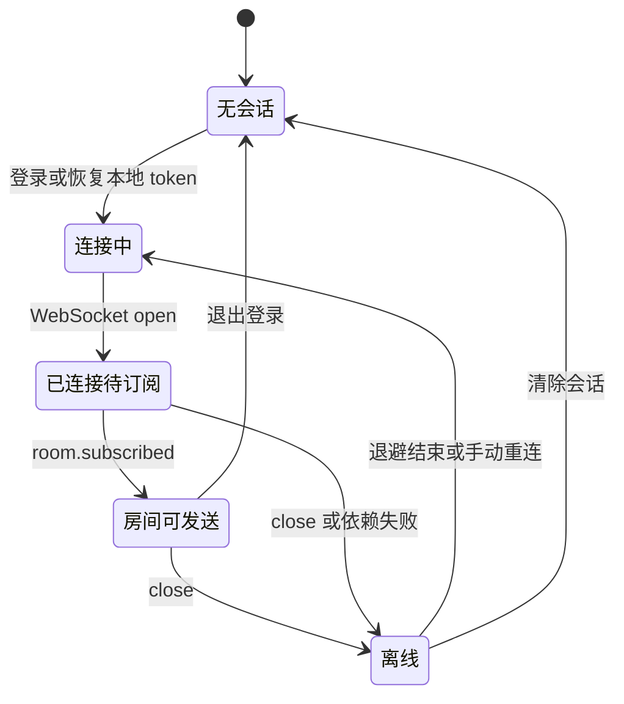
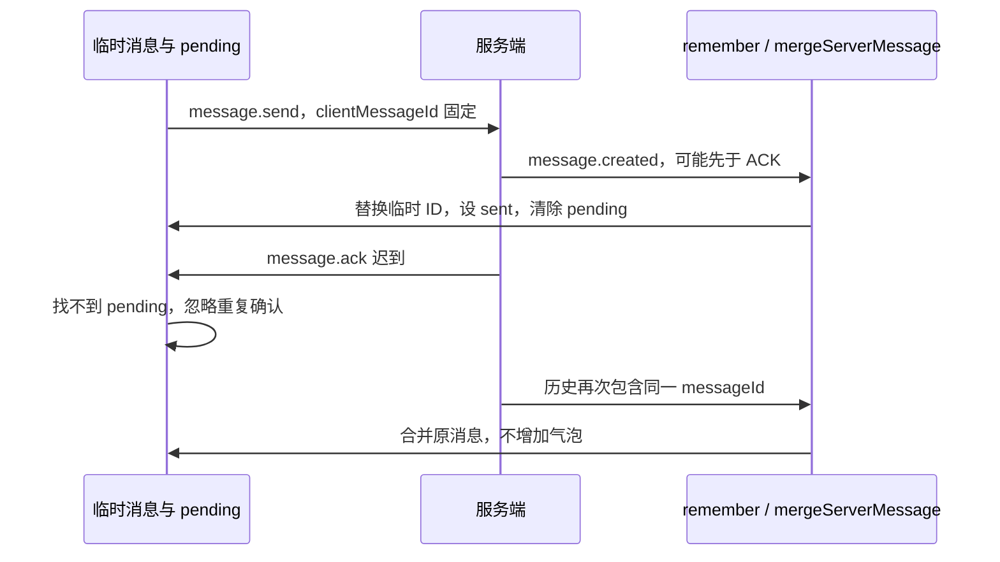

# 09. 浏览器状态、消息交互与断线恢复

前端不是可靠性之外的一层皮肤。幂等协议只有在客户端重试复用正确 ID、合并 ACK 与广播、恢复历史时不重复显示，才能形成用户可感知的完整链路。本文以当前 [chat.js](../../wwwroot/chat.js)、[index.html](../../wwwroot/index.html)、[chat.css](../../wwwroot/chat.css) 为准。

## 1. 技术组成与职责

| 文件 | 职责 |
| --- | --- |
| `wwwroot/index.html` | 登录、聊天、房间列表、输入区、创建与加入房间弹窗的 DOM 结构 |
| `wwwroot/chat.css` | 布局、字体、颜色、消息样式、移动端抽屉、交互状态 |
| `wwwroot/chat.js` | 会话、HTTP API、WebSocket、消息合并、恢复与 UI 事件 |
| `wwwroot/assets/icons/` | 同源分发的 Lucide 图标与许可证 |
| `wwwroot/assets/fonts/` | 本地优先、按 unicode-range 加载的中文字体分片与构建来源 |
| `tests/ui/ChatInteractionTest.cjs` | 可控网络与故障场景的浏览器交互回归 |

没有 React/Vue、前端路由服务、Node 后端或 npm 打包后才能运行的要求。脚本用立即执行函数隔离作用域，`state` 是页面状态中心，事件处理函数调用渲染函数更新 DOM。

将脚本与样式外置、图标与字体同源分发，既使静态文件服务能直接提供完整界面，也适配生产代理的 CSP。浏览器 UI 测试使用 Node/Playwright，但这是测试依赖，不是服务器运行依赖。

## 2. 页面状态不是全部持久化的

### 2.1 状态表

| 状态 | 结构与作用 | 刷新后保留 |
| --- | --- | --- |
| `token`、`username` | 当前登录身份，HTTP 和 WS 认证使用 | 是，localStorage |
| `currentRoomId` | 当前房间，恢复时仍需重新检查是否属于房间列表 | 是，localStorage |
| `rooms` | 当前账号已加入房间列表 | 否，重新请求 |
| `messages` | roomId → 消息数组 | 否，重新拉历史 |
| `pending` | clientMessageId → 待确认消息的重试上下文 | 否 |
| `drafts` | roomId → 尚未发送的文本 | 否 |
| `historyCursors` | roomId → 已成功读取的历史 checkpoint | 否 |
| `historyInitialized` | 完整首次历史加载已结束的房间集合 | 否 |
| `historyRequests`、`loadingRooms` | 当前历史请求 Promise 与加载状态 | 否 |
| `unreadIds`、`unread` | 每房间去重后的有界未读集合及计数 | 否 |
| `readThrough` | 每房间已读服务端 messageId 水位 | 否 |
| `subscriptions` | requestId → 等待订阅确认的 roomId | 否 |
| `subscribedRooms`、`subscriptionQueue` | 已确认订阅集合和待发送队列 | 否 |
| `sessionVersion`、`roomVersions` | 拒绝过期异步请求回写的版本号 | 否 |
| `ws`、重连计时器与延迟 | 当前 socket 和重连控制 | 否 |

localStorage 仍使用兼容旧界面的键 `linya.token`、`linya.username`、`linya.room`，不表示系统存在另一个业务模块。

当前没有 IndexedDB 待发送箱，也没有服务端已读游标。关闭页面后尚未提交的消息和草稿可能消失；重新登录或跨设备不能恢复未读水位。不要将“断线后页面仍打开时可恢复”扩大成“任意客户端崩溃都不丢待发送消息”。

### 2.2 四种 ID 必须分开

| ID | 生成与使用 | 重试时的行为 |
| --- | --- | --- |
| `requestId` | 浏览器为一次 WS 命令生成；当前 UI 用它关联 error 和订阅结果，ACK 另按 clientMessageId 查找 | 每次发送尝试重新生成 |
| `clientMessageId` | 浏览器为一条逻辑消息生成，优先 `crypto.randomUUID()` | 必须保持不变 |
| `messageId` | 数据库存储后返回，浏览器按字符串保存、BigInt 比较 | 同一逻辑记录保持不变 |
| `eventId` | 后端 Outbox 使用的事件标识 | 前端主要按 messageId/clientMessageId 合并，不以它作显示主键 |

发送前临时气泡的 `id` 暂时取 `clientMessageId`；ACK 或历史确认后替换为服务端 `messageId`。这个替换不是新建第二条消息。

## 3. HTTP API 封装和登录流程

`api(path, options)` 统一完成：

1. 记录调用时的 `sessionVersion`。
2. 有 body 且未显式设置时添加 JSON Content-Type。
3. 有 token 时添加 `Authorization: Bearer ...`。
4. `fetch` 后读取文本并尝试解析 JSON。
5. 响应返回时若版本变化，抛出 `stale_session`，不把旧账号结果写回新会话。
6. 非 2xx 响应转换成带 status/code 的 `ApiError`，适配 v1 错误结构和旧式 `msg`。

### 3.1 注册和登录

浏览器先验证用户名为 3 至 64 位字母、数字、下划线或短横线，密码长度为 8 至 128。服务端仍执行自己的验证，不能信任客户端校验。

注册调用 `POST /register`。成功后切回登录页，并不自动签发登录状态。登录调用 `POST /login`，确认响应含 token 后保存身份并进入聊天界面。401 和 503 分别呈现认证失败与依赖不可用，不假装登录成功。

### 3.2 恢复工作区

`enterChat` → `fetchRooms` → `GET /api/v1/rooms`：

- 只恢复服务器返回的已加入房间。
- 没有房间时，当前 UI 自动创建名为“综合大厅”的房间，再读取列表；这不是所有账号自动加入同一个全局公共房间。
- localStorage 中的旧房间 ID 不在列表时选择第一个有效房间，恢复该房间草稿并更新已读状态。
- 先加载当前房间历史，然后建立 WebSocket。
- 401 使本地会话失效，其他依赖错误显示离线/失败状态，不直接清空所有服务器数据。

服务端身份和仓储实现见 [04](04_Application_Auth_and_Domain.md)、[05](05_MySQL_and_Transactions.md)。

## 4. WebSocket 状态机和房间订阅队列

### 4.1 建立连接

URL 为同源 `/ws`，页面是 HTTPS 时选择 `wss`，否则 `ws`。浏览器传两个子协议：`httpserver.v1` 与 `bearer.<token>`；没有把 token 拼在 URL 查询参数中。



`open` 只说明传输握手成功，不说明房间订阅成功。发送按钮要求：socket 为 OPEN、已有当前房间、该房间在 `subscribedRooms` 中、内容有效。

### 4.2 为什么订阅不是一次性全部发出去

每次新连接清空旧订阅上下文，按以下优先级排队：

1. 当前房间。
2. 有待确认消息的房间。
3. 所有已加入的其他房间。

用 Set 去重，`flushSubscriptions` 保证同一时间只有一个等待确认的 `room.subscribe`。用户切换到已经排队的房间时将它提到队首。

这么做让当前会话尽快可用，减少短时大量订阅带来的服务端压力，并明确“哪个 requestId 正在等待哪个房间”的对应关系。它不是服务端全局房间排序，也不会把其他房间的成员关系改掉。

### 4.3 收到订阅确认

`room.subscribed` 必须同时匹配 requestId 和 roomId，随后：

1. 删除该在途订阅。
2. 标记房间已订阅并更新输入区。
3. 继续发送队列下一项。
4. 将重连退避重置为 1 秒。
5. 拉取该房间历史。
6. 历史请求结束且仍是同一个 socket 时，恢复该房间 pending 发送。`loadHistory` 内部捕获错误，因此结束不等于全部历史加载成功；失败后 Promise 仍 resolve，`resumePending` 仍可能执行。

订阅发生依赖错误时主动关闭连接，进入重连；成员权限等明确错误则将该房间 pending 标记失败、提示用户并处理下一订阅。

所有 socket 事件处理都检查 `state.ws === socket`，避免旧连接的迟到 close/message 破坏新连接状态。

边界：当前没有独立的订阅 ACK 超时计时器。连接不关闭、服务端也不返回订阅结果时，串行队列可能停住。不要把消息 ACK 的超时机制误认为也覆盖订阅。

## 5. 一条消息的客户端发送路径

### 5.1 乐观显示

`sendMessage` 检查是否处于中文输入组合阶段、是否为空、UTF-8 字节数是否超过 4096、连接与订阅是否可用。通过后：

1. 创建一个新的 `clientMessageId`。
2. `addMessage` 放入自己的临时气泡，状态 `sending`。
3. 删除当前房间草稿、清空输入框并滚动到底部。
4. 调用 `dispatchMessage`。

乐观显示只代表客户端已开始发送，不代表 MySQL 提交，也不代表消息一定已经离开浏览器。

### 5.2 建立 pending 并发送

`dispatchMessage` 从消息对象取内容和稳定 `clientMessageId`，创建或复用 pending，里面保存 roomId、临时 messageId、attempt、当前 requestId、timer。

如果此刻断网或尚未订阅，保留 sending，不直接丢弃逻辑消息。条件满足时增加 attempt，生成新 requestId，发送如下协议结构：

```json
{
  "version": 1,
  "type": "message.send",
  "requestId": "request-attempt-2",
  "payload": {
    "roomId": "12",
    "clientMessageId": "logical-message-8",
    "content": "今天的联调已经完成"
  }
}
```

示例标识只是说明字段关系，不是实际捕获的用户消息。

### 5.3 ACK 超时与重试

每次实际发送后等待 ACK 5 秒。超时或 `dependency_unavailable` 进入 `scheduleRetry`：按 attempt 使用 2、4、8 秒等退避，自动尝试预算通常在 4 次已发送尝试后终止，显示失败并保留手动重试入口。

这里的 4 次不是涵盖断线、人工重试和全部竞态的全生命周期绝对上限。连接恢复可再次执行 `resumePending`，手动重试也会建立新一轮 pending；不应把它讲成整个系统永远只投递 4 次。

重试复用 `clientMessageId`，但 requestId 更新。服务端依靠数据库唯一键返回原消息，见 05。用户点击“重试”也不能生成一个新的逻辑消息 ID，否则数据库会合理地把它看作另一条消息。

## 6. ACK、广播和历史怎样合并成一个气泡

可能发生的顺序有：ACK 先到、广播先到、ACK 丢失但历史查到、广播重复、连接重建后重复补拉。

`remember` 的合并规则是：

- 相同服务端 `messageId` 合并。
- 对当前用户自己的消息，相同 `clientMessageId` 也合并，以替换尚无服务端 ID 的临时气泡。
- 其他人的 clientMessageId 不用于替换自己的临时消息，身份比较是条件的一部分。

`mergeServerMessage` 处理广播和历史，只要确认是自己的稳定 clientMessageId，就清除相关 pending 和超时计时器。`message.ack` 按 payload.clientMessageId 找到 pending 对应消息，更新服务端 ID、服务端时间和 sent 状态；当前不会再验证 ACK 的 requestId 是否等于最近一次尝试，因此较早尝试的有效 ACK 也能确认同一逻辑消息。



前端不会仅靠“收到了 ACK”来判断历史与广播是否重复。底层虽然先调用 ACK 回复函数，再返回或进入后续路径，但异步队列、Outbox 和网络会改变浏览器的实际到达顺序。

## 7. 排序、缓存和系统提示

### 7.1 不用客户端时间定义提交顺序

`sortMessageList` 对服务端数字 ID 用 BigInt 比较，避免数据库 BIGINT 超过 JavaScript Number 安全整数后精度丢失。未确认的临时消息排在已确认消息之后，临时消息之间再按时间排列。

ACK 把临时 ID 换成服务端 ID 后会重新排序。UI 不能假设消息最初插在数组尾部就永远是正确位置。

系统提示使用生成时的最新已确认消息 ID 作为 `anchorId`，放在该位置之后，不被后续历史排序移动到不合逻辑的位置；会话摘要忽略系统提示。

注意：按 ID 显示是当前协议行为，不代表数据库自增 ID 就是多事务的提交顺序。并发反序提交的恢复风险见 05 和 10。

### 7.2 每房间约 1000 条的展示缓存

`MAX_CACHED_MESSAGES=1000`。超过目标时优先删除不处于 sending/failed 的记录，防止尚未确认的消息在离线积压补拉时被裁掉而无法重试。

如果缓存全部是待发送或失败消息，代码会停止裁剪，所以 1000 不是严格硬上限；房间数量本身也会影响总内存。这是保留用户待处理数据的取舍，不是已经实现全局内存预算。

数据库历史保留与浏览器展示缓存独立。当前前端会从 after=0 分页向前加载，再裁剪显示缓存；尚未实现滚动到顶部再按 before 懒加载更早历史的完整交互。

## 8. 历史补拉的两个水位

### 8.1 checkpoint 不等于首次加载结束

`historyCursors` 记录成功读完页面的最后 messageId；`historyInitialized` 表示该房间首次历史已经全部分页完成。二者分开解决“前两页成功、第三页失败”时的语义问题。

若只有 checkpoint 而没有完成标记，失败后重试可能把剩余旧历史误认为断线新消息，产生大量错误未读。当前代码只在没有 nextAfter 或游标不再推进时设置完整标记，空历史也设置完成状态。

### 8.2 `loadHistory` 的执行顺序

1. 捕获 sessionVersion 与该房间 roomVersion，形成 `current()` 判断。
2. 若同房间已有在途请求，先等待它，尽量串行补拉。
3. 从 checkpoint 或 `0` 开始，请求 `after=...&limit=100`。
4. 收到响应后先验证版本，再合并每条服务器消息。
5. 用最后一条消息推进 checkpoint，继续跟随 nextAfter。
6. 首次后台房间历史建立基线，不把全部旧消息计为未读。
7. 分页终止后标记 historyInitialized，finally 清理加载状态并重新渲染。

当前 UI 显式使用 limit=100，因此不走服务端 `after=0 && limit<=50` 的特殊首屏缓存路径。该缓存路径存在的分页边界仍然影响其他 API 调用者，不能因为 UI 绕开就说接口问题不存在。

### 8.3 为什么订阅成功还要再拉一次历史

首次历史请求和 WS 订阅之间存在时间间隙：一条消息可能在 HTTP 查询后提交、在订阅建立前广播。订阅确认后再次从历史 checkpoint 拉取，可以覆盖这一常见窗口。

重连也是“重新订阅 → 尝试补拉历史 → 恢复 pending”。若之前消息已经提交但 ACK 丢失，成功取得的历史先确认 pending，就不必再次发送该消息。由于 loadHistory 会捕获异常，这不是“全部补拉成功才允许重发”的屏障；补拉失败时仍依靠稳定 clientMessageId 和数据库幂等保护后续重发。当前初载分页失败测试通过主动断开 WS 触发下一轮恢复，并非证明存在独立自动历史重试循环。

这是当前恢复策略，不是任意故障下无遗漏的证明。跨实例自增 ID 与提交顺序不一致、服务端分页实现边界，以及在线时单独丢失一个广播但未触发补拉，都需要单独考虑。前端没有常驻周期历史校准任务。

## 9. 未读状态如何避免重复计数

未读不是单纯 `count++`。主要路径 `trackUnread` 结合三个条件：

1. 当前房间的消息直接推进 readThrough 并清空未读。
2. 后台房间只统计他人发送、具有数字 messageId、且 ID 大于 readThrough 的消息。
3. 用 unreadIds Set 去重，最多收集 100 个 ID；展示为 `99+`。

因此广播重复、补历史重复以及展示缓存淘汰，都不应直接导致同一 ID 反复加未读。初次后台历史建立 read baseline 时，还会避免越过正在积累的实时未读 ID。

用户切换到房间时 `markRoomRead` 从已确认消息推进水位并清空集合。当前策略中的“已读”是“当前房间视为已读”，不检查消息是否实际进入视口，也不是对端已读回执。用户在当前房间向上阅读旧消息时，新消息仍可能被当前策略视为已读。

达到 100 后不再记录额外 ID，所以 `99+` 不是精确的 101、1000 或更大计数。刷新、退出和跨设备恢复均未实现。

## 10. 房间与会话生命周期

| 操作 | API / 本地动作 | 与实时状态的衔接 |
| --- | --- | --- |
| 创建房间 | `POST /api/v1/rooms`，重新取列表 | 切换到新房间、订阅、加载历史 |
| 通过 ID 加入 | `POST /api/v1/rooms/{id}/members` | 重新取列表并切换，不把单纯订阅当成成员加入 |
| 切换房间 | 保存旧草稿、恢复新草稿、清未读 | 优先订阅新房间并补历史 |
| 退出房间 | `DELETE /api/v1/rooms/{id}/members/me` | roomVersion 增加，清该房间缓存、pending、游标与队列项，再选有效房间 |
| 退出登录 | 停止重连、关闭 socket、尽力 `POST /logout` | finally 清所有本地会话状态并移除 localStorage |

roomVersion 主要用于防止“退群前发出的历史请求，在退群后返回，又把旧房间写回”。sessionVersion 解决跨账号请求回写；socket 身份检查解决新旧连接回调交错。这是三类不同作用域的过期结果防护，不应该全部混称为数据库版本锁。

版本保护不会取消 HTTP 请求，也不是请求超时。`api` 没有 AbortController 或显式总时限；历史请求长期不返回会使后续请求等待，退出登录也要等 `/logout` 结束后才进入清本地状态的 finally。连接退避从 1 秒增至最多 30 秒，没有 jitter；当前也没有 token 自动刷新，浏览器通常无法从失败的 WS 握手直接读取 HTTP 401，需要区分握手失败与业务错误事件。

退出登录时服务端请求失败也会清理浏览器状态，所以界面显示已退出不等于 Redis 撤销记录一定写成功。其他仍打开的客户端连接是否失效取决于后端会话策略，当前边界见 04、07。

## 11. 影响使用体感的实现

- 输入法：compositionstart/end、`isComposing` 和 keyCode 229 防止中文选词回车误发送。
- 长度：TextEncoder 计算 UTF-8 字节，4096 B 不是 4096 个汉字。
- 输入区：随文本增长但高度有上限；Enter 发送，Shift+Enter 换行。
- 自动滚动：距底部小于 64 像素或切换房间时跟随新消息，否则保留 scrollTop；提供返回最新位置按钮。
- 列表：房间名搜索与全部/未读筛选组合，草稿摘要优先于最后消息摘要。
- 字体与标识：使用稳定 ID/用户名散列选择配色，不让刷新导致用户标识随机变色；按日期分组消息。
- 无障碍：工具按钮提供可读名称、弹窗焦点、未读状态和键盘 tab 切换，移动端抽屉支持关闭与 Escape。
- 文本安全：聊天文本与房间名通过 textContent / createTextNode 写入，不作为 HTML 执行。

`renderMessages` 当前重建消息区域 DOM，不是虚拟列表或细粒度增量渲染。缓存较大时的重排开销、移动端低性能设备体验仍应压测，不能只凭桌面截图判断性能。

字体采用 Noto Sans SC 分片，同源 WOFF2 与 unicode-range 让浏览器按实际字符加载；优先本机字体，强制无本机字体的路径也在 UI 测试中覆盖。字体构建脚本是离线资产工具，不会在每个请求时执行。来源及大小以 [字体清单](../../wwwroot/assets/fonts/manifest.json) 为准。

localStorage token 仍会暴露给同源 JavaScript，CSP 和 textContent 可降低部分 XSS 风险，但不意味着令牌存储已经具有 HttpOnly Cookie 的隔离属性。不能为美化架构而略去这个安全取舍。

## 12. 前后端交互测试与证据边界

入口：[ChatInteractionTest.cjs](../../tests/ui/ChatInteractionTest.cjs)。测试直接加载仓库静态资源，并使用可控 HTTP 与 WS 夹具制造情况；还检查 CSP 错误、静态 MIME、字体下载和四种视口。此类测试善于确定性地验证 UI 状态，但不能替代真实 MySQL/Redis 事务与跨实例测试。下表是检查目标，明确标为待专项测试的行只代表源码行为分析，不计入已运行故障场景。

| 场景 | 应观察的状态 |
| --- | --- |
| 握手已 open，订阅未确认 | 源码限制输入区不能发送；保持 open 且始终不返回订阅结果的故障注入待补 |
| ACK 丢失，广播或历史包含相同逻辑消息 | 只显示一条、pending 清理、服务端 ID 生效 |
| 断线时存在 pending 和大量历史积压 | 补历史不裁掉待处理消息，恢复时仍使用旧 clientMessageId |
| 后台房间初始历史 | 旧记录不全部显示未读 |
| 初次分页中途失败再重试 | checkpoint 保留，只有首次全部完成后才进入增量未读模式 |
| 相同消息重复广播和补拉 | 不新增气泡，不重复增加未读 |
| 退群、切账号期间迟到响应 | 已有退群重入及旧账号房间响应测试；退群前历史迟到的独立竞态场景待专项补充 |
| 中文输入、长房间名、长消息 | 不误发送、不横向溢出，工具栏和输入区仍可访问 |
| 当前页向上阅读 | 新消息不强制把用户拉到底部，返回最新按钮可用 |

已有结果见 [2026-09-12 记录](../Productionization_Roadmap/Acceptance_2026-09-12.md)：最终 UI 套件产生 32 张截图，包含 1440×900、1280×720、390×844、320×740；另有本地内存预览的双账号真实主流程。这些是已有记录，本次写文档没有重新运行浏览器全套测试，也不将本地预览等同于公网持久化验收。

## 13. 面试时怎样讲前端与后端协同

可以这样回答：“后端提供稳定的幂等键和历史游标，前端为每条逻辑消息保留 clientMessageId，对 ACK、广播和历史统一合并。连接重建后先恢复订阅，尝试补历史，再重发仍未确认的消息；历史失败不阻止重发，所以数据库幂等仍是必要保护。前端还把历史分页进度与首次加载完成分开，避免旧历史被误记未读。当前恢复状态主要在页面内存中，跨页面崩溃的待发送持久化、跨设备已读同步和后端并发游标边界仍是下一步。”

这个回答同时交代协议、状态、竞态与边界，比只讲“做了一个漂亮聊天室页面”更能体现工程理解。
