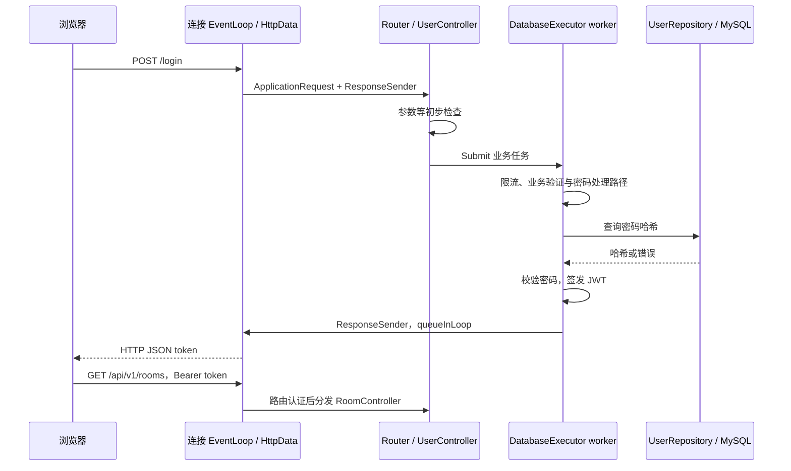
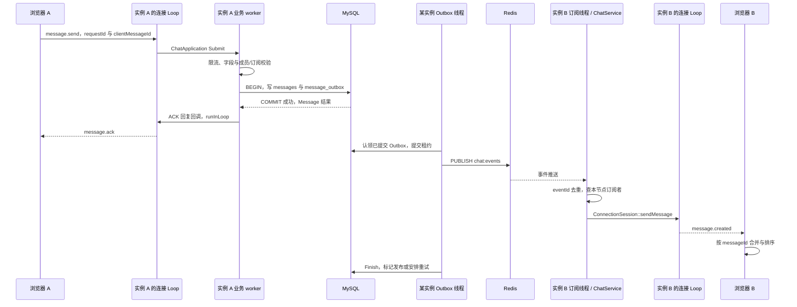

# 10. 端到端通信链路与秋招面试指南

这一篇不再孤立讲类，而是把浏览器、线程、协议、业务、数据库、中间件和运维串起来。读完后应该能够沿着源码回答：“这条消息现在在哪里，谁在处理，什么时候算成功，失败后谁负责恢复？”

## 1. 先用一段话介绍当前项目

项目是基于自研 Linux C++17 网络服务框架的多房间实时聊天服务。底层采用主从 Reactor 和 One Loop Per Thread，通过统一 Poller 接口提供 epoll/io_uring 两种后端；HTTP 与 WebSocket 经连接适配层进入应用服务。业务使用独立有界执行器执行主要阻塞任务，以 MySQL 保存用户、房间、成员、消息和事务 Outbox，通过 Redis Pub/Sub 将事件送到不同实例上的本地连接。浏览器结合稳定消息 ID、ACK、去重和历史补拉恢复断线状态，并通过日志、指标、故障测试和容器部署流程验证行为。

这是模块化单体的多实例部署，不是微服务拆分。当前已经形成可演示和可验证的工程链路，但并不宣称端到端 exactly-once、任意故障无损、原生跨平台或已完成公网长稳。

## 2. 四个平面串起整个系统

| 平面 | 主要内容 | 沟通方式 | 权威状态 |
| --- | --- | --- | --- |
| 用户请求 | 注册登录、房间管理、历史查询 | HTTP 请求与响应 | 由业务仓储和认证规则决定 |
| 实时通信 | 订阅房间、发消息、ACK、广播 | WebSocket 文本协议 | Session 是本节点在线状态；消息事实仍在仓储 |
| 持久化与分发 | 消息事务、Outbox、跨实例事件 | MySQL 事务、Redis 命令及 Pub/Sub | MySQL 提交记录和 Outbox 发布意图 |
| 运维控制 | 启动、退出、探活、监控、迁移、发布 | 环境配置、信号 fd、HTTP 探针、脚本 | 部署状态和观测快照，不替代业务成功证据 |

不要把控制面 `/readyz` 返回 200 当成每次发消息必定成功，也不要把 Redis 发布计数当成客户端实际接收数。

## 3. 链路一：首次打开页面

### 3.1 连接到页面资源

1. 浏览器访问 Nginx 的 HTTPS 入口；本地预览也可以直接访问 WebServer 的 HTTP 端口。
2. Nginx 建立到后端的连接。TLS 在代理终止，当前 WebServer 不是直接提供这层生产 TLS 的组件。
3. 主 EventLoop 发现监听 socket 可读，`Server::handNewConn` accept 并选择工作 Loop。
4. 新建 `HttpData`，通过 `queueInLoop` 交给工作 Loop 注册。
5. `Channel` 将可读事件转到 `HttpData::handleRead`，输入字节进入 `ChainBuffer` 与 HTTP 状态机。
6. 对 `/` 等静态路径，应用 Router 未处理后进入 `StaticFileService`，定位 `wwwroot/index.html`。
7. 生成响应，经输出缓冲发送；浏览器继续请求 CSS、JS、图标、字体。

静态文件当前采用安全路径检查和有上限的整文件读取，不是 sendfile。字体与图标的 MIME 也是协议正确性的一部分：在 nosniff/CSP 下，内容存在但类型错误仍可能不显示。

### 3.2 浏览器接管界面

`chat.js` 读取 localStorage。没有 token/username 时显示登录；存在时先尝试 API 恢复账号房间列表，不能只凭本地 token 字符串非空就认定当前仍有权限。

相关源码：[Server.cpp](../../src/server/Server.cpp)、[HttpData.cpp](../../src/httpdata/HttpData.cpp)、[StaticFile.cpp](../../src/httpdata/StaticFile.cpp)、[chat.js](../../wwwroot/chat.js)。

## 4. 链路二：注册、登录、创建房间



精确的限流与校验顺序以 [04](04_Application_Auth_and_Domain.md) 中对应 Controller 为准。这里强调线程切换：Controller 是 I/O Loop 中先被调用，再把需要异步处理的工作提交执行器，不是 HTTP 请求先进入线程池、然后才决定调用哪个 Controller。

创建房间从 `POST /api/v1/rooms` 进入 `RoomController`，在业务任务中调用 `ChatService::CreateRoom`，最终由 MySQL 仓储事务建立 room 和创建者 membership。一项失败应使事务整体回滚，防止只存在房间却没有房主成员关系。

API 返回成功后，浏览器重新取列表、选择房间并请求历史。创建一个业务房间与在某条 WebSocket 上订阅房间是两个动作；前者持久化，后者注册在线连接。

认证用户仓储可显式选择 memory 用于本地预览，但默认生产链路是 MySQL。内存模式的真实注册登录不等于账号持久化，见 01、04。

## 5. 链路三：WebSocket 握手与房间订阅

### 5.1 握手只建立已认证连接

浏览器建立 `/ws`，传 `httpserver.v1` 和 `bearer.<token>` 子协议。Nginx 转发 Upgrade，`HttpData` 检查请求、Origin、WebSocket 参数、身份和连接限制，然后返回 101，连接转入 WS 状态。

需要注意三点：

- 应用层 token 提取实际查询参数优先于 Authorization；当前浏览器不使用查询令牌，公网 Nginx 的 `/ws` 显式拒绝该用法。
- Redis 启用时 denylist 验证仍可能在握手线程同步等待，不能讲成全部认证均已移到工作池。
- 成功握手并不自动使连接拥有每个房间的订阅，更不赋予原本不存在的 membership。

### 5.2 订阅建立本节点映射

收到 v1 `room.subscribe` 后：

1. WS codec 还原文本，`ChatProtocol` 解析字段。
2. `ChatApplication` 提交业务任务。
3. `ChatService::AttachSession` 检查房间和用户成员资格。
4. 将当前 `ConnectionSession` 弱引用登记到本实例的 room → session 映射。
5. 通过当前连接回复 `room.subscribed`。
6. 浏览器标记该房间可发送，并补拉历史。

这个映射在当前进程内，不写入 MySQL 作为永久 session。Redis presence 只提供带 TTL 的在线辅助信息，并不取代本地 socket 引用，也不决定授权。

## 6. 链路四：一条消息从 A 用户到 B 用户

假设 A 的连接在实例 A，B 的连接在实例 B，双方已经加入并订阅同一房间，MySQL 与 Redis 已启用。



图按便于阅读的顺序画 ACK 与发布；实际两个分支在 MySQL 提交后并行推进，广播可能先于 ACK 到达，Outbox 也不一定由接受消息的实例认领。

### 6.1 接入与业务阶段

工作 Loop 解码 WebSocket 帧后调用 `ChatApplication::HandleMessage`。v1 JSON 的解析错误可以直接回复；合法业务命令进入 `DatabaseExecutor`。队列满、任务过期、业务权限失败各有错误路径。

`ChatService::DispatchMessage` 转入发送用例，结合请求身份、roomId、clientMessageId、内容与 sessionId 做检查。身份来自认证会话，不信任客户端自报 senderId。

### 6.2 事务阶段

`MySqlChatRepository::AppendOrGet` 从池借一条连接，开启事务，检查成员关系，尝试插入消息：

- 新记录：插入 messages，再插入 message_outbox，提交后返回消息与 `inserted=true`。
- 唯一键重复：根据 `(sender_id, client_message_id)` 读取原记录，成功时返回相同消息与 `inserted=false`，不创建第二条 Outbox。
- 写入、事件插入或提交失败：返回依赖错误；未提交事务由 RAII 回滚。

成员检查与并发退群之间仍有事务竞争边界，幂等键复用但内容/房间改变也没有完整冲突拒绝，详见 05。这里描述正常路径，不将这些边界隐藏在“幂等已实现”四个字后面。

### 6.3 ACK 阶段

MySQL 模式下成功 ACK 在事务结果成功后构造。它向发送者提供服务端 messageId、clientMessageId 和时间。重复请求返回原结果，而不是产生新消息。

它不等待所有接收者，也不等待 Outbox 完成。若 ACK 丢失，发送者保持同一逻辑 ID 重试或通过历史确认。已经提交的消息不会因为发送端 socket 消失而撤回数据库。

### 6.4 广播阶段

持久仓储启用 Outbox 时，`ChatApplication` 不对结果 recipients 再做一次直接广播，而是让发布器承担实时分发；否则发送节点可能同时通过本地和 Redis 路径重复推送。

Outbox 使用 `FOR UPDATE SKIP LOCKED` 选择可处理记录，写租约并提交，随后在事务外调用 Redis Publish。各实例订阅同一 channel，并在本地 `DeliverOutboxEvent` 中按 eventId 做短期去重，再取得该房间的本地会话。

接收线程不会直接调用其他 I/O 线程的 write。`ConnectionSession::sendMessage` 最终排队到对应 Loop，那里编码 WS 帧、检查输出预算并写 socket。

内存聊天仓储没有持久 Outbox 时走本地 recipients 广播。它能演示单节点聊天，但不能被当作完整跨实例持久化模式。

## 7. 为什么“非阻塞服务器”仍可能出现延迟

将一条消息拆成以下时间段更容易定位：

```text
客户端发出
  -> 连接 Loop 获得运行机会 / 协议解析
  -> 业务队列等待
  -> 服务锁等待 / 借数据库连接 / SQL / COMMIT
  -> ACK 回调排队 / 输出缓冲 / 网络
  -> 浏览器收到 ACK

COMMIT
  -> Outbox 下一次扫描 / 认领
  -> Redis 普通命令队列 / PUBLISH
  -> 远端订阅处理 / ChatService 锁
  -> 接收者 Loop 排队 / 背压 / 网络
  -> 浏览器收到 message.created
```

默认 Outbox poll 200ms 是第二条路径中可能可见的一部分，但不是所有广播延迟的上限。DB 锁、共享 Redis 队列、订阅重连或慢接收端都可能继续增加等待。

`epoll/io_uring` 处理的是网络事件与部分操作的组织方式，不能自动消除粗粒度业务锁、密码计算、同步 Redis 等待、数据库事务和磁盘读写。

## 8. 链路五：断线、重启和重试

### 8.1 只断开浏览器连接

页面仍打开时 pending、草稿和游标保留。close 清理旧 socket 订阅和计时器，按 1、2、4 秒到最多 30 秒的连接退避重新握手。新连接建立后先按优先级订阅，尝试补拉历史，再发送仍未确认的逻辑消息。历史请求内部捕获错误，所以失败后仍可能重发，并不以“全部历史成功”作为门禁；稳定 clientMessageId 仍需由数据库幂等兜底。

该重连退避没有随机抖动；大量客户端同时断线时仍需考虑重连同步突发。没有主动 WS 心跳驱动完整探活，空闲连接也可能因代理超时进入重连。

### 8.2 WebServer 进程崩溃

- socket 与本地 Session 映射消失，浏览器必须建立新连接。
- 内存仓储的数据消失；MySQL 已提交数据仍可由新进程读取。
- 事务未提交的消息不能作为成功事实恢复。
- 已提交未发布的 Outbox 可在租约允许后被发布器重新认领。
- Redis 已经发布但离线浏览器错过的事件不会由 Pub/Sub 保留，需历史查询。

“进程重启后消息不丢”准确地说是“已经成功提交到持久仓储的消息仍可查询”，不包含客户端尚未发出的文本、未提交事务、Redis 唯一保存的安全状态或页面内 pending。

### 8.3 故障窗口矩阵

| 故障点 | 当前事实 | 恢复路径 | 不可扩大解释 |
| --- | --- | --- | --- |
| 客户端发送前关闭页面 | 尚无数据库记录，pending 也未持久化 | 当前无自动恢复 | 不保证离线草稿与待发消息持久化 |
| messages 写后、Outbox 写前失败 | 同事务未提交 | 回滚，原 clientMessageId 重试 | 不能提前返回成功 ACK |
| COMMIT 后 ACK 丢失 | 消息与事件意图已存在 | 重试去重或历史确认 | 超时不是“服务端肯定未执行” |
| COMMIT 后发布器崩溃 | Outbox 可继续扫描 | 重启后认领 | 认领并不保证立即送达 |
| PUBLISH 成功、Finish 前崩溃 | 可能再次发布同事件 | 本地事件去重、前端消息去重 | 不是 exactly-once |
| 接收实例订阅暂时断开 | Redis 不保留期间事件 | 后续客户端历史补拉 | 在线但未触发补拉时不一定立即修复 |
| 接收连接输出过高水位 | 非关键广播可能被丢弃 | 后续历史恢复 | 已调用 sendMessage 不代表已写入客户端 |
| Redis 故障、既有 WS 仍在 | MySQL 写入可继续，Outbox 积压 | 本地限流降级、恢复后重试 | 新 HTTP/握手可能因 denylist fail-closed 被拒绝 |
| MySQL 不可用 | 持久化成功无法确认 | 错误、退避和依赖恢复后重试 | 不应返回假成功或静默切换内存写 |

## 9. 三个需要单独演示的一致性边界

这些是本次源码梳理识别出的边界，不是已经运行并通过的新验收。

### 9.1 自增 ID 不是提交顺序

可能的交错：

```text
事务 T1 分配 messageId=101，暂未提交
事务 T2 分配 messageId=102，先提交
客户端查询 after=100，看见 102，将 checkpoint 推进到 102
T1 随后提交 101
客户端以后只查 after=102，不会再取到 101
```

单进程的 ChatService mutex 不能限制另一进程中的事务。当前没有同房间的跨实例提交序列锁，所以不能仅凭 SQL 使用 ORDER BY id 就宣称所有并发恢复无遗漏。

后续可以评估同房间序列化分配/提交、可靠日志偏移或带重叠窗口的补拉并去重；每种方案都有吞吐与恢复语义的代价。验收要用两个独立事务人为制造反序提交，并断开实时推送，只用历史恢复检查 101 和 102 都可见。

### 9.2 租约认领不等于完成写入有 fencing

当前 Claim 写入 lease_owner/lease_until，但 Finish 按 event_id 更新，不检查当前 lease_owner 或一个单调代数。

可能交错：A 认领后暂停，租约过期，B 重新认领；A 恢复后仍能写 Finish，影响 B 正在处理的记录。Pub/Sub 发布本身还有结果不确定性，重复发布不能靠数据库租约彻底消灭。

后续需将完成/失败更新与认领身份绑定并检查 affected rows，再验证过期 worker 不能覆盖新租约。测试应人为延迟 A 超过租期、让 B 认领，然后释放 A，检查状态和重复事件，而不是只验证单发布器最终 pending=0。

### 9.3 成员权限和既有连接的收回

当前握手验证 JWT，但既有 WS 不会因为 token 到期或该连接所用 token 被其他持有者撤销而立刻逐帧失效。`/logout` 撤销的是当前 token 的 jti，不是该用户名的全部登录令牌；两次独立登录获得的不同 jti 不应混为一次撤销。退出房间更新持久成员关系并清理本节点会话，但其他节点的本地映射没有相同的立即失效通知；接收广播时也未逐条重查成员。

所以“新请求会检查权限”和“所有现存接收连接立即停止接收”是不同承诺。可评估撤销事件、权限版本或周期会话验证，再用两个实例测试：退群场景让同一用户在 B 上订阅、在 A 上退群；撤销场景让两连接持有同一个 token，在 A 撤销其 jti 后观察 B 的既有连接。独立登录产生的不同 token 不作为相互撤销的预期。

## 10. 模块之间到底怎样通信

| 起点 → 终点 | 传递内容 | 机制 | 同步/异步与主要风险 |
| --- | --- | --- | --- |
| Main Loop → 工作 Loop | 新连接 shared_ptr 捕获 | `queueInLoop` + eventfd | 异步，目标 Loop 负责后续 I/O |
| HttpData → Router | 拥有字符串的 ApplicationRequest | 函数调用 | 当前 I/O 线程同步进入 |
| Controller → DB executor | 工作闭包、deadline、过期回调 | 有界任务队列 + 条件变量 | 提交可拒绝，deadline 主要检查排队阶段 |
| DB worker → HttpData | 状态码、响应类型与正文 | ResponseSender + 原 Loop 队列 | 复制正文，weak_ptr 失效则放弃回复 |
| ChatApplication → 当前发送者 | ACK/error JSON | sendMsg → runInLoop | 关键输出仍受硬限和连接状态约束 |
| ChatService → Repository | 领域值对象、ID、内容 | 接口虚函数 | MySQL 适配是同步调用，可能持服务锁 |
| Repository → MySQL | 预处理参数、事务 SQL | 池内 MYSQL 连接 | 数据库超时不等于端到端确定未执行 |
| 业务 → Redis worker | argv 任务 | 命令队列 | Execute 等待结果；Submit 只确认入队 |
| Outbox → Redis | 已提交事件 JSON | PUBLISH chat:events | 只涉及 Redis 接收，不含终端确认 |
| Redis subscriber → ChatService | 事件 JSON、eventId | 注册的 handler 函数 | 在订阅线程执行，解析与去重后找本地会话 |
| ChatService → 接收者 Loop | MessageCreated 字符串 | ConnectionSession 回调 | 非关键广播可因高水位被丢弃 |
| 浏览器 → 服务端历史接口 | roomId、after、limit | HTTP + Bearer token | 与 WS 并行，需合并和权限验证 |
| Prometheus → 服务端 | 抓取请求 | GET /metrics | 指标快照，不是消息交付证明 |
| 退出信号 → Main Loop | signalfd 记录 | Poller 事件 | 普通事件回调触发关闭过程 |

跨实例只有 SQL/Redis/网络协议，没有共享 C++ 指针；跨线程也不应该让多个线程同时修改同一个连接的输出缓冲。

## 11. 测试如何对应到这些承诺

| 需要证明的事实 | 仓库中的入口 | 能证明的范围 / 仍需补充 |
| --- | --- | --- |
| HTTP/WS 的解析与协议拒绝 | [HttpRequestParserTest](../../tests/httpdata/HttpRequestParserTest.cpp)、[WebSocketCodecTest](../../tests/httpdata/WebSocketCodecTest.cpp) | 单元输入覆盖，不是整个 RFC 的形式化合规 |
| 应用层不直接依赖传输实现 | [ApplicationDependencyTest](../../tests/architecture/ApplicationDependencyTest.sh) | 约定头文件边界检查，不证明所有运行路径无锁竞争 |
| 消息幂等写入 | [DatabaseMessageIdempotencyTest](../../tests/integration/DatabaseMessageIdempotencyTest.py) | 当前是同进程两条 WS；仍需补跨实例同时写同键、复用键不同内容和反序提交 |
| 消息与 Outbox 同事务 | [TransactionRollbackTest](../../tests/integration/TransactionRollbackTest.py) | 指定失败注入后的回滚，不自动覆盖任何崩溃点 |
| 进程重启后数据仍可查 | [PersistenceRestartTest](../../tests/integration/PersistenceRestartTest.py) | 真实持久化路径，不含页面 pending 持久化 |
| 跨实例广播 | [CrossInstanceChatTest](../../tests/e2e/CrossInstanceChatTest.py) | 双进程场景，不等于多主机长稳和任意消息顺序 |
| Outbox 故障后恢复 | [OutboxRecoveryTest](../../tests/integration/OutboxRecoveryTest.py) | 发布记录恢复断言，不替代终端离线补拉证明 |
| 慢接收者与依赖延迟 | [SlowConsumerTest](../../tests/resilience/SlowConsumerTest.py)、[DependencyLatencyTest](../../tests/resilience/DependencyLatencyTest.py) | 指定条件下的预算和响应，不能覆盖所有同步认证路径 |
| UI 去重与补拉 | [ChatInteractionTest](../../tests/ui/ChatInteractionTest.cjs) | 可控客户端状态回归，不能替代真实并发数据库语义 |
| 发布失败后回滚 | [DeployReleaseTest](../../tests/deployment/DeployReleaseTest.py)、[DeployRollbackDockerTest](../../tests/deployment/DeployRollbackDockerTest.py) | 本地脚本与真实容器故障验证，不等于云端发布已执行 |

历史验收记录中，2026-09-12 的 Debug + 真实 MySQL/Redis 为 44/44，压测器回归 17/17，部署回归 13/13，前端最终 UI 产生 32 张截图。ASan/UBSan、TSan 等要保留其各自原始运行日期和环境，不能归并成“今天所有配置都重跑通过”。详见 [验收记录](../Productionization_Roadmap/Acceptance_2026-09-12.md) 与 [08](08_Observability_Deployment_and_Testing.md)。

本次架构文档核对没有重新运行上述业务测试，也发现了现有测试未覆盖的条件。测试通过与代码仍有边界并不矛盾：测试只能证明实际断言的场景。

## 12. 面试项目陈述的三个重点

下面是基于当前实现的工作内容表达；只有你能够解释、定位并复现的内容，才适合使用第一人称放进简历。性能数字必须来自目标环境实测。

1. 网络与模块边界：构建主从 Reactor、One Loop Per Thread 网络层，封装 epoll/io_uring Poller、eventfd 任务投递及连接生命周期；通过请求值对象和会话回调连接协议与业务，并为主要阻塞任务引入有界执行器。
2. 消息业务与可靠性：设计房间、成员和版本化消息协议，以 MySQL 唯一键实现逻辑消息幂等、事务 Outbox 保存发布意图，结合 Redis 跨实例通知及客户端 ACK/历史合并实现已覆盖故障场景的恢复链路。
3. 可验证的工程交付：围绕队列、输出背压、依赖异常、认证授权建立测试与观测，接入 Prometheus/Grafana 和容器部署、数据库迁移、失败发布回滚流程，并通过桌面/移动端交互测试验证用户路径。

这三个重点分别回答“你能否搭底层”“你能否保证业务语义”“你能否证明和运维”。不必把所有技术名词塞进一条很长的项目简介。

## 13. 高频追问与回答要点

### 13.1 为什么不用每个连接一个线程？

长连接大部分时间等待网络，线程数跟连接数一起增长会带来栈内存和调度成本。这里把多个非阻塞连接交给固定数量 I/O Loop。业务阻塞不能因此消失，所以另外设置执行器；同时承认静态读取和部分 Redis 认证检查尚未完全隔离。

### 13.2 主 Reactor 和从 Reactor 怎样通信？

主线程创建连接并轮询选择 Loop，将注册函数放入该 Loop 的 pending 队列，写 eventfd 唤醒。业务对象由闭包捕获，不是把对象序列化到 eventfd。后续 socket 操作归属该 Loop。

### 13.3 为什么需要 Channel，而不是 Poller 直接调用 HttpData？

Channel 保存 fd、事件兴趣和回调，使 Poller 不必依赖 HTTP/JWT/房间。这样两种 Poller 可以复用同一层连接回调，单元测试也能单独检查 owner 和事件分发。但 HttpData 仍是协议与应用之间的具体适配层。

### 13.4 io_uring 相比 epoll 的价值是什么？

统一后端边界让连接模型可以选择不同内核事件/操作机制，并给异步写和完成事件管理提供路径。当前读取仍有 readv 的混合使用，取消与 buffer 生命周期也要在真实内核验证。不能只因使用 io_uring 就宣称必然更快，应固定工作负载与环境做对照。

### 13.5 数据库连接池为什么还不够？

池只复用连接，不会把同步 mysql 调用自动变非阻塞。执行器负责不让主要业务直接占据连接 Loop，队列有上限并可拒绝；连接池限制实际数据库会话资源。这两个池分别管理任务并发和连接资源。

### 13.6 为什么既要数据库幂等，又要客户端去重？

数据库唯一键避免同一逻辑消息建立多条持久记录；客户端去重处理重复广播、历史重叠、ACK 与事件乱序。前者解决写入副作用，后者解决显示与确认状态，不是重复建设。

### 13.7 为什么不在写消息后直接 PUBLISH？

MySQL 提交后、PUBLISH 前崩溃会让业务记录存在却没有可靠发布意图。Outbox 将记录与事件意图放在同一事务，后台扫描可重试。它解决双写窗口中的意图丢失，不使 MySQL 和 Redis 成为一个原子事务。

### 13.8 PUBLISH 成功为什么还不算投递成功？

它只确认 Redis 处理了命令，不代表指定浏览器在线、网络写完、页面处理甚至用户阅读。订阅者可能断线，输出高水位也可能丢弃广播。因此要区分发布、接收、显示、已读；本项目没有完整的接收端逐消息确认协议。

### 13.9 Outbox 是不是 exactly-once？

不是。发布成功而状态回写失败会重试，租约超时也有并发窗口。当前通过稳定事件 ID、短期事件去重、数据库逻辑消息唯一键和前端合并降低重复影响；完成更新 fencing 仍待完善。

### 13.10 Redis 挂了怎么办？

要按用途回答。缓存可回源，本地限流可降级，presence 最佳努力，Outbox 留在 MySQL 等待重试；启用撤销检查后的新认证通常 fail-closed。既有已认证 WS 不逐帧重查，所以其行为和新连接不同。Redis 数据本身丢失还会影响 denylist，不能笼统说 Redis 随时可清空。

### 13.11 如何防止慢客户端拖垮整个服务？

连接级输出高水位限制非关键广播，硬限关闭过载连接；写操作回到归属 Loop，业务与 Redis 队列也分别有界。仍需补齐全局 pending 预算、可测的终端恢复、所有路径的公平性与实际内核取消寿命测试，不能把一个输出阈值当成完整资源治理。

### 13.12 服务怎么平滑退出？

信号先屏蔽，再由 signalfd 进入主 Loop，停止 accept，调度连接退出，经过宽限期后停止主循环并 join Outbox、执行器和 Redis。现状是有序退出流程，不是每个在途任务都保证响应送达；执行器重新懒创建和连接 drain 边界也需测试。

### 13.13 怎么证明性能？

先明确场景：HTTP `/ping`、持久化聊天 ACK、跨实例 fanout 不是同一种工作。报告机器、网络、后端、连接数、发送模型、消息大小、持久化配置、时长、错误率和分位延迟。当前 closed-loop 单条 in-flight 压测器可验证受控负载，但不能直接代表多发送者并发峰值。

### 13.14 最值得继续优化什么？

优先补可证明的正确性：反序提交游标、Outbox fencing、跨实例退群与 token 生命周期；再处理 Loop 同步等待、粗粒度服务锁、静态文件读取与全局资源预算；最后补目标机容量、云端发布和长稳。前端再增加待发送箱持久化、历史懒加载和跨设备已读，不能用交互完善替代消息语义修复。

## 14. 源码核对发现的后续验证清单

以下不是本次已实施的改动，也不代替生产化路线图的正式状态。这是下一轮完善时可直接转成测试的检查清单。

| 优先验证主题 | 已观察到的边界 | 验证方式 |
| --- | --- | --- |
| 跨实例历史完整性 | 自增不保证提交顺序 | 双事务反序提交 + 断开实时推送 + 游标恢复 |
| 首屏历史分页 | after=0、limit=50 缓存路径缺少额外探针 | 准备 51/100/1000 条，逐页直到 nextAfter 终止并核对集合 |
| 租约过期 worker | Finish 缺少 owner fencing | 暂停旧 worker 超租期，另 worker 认领，再恢复旧 worker |
| 幂等冲突 | 同 key 改内容或房间未完整拒绝 | 相同 sender/clientMessageId 发不同载荷，定义明确冲突契约 |
| 权限立即收回 | WS 到期/撤销与跨节点退群的既有订阅 | 退群用同用户跨实例；撤销用同 token 的两连接，验证已撤销 jti 的既有连接 |
| 多主机限流 | Redis 窗口 key 使用 steady_clock 时间原点 | 不同启动时钟/主机同时请求，确认是否命中同一个窗口 |
| I/O 公平性与生命周期 | ET readv 推进、io_uring cancel 内存寿命 | 大于单次读取容量的输入、半包、cancel、fd 复用，结合真实内核与 sanitizer |
| 长时计时与心跳 | Timer 使用墙上时钟并取模；无完整主动 WS 心跳 | 模拟时钟跳变/回绕、长时间空闲 WSS 与持续负载 |
| Readiness 状态刷新 | probe 过期回调缺失可能保留 in-flight | 饱和执行器使 probe 过期，再恢复依赖并观察快照能否继续更新 |
| 发布与告警闭环 | 同批激活；receiver=discard；云端证据未补 | 真实 registry/可信 TLS 发布、失败回滚、持续连接观察与外部告警送达 |
| 用户端持久恢复 | pending/草稿/已读在内存；无独立订阅 ACK 超时 | 页面崩溃、刷新、跨设备、订阅无响应，定义并验收预期行为 |

具体出处与修复取舍分别见 02、04、05、06、07、08、09。不要把建议方案写进“当前实现”段落。

## 15. 自己准备面试时的验收标准

可以用一次完整演示检验理解程度：注册两个账号，创建和加入房间，让连接分别落在两个实例，发一条消息；指出数据库消息记录、Outbox 事件和对应日志；断开一个客户端再补拉；重复同一 clientMessageId；制造依赖错误并解释 ACK、重试和恢复结果；最后展示指标和失败发布回滚记录。

每个环节都应回答：执行线程是谁、依赖谁、状态存在何处、成功边界在哪里、失败由谁重试、测试实际断言什么。能回答这些问题，比背一长串中间件名字更能证明你理解这个项目。

返回 [文档入口](README.md)。
