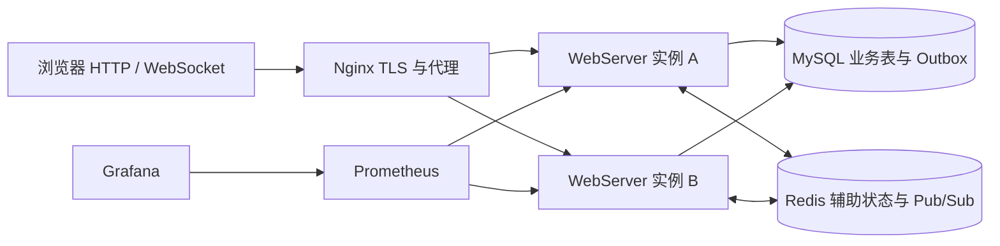

# 当前项目架构与秋招面试手册

这套文档回答三个问题：项目现在到底实现了什么，每个模块内部怎样工作，一次用户操作怎样跨模块完成。阅读对象是准备使用本项目参加 C++ 后端校招面试的开发者。

## 1. 阅读基准

- 核对日期：2026-09-12。
- 核对对象：本地 `httpServer` 工作区的实际源码、配置、测试及已有验收记录。
- 基线提交：`ad14ca4467ef4c129fcc7f1c070b338298a987f8`；工作区还有未提交修改，因此本文不是该提交的纯净快照。
- 最近拆分的 `wwwroot/chat.js`、`wwwroot/chat.css`、部署脚本和测试修改均在本次阅读范围内。
- 文档描述的是实现现状。路线图、源码注释、旧简历与实际执行逻辑冲突时，以执行逻辑为准。
- 本次工作是架构梳理，不修改业务代码；发现的缺口明确列出，不通过改写文档把它们视为已经解决。

“有实现”“有针对性测试”“在生产目标环境完成验收”是三个不同层次。这里不会把本地测试通过换算成公网已上线、24 小时稳定运行或确定的并发容量。

## 2. 项目定位

可以把项目理解为：以自研 Linux C++17 网络服务框架承载的多房间实时聊天服务。网络侧采用主从 Reactor、One Loop Per Thread 和可选择的 `epoll/io_uring` 后端；应用侧提供 HTTP API、JWT 认证和版本化 WebSocket 消息协议；MySQL 保存业务数据和 Outbox，Redis 支持跨实例实时事件及部分辅助状态；浏览器负责交互状态、消息合并和断线补拉。

它不是仅有几个 socket 示例的聊天室，但也不能直接宣称为成熟即时通信平台。更准确的阶段是：已经形成业务、可靠性、可观测性和部署验证链路的工程项目，仍有明确的一致性、生命周期和目标环境验收边界。

图中的双实例、TLS 和监控是仓库中的部署拓扑，不表示当前浏览器所访问的本地端口就是这个完整环境。单进程本地预览、内存模式、MySQL 模式和完整双实例模式必须分别说明。

## 3. 文档导航

| 文档 | 主要解决的问题 |
| --- | --- |
| [01 整体架构、启动与线程](01_Architecture_Startup_and_Threads.md) | 系统分几层；进程如何启动；有哪些线程；对象、队列、连接归谁管理 |
| [02 网络层与连接生命周期](02_Network_and_Connection.md) | Server、EventLoop、Channel、Poller、eventfd、Buffer、Timer、对象池怎样配合 |
| [03 HTTP、WebSocket 与静态文件](03_HTTP_WebSocket_and_Static_Files.md) | 字节怎样变成请求或帧；协议状态机怎样转移；响应怎样回到连接 |
| [04 应用、认证与领域](04_Application_Auth_and_Domain.md) | 路由、JWT、Controller、ChatService、Room、Membership、Session 的关系 |
| [05 MySQL 与事务](05_MySQL_and_Transactions.md) | 表结构、连接池、执行器、幂等插入、事务、历史游标怎样实现 |
| [06 Redis 与 Outbox](06_Redis_and_Outbox.md) | Redis 线程与命令、缓存、限流、撤销、presence、跨实例发布的完整路径 |
| [07 可靠性、背压与安全](07_Reliability_Backpressure_and_Security.md) | 慢客户端、队列满、超时、退出、攻击输入和依赖故障如何处理 |
| [08 观测、部署与测试](08_Observability_Deployment_and_Testing.md) | 指标、日志、容器、代理、迁移、发布回滚、测试与容量证据 |
| [09 前端状态与恢复](09_Frontend_State_and_Recovery.md) | 登录、订阅、发送、重试、去重、补历史、未读、草稿和竞态保护 |
| [10 端到端链路与面试指南](10_End_to_End_and_Interview_Guide.md) | 把全部模块串起来，解释故障窗口，准备项目陈述和深入追问 |

推荐顺序：先读 01，再读 10 的端到端链路；随后按 02 至 09 深入源码；最后回到 10 的面试问题，尝试脱离文档复述。

## 4. 模块覆盖清单

| 源码或目录 | 本手册中的归属 |
| --- | --- |
| `src/Main.cpp`、`src/config/`、`CMakeLists.txt` | 01、08 |
| `src/server/`、`src/eventloop/`、`src/channel/` | 01、02 |
| `src/epoll/`、`src/Poller.cpp`、`src/IoUring*` | 02 |
| `src/base/ChainBuffer.h`、`MemoryPool.h`、`ObjectPool.h`、`src/timer/` | 02、07 |
| `src/httpdata/`、`src/protocol/` | 03 |
| `include/httpserver/domain/`、`ApplicationContext.h` | 01、04 |
| `src/application/ApplicationRouter.cpp`、`src/chat/` | 04 |
| `Authentication.cpp`、`AuthenticationRateLimiter.cpp`、`src/util/CryptoUtil.*` | 04、07 |
| `ChatApplication.cpp`、`ChatService.cpp`、`InMemoryChatRepository.cpp` | 04、05、10 |
| `DatabaseExecutor.cpp`、`src/sql/`、SQL 迁移脚本 | 05、08 |
| `src/redis/RedisClient.cpp`、`OutboxPublisher.cpp` | 06 |
| `Metrics.cpp`、`OperationalStatus.cpp`、`StructuredLog.cpp`、异步日志 | 07、08 |
| `Dockerfile`、Compose、`deploy/`、`scripts/`、`.github/workflows/` | 08 |
| `tests/`、基准客户端与故障测试 | 各模块的验证章节、08 |
| `wwwroot/`、`tests/ui/` | 09 |

`src/thread/ThreadPool.cpp` 是仓库中的旧通用线程池实现，但当前 `httpserver_core` 的构建源列表没有使用它。不要把它误认为当前 Reactor 线程池或数据库工作执行器。当前实际运行的两类池分别是 `EventLoopThreadPool` 与 `DatabaseExecutor`。

## 5. 先统一这些名词

| 名词 | 在本项目中的准确含义 |
| --- | --- |
| 节点 / 实例 | 一个独立的 `WebServer` 进程或容器，不是一个 EventLoop 线程 |
| Main Reactor | 接收连接、处理信号等事件的主 EventLoop |
| Sub Reactor / I/O Loop | 持有客户端连接并执行其 I/O 与协议处理的 EventLoop |
| 业务执行器 | `DatabaseExecutor` 的有界任务队列和工作线程，不持有客户端 socket |
| 数据库连接池 | 复用 `MYSQL*` 的 `SqlConnPool`，不是线程池 |
| Room | 持久化业务房间 |
| Membership | 用户与房间的成员关系，不依赖 WebSocket 当前是否在线 |
| Session | 当前进程内的一条已认证 WebSocket 会话，不跨进程共享对象 |
| `clientMessageId` | 客户端给逻辑消息分配的稳定幂等标识，重试必须复用 |
| `requestId` | 单次请求或协议命令的关联标识；一次重试可以有新的值 |
| `messageId` | 服务端持久化消息的标识，也是历史查询与前端排序使用的值 |
| `eventId` | Outbox 事件标识，用于事件关联与接收侧去重，不等同于请求 ID |
| ACK | 服务端确认逻辑消息已接受；MySQL 模式下发生在事务成功之后，不是对方已读 |
| Presence | Redis 中带过期时间的在线辅助状态，不是 WebSocket 主动心跳，也不是权限依据 |

## 6. 阅读前必须知道的实现边界

1. 当前连接注册含 `EPOLLET`，不能继续写成 epoll 水平触发；ET 读到 `EAGAIN` 的完整性仍需注意，见 02。
2. `io_uring` 是可选择后端，没有自动降级到 epoll，也不是整个协议读写链路都改成内核异步操作。
3. 源码依赖 Linux 特性；WSL 是 Linux 运行环境，不代表 Windows/macOS 原生跨平台。
4. MySQL 事务解决“消息与待发布事件一起提交”，不提供跨 MySQL 与 Redis 的分布式原子提交。
5. Redis Pub/Sub 不保存离线消息；Outbox 不意味着 exactly-once，更不意味着端到端永不丢失。
6. Outbox 完成更新尚未以租约持有者进行 fencing；消息自增 ID 也不等于并发事务的提交顺序，见 05、06。
7. 大部分业务工作已移入执行器，但部分 JWT 撤销检查仍会同步等待 Redis；`ChatService` 的粗粒度锁也包含部分仓储调用。
8. 已建立 WebSocket 的令牌到期、退出登录以及跨节点退群，不等价于立刻切断该连接全部后续接收，见 04、07。
9. 当前静态文件是有大小上限的整文件读取，不是 `sendfile/mmap` 零拷贝传输。
10. 发布脚本有版本追踪、探活和回滚流程，但不是已经实现严格零停机滚动发布；公网可信 TLS、目标机容量和 24 小时长稳仍要看实际验收记录。

这些边界不是让你否定项目，而是让你能解释：已经解决什么、没有解决什么、为什么、下一步如何验证。每个关键边界都在相应章节中给出源码定位和后续验证方向。

## 7. 与原有文档的关系

- [生产化路线图](../Productionization_Roadmap/README.md)：回答计划与模块验收目标。
- [当前验收状态](../Productionization_Roadmap/Acceptance_Status.md)：回答哪些证据已有、哪些仍待补充。
- [2026-09-12 验收记录](../Productionization_Roadmap/Acceptance_2026-09-12.md)：保存当时的测试环境与结果。
- [API v1](../API_v1.md)、[WebSocket 协议](../WebSocket_Protocol.md)：用于接口对接。
- 本手册：回答当前源码为什么这样分层、具体怎样执行、怎样准确地用于面试讲述。

后续代码变更时，优先同步受影响模块及 10 的端到端流程；变更部署、并发或消息语义时，还应同步本页的实现边界。不要只更新架构图而不更新失败路径。
